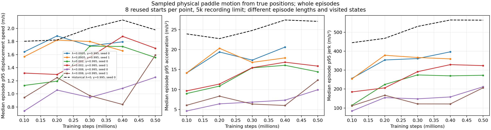
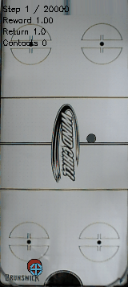
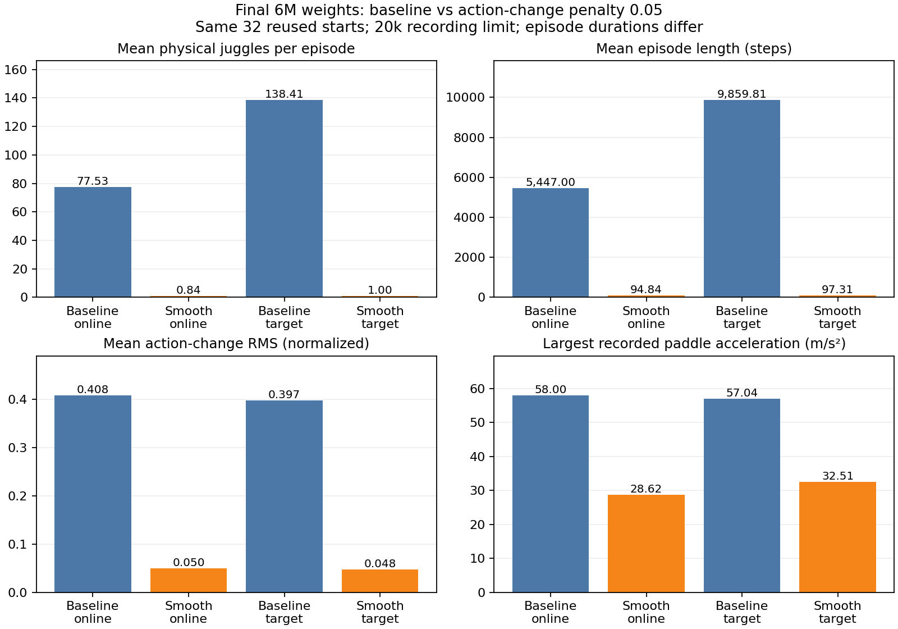
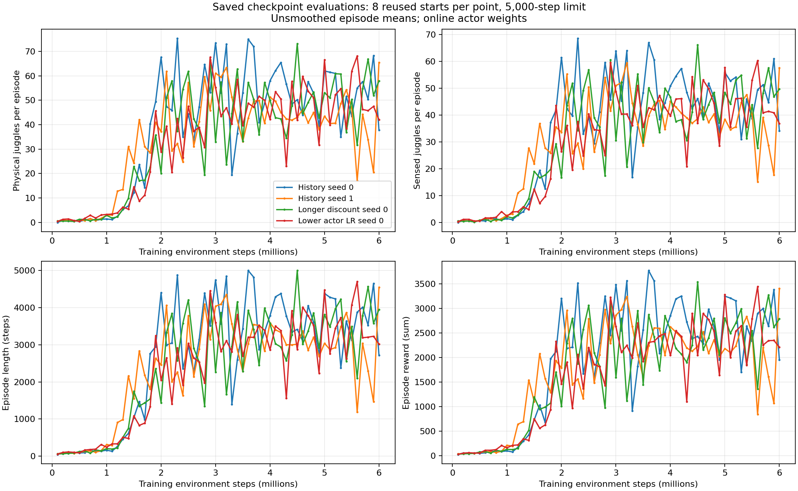
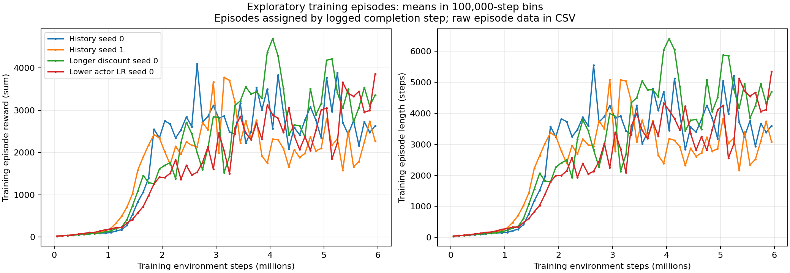

# Agent logbook

Scope: recent sustained-juggling work and this documentation setup. Backfilled 2026-10-28 12:23:43-05:00. Historical entries reconstruct tasks from commits and documents; original prompts and agent identities are unavailable. Commit author names do not establish agent identity. Historical times are author-commit recording milestones, not execution times. Timezone: America/Chicago. [Experiment logbook](experiment_logbook.md).

Entries and contents are ordered newest first; IDs remain permanent.

## Table of contents

- [A053 — Preserve long-reference work through a dependency-guarded CPU continuation](#a053)
- [A052 — Add physical motion and matched-budget control to sweep reporting](#a052)
- [A051 — Extend scratch smoothness research with a replicated discount comparison](#a051)
- [A050 — Audit actual controller targets and publish exact-replay and GIF evidence](#a050)
- [A049 — Attach longer independent reference testing while six learners advance](#a049)
- [A048 — Launch replicated weaker smoothness sweep under the GPU ceiling](#a048)
- [A047 — Document completed smoothness trial and publish raw comparison evidence](#a047)
- [A046 — Launch smoothness training and attach durable raw-metric tests](#a046)
- [A045 — Enable action-change penalty in a fresh history trial configuration](#a045)
- [A044 — Publish training reward and juggle curves and reconcile completed trials](#a044)
- [A043 — Document useful baseline juggling independently of evaluation cutoff](#a043)
- [A042 — Audit retained-target reset physics while full-budget learners continue](#a042)
- [A041 — Guard final evaluations and prepare single-factor scratch follow-up](#a041)
- [A040 — Publish completed milestone tests and independent failure GIFs](#a040)
- [A039 — Verify new-trial caps and queue fixed 2M variant comparisons](#a039)
- [A038 — Complete selected-target independent test and queue fixed5M variants](#a038)
- [A037 — Complete four-variant selection and lock independent target test](#a037)
- [A036 — Complete target3.6M comparison and evaluate4M target weights](#a036)
- [A035 — Complete fixed4M benchmark and start matched long-horizon comparison](#a035)
- [A034 — Inspect replay capacity and evaluate saved target weights](#a034)
- [A033 — Complete3.6M independent evaluation and retain research candidate](#a033)
- [A032 — Verify policy-memory bookkeeping while independent test runs](#a032)
- [A031 — Publish balanced 3M clips and test the first perfect validation checkpoint](#a031)
- [A030 — Verify discount-trial checkpoint and attach fixed 4M evaluator](#a030)
- [A029 — Reallocate weaker trial and verify scratch-history learning](#a029)
- [A028 — Reuse completed baseline allocation for scratch replication](#a028)
- [A027 — Complete fixed 3M evaluation and lock a new independent test](#a027)
- [A026 — Uncensor the long episodes and publish their failure evidence](#a026)
- [A025 — Attach a guarded fixed-milestone evaluator](#a025)
- [A024 — Assess 3M milestone before reallocating a training slot](#a024)
- [A023 — Publish selected 20k clips with aggregate failure context](#a023)
- [A022 — Audit evaluation physics without touching live learners](#a022)
- [A021 — Measure newer history checkpoint and start paired longer test](#a021)
- [A020 — Publish history milestone and independent failure test](#a020)
- [A019 — Prepare independently testable actor and critic controls](#a019)
- [A018 — Evaluate and isolate an unsuccessful state-estimator candidate](#a018)
- [A017 — Reassign the plateauing pilot to survival-focused scratch training](#a017)
- [A016 — Publish the first multi-minute noisy scratch rollout and 2M comparison](#a016)
- [A015 — Prepare authorized reward changes without relaxing simulator fidelity](#a015)
- [A014 — Reassign an underperforming pilot GPU to fresh policy memory](#a014)
- [A013 — Publish the 1M milestone without promoting a validation-only winner](#a013)
- [A012 — Prepare guarded from-scratch history training](#a012)
- [A011 — Test whether deployable memory improves state estimation](#a011)
- [A010 — Publish the first matched exploration milestone](#a010)
- [A009 — Publish stronger scratch incumbent and attach checkpoint selection](#a009)
- [A008 — Separate physical-trajectory diagnostics from noisy juggle counts](#a008)
- [A007 — Add reproducible progress figures and inspect live learners](#a007)
- [A006 — Continue sustained-juggling research and publish progress](#a006)
- [A005 — Reverse logbooks and launch scratch training](#a005)
- [A004 — Preserve simulator contract and set up logbooks](#a004)
- [A003 — Restore original sensing and matched comparison](#a003)
- [A002 — Clean diagnostics and evaluation](#a002)
- [A001 — Continuing-task implementation](#a001)

## A053 — 2026-11-01 17:33:50 -0600 — Preserve long-reference work through a dependency-guarded CPU continuation

Prepared a terminal-state-only continuation so a short reference allocation need not discard completed cases or restart the full cohort.

Verified the parent live; attempted an extension and recorded Slurm permission denial without treating it as a stopped process. Queued job 115869 with an afterany dependency and a separate accounting-state guard. Added integrity checks for completed/partial/corrupt NPZs, frozen source/model checks, per-case persistence and raw-cohort aggregation with unknown termination causes kept explicit. Three meaningful reuse tests passed; no live learner/evaluator source changed. Related: [E053](experiment_logbook.md#e053).

[Detailed note and reproduction](../notes/scratch/experiments/2026-11-01_23-32_long-reference-continuation.md); [exact dependency/manifest](juggling-long-reference-completion-queue.json). Heading records documentation time; queue timestamp is retained in provenance.

## A052 — 2026-11-01 17:19:12 -0600 — Add physical motion and matched-budget control to sweep reporting

Extended read-only sweep reporting with physical motion distributions, a protocol-matched historical control and raw per-episode exports.

Kept live trainer/evaluator/simulator sources unchanged; cached existing motion diagnostics only beside ignored results. Added protocol/sample-count guards and checked exported means/medians against all 264 episode rows. Compared equal training budgets and preserved separate seed curves. Reviewed both figures, clarified derived displacement speed versus cached velocity, checked links/images/anchors/TOCs and whitespace. Eight learners plus CPU reference remain live; total user GPU allocations 11. Related: [E052](experiment_logbook.md#e052).

[Detailed snapshot and reproduction](../notes/scratch/experiments/2026-11-01_23-18_smoothness-motion-curves.md); [raw episode metrics](juggling-smooth-sweep-episodes.csv); [moving report](juggling-smooth-sweep.md).

Figure generated 2026-11-01 from saved checkpoint trajectories: each point is the median episode-p95 position-derived motion statistic. Historical control is dashed black. These are sampled diagnostics with different durations/states, not UR5 safety thresholds.

## A051 — 2026-11-01 17:10:39 -0600 — Extend scratch smoothness research with a replicated discount comparison

Launched two controlled longer-discount smoothness trials and extended the progress report to distinguish discount and seed.

Revalidated all live jobs, GPU counts, disk headroom, canonical environment/scratch guards and simulator hashes. Counted nine then ten GPUs immediately before adding one each. New configurations change only permitted algorithm/artifact fields; no live trainer/evaluator source changes. Slurm confirms both new jobs running. Existing diagnostics confirm nonzero compiled regularization terms in all six original learners. The reference test remains live; no observation timeout was treated as a stopped process and no learner was restarted. Related: [E051](experiment_logbook.md#e051).

[Detailed note and reproduction](../notes/scratch/experiments/2026-11-01_23-09_smooth-long-discount-pair.md); [launch provenance](juggling-smooth-longdiscount-launch.json); [raw progress](juggling-smooth-sweep.md). Heading records documentation time; exact submission/runner times are preserved in provenance. New-pair figures are unavailable until its first 500k validation.

## A050 — 2026-11-01 17:01:00 -0600 — Audit actual controller targets and publish exact-replay and GIF evidence

Added a standalone exact-action replay diagnostic to separate actual PID-target motion from the scaled action-change proxy.

Kept live trainer/evaluator and simulator sources untouched; read only cached targets/body velocities during diagnostic replays and verified every saved state/outcome with exact numeric equality. Exported both 32-episode prefix records with source trajectory hashes, clarified reset-edge conventions and differing motion definitions, and copied an existing performance GIF into tracked docs. Reviewed GIF start/end frames, frame count and duration. All six learner and CPU-reference Slurm handles remain running; published the latest available checkpoint report without selecting or stopping trials. Related: [E050](experiment_logbook.md#e050).

[Detailed measurement correction and reproduction](../notes/scratch/experiments/2026-11-01_22-59_pid-target-replay-audit.md); [baseline replay](assets/juggling/baseline-pid-target-replay.json); [strong-penalty replay](assets/juggling/strong-smooth-pid-target-replay.json).

Existing historical GIF copied 2026-11-01: seed 700000, 106 steps / one physical juggle. It illustrates the strong-penalty failure, not average performance.

## A049 — 2026-11-01 16:53:48 -0600 — Attach longer independent reference testing while six learners advance

Verified all six learners advancing and launched a CPU-only longer reference test of the unchanged retained target.

Observed live Slurm handles 115858–115863 and training steps advancing beyond 20k; no restart or reallocation. Reviewed robot-stop documentation: sampled simulation motion cannot certify UR5 stop risk, and reset/compliance/arm-state causes remain outside these metrics. Copied and hashed the historical actor, checked canonical config/simulator hashes, and submitted job 115864 with no GPUs. Preserved exact commands and sources; normalized a status-file trailing-newline defect without touching the live evaluation. Published the first available 100k-step checkpoint metrics/figure; physical juggle means 0–0.125 are preliminary and all learners continue. Related: [E049](experiment_logbook.md#e049), [A048](#a048).

[Detailed note](../notes/scratch/experiments/2026-11-01_22-52_long-juggle-reference.md); [launch and frozen-model evidence](juggling-long-reference-launch.json). Worker start 2026-11-01 16:52:36.988738 -0600; heading records documentation time.

## A048 — 2026-11-01 16:49:01 -0600 — Launch replicated weaker smoothness sweep under the GPU ceiling

Launched six authorized scratch jobs and attached durable raw-metric tests plus physical motion diagnostics.

Checked current jobs and disk headroom, compared effective configs and simulator diffs, verified canonical sensing/scratch guards and fixed reviewed source hashes. Submitted six one-GPU jobs with per-submission total-GPU checks; all were confirmed running and logging actor updates beyond 20k. New motion diagnostics read saved true positions only and passed analytic velocity/acceleration/short-recording tests. Added a source-based progress report, exact commands/manifests and a dated campaign note. No simulator/trainer math changes; source hashes guard auxiliary tests. Independent longer testing follows candidate comparison, without binary acceptance gates. The continuing research goal remains active. Related: [E048](experiment_logbook.md#e048).

[Campaign note and reproduction](../notes/scratch/experiments/2026-11-01_22-48_weaker-smoothness-sweep.md); [launch provenance](juggling-smooth-sweep-launch.json); [progress report](juggling-smooth-sweep.md). All six runners recorded start at 2026-11-01 16:46:53 -0600; heading records this documentation time. New-trial figures are unavailable until the first saved evaluation.

## A047 — 2026-11-01 11:08:04 -0600 — Document completed smoothness trial and publish raw comparison evidence

Reconciled the completed smoothness run, exported all saved test metrics and published its juggling-versus-command-change comparison.

Read runner/orchestrator statuses, all six milestone tests, final 10k test, matched baseline tests and Slurm accounting. Added a read-only reproduction script, 288 raw episode rows, nine summary rows, source hashes, a comparison figure and a dated completion note; preserved the launch note and original provenance. Validated raw means against saved summaries, reviewed the figure and checked relative links/images, unique anchors, ordered TOCs and whitespace. No new training or rollout; unrelated untracked puck-score config excluded. Related: [A046](#a046), [E047](experiment_logbook.md#e047).

[Detailed results and reproduction](../notes/scratch/experiments/2026-11-01_17-06_smooth-history-results.md); [raw episodes](assets/juggling/smooth-results-episodes.csv); [summaries](assets/juggling/smooth-results-summary.csv); [completion evidence](juggling-smooth-training-completion.json). Runner final evaluation completed 2026-11-01 00:47:49 -0500; milestone testing completed 00:48:37 -0500, before the DST change. Heading timestamp records this analysis after that change.

Historical figure generated 2026-11-01: mean physical juggles, episode steps and action-change RMS, plus largest recorded acceleration. Lower command changes accompany much shorter episodes; peak-motion comparisons have unequal observation durations.

## A046 — 2026-10-31 17:43:56 -0500 — Launch smoothness training and attach durable raw-metric tests

Launched the authorized smoothness trial from scratch and attached frozen milestone evaluations.

**Running:** submitted Slurm job 115589 with a new GPU allocation, preserving existing jobs and the current branch. Verified effective differences, canonical scratch/sensing guards and prior reviewed simulator/config hashes. Durable orchestration tests online and target actors at 1M/3M/6M, snapshots weights, checks hashes, records failures and preserves the learner if auxiliary tests fail. Exact sources and provenance are retained. No training warm start or simulator/control/DR modification. Related preparation: [A045](#a045); experiment: [E046](experiment_logbook.md#e046).

[Detailed note and reproduction](../notes/scratch/experiments/2026-10-31_22-43_smooth-history-scratch.md); [launch provenance](juggling-smooth-training-launch.json); [orchestrator source](juggling-smooth-training-watch-source.txt). Actual runner launch: 2026-10-31 17:43:21 -0500; this heading records documentation time.

## A045 — 2026-10-31 14:09:48 -0500 — Enable action-change penalty in a fresh history trial configuration

Prepared a fresh history policy configuration with an explicit action-change penalty after confirming the four completed history trials had it disabled.

**Prepared, not launched:** [smooth scratch configuration](../configs/td3/sustained/noisy_history_smooth_scratch.yaml) differs from [original history seed 0](../configs/td3/sustained/noisy_history_scratch.yaml) only by run name and `actor_action_delta_penalty: 0.05` (previously default 0). The existing shared actor objective adds `0.05 * mean((action - previous_action)^2)` against normalized `(1-gamma)*Q`. This discourages abrupt commands; it is not measured motor energy or a physical smoothness guarantee. The coefficient is an unvalidated starting hypothesis. Existing checkpoints are unchanged and cannot acquire this preference without new training. Any future trial initializes actor/critic/history encoder from scratch.

Reviewed simulator differences from merge `94acd81932c59f3cd3b827d6f39a0283747a1beb`; the optional observation-history change remains default false and is not enabled. The canonical environment/scratch guards and exact effective-config comparison passed. Existing actor-loss gradient test passed, confirming the penalty pushes toward previous actions. No simulator, observation, PID, action smoothing, workspace, termination or DR change; no training or new evaluation experiment, so no experiment entry is added. Future assessment should report physical/sensed juggles, episode steps, action/target changes and physical speed/acceleration jointly, without binary acceptance gates. Related: [A044](#a044), [E045](experiment_logbook.md#e045).

## A044 — 2026-10-31 14:02:11 -0500 — Publish training reward and juggle curves and reconcile completed trials

Generated and published raw training and checkpoint plots at the user’s request, then reconciled completed trial statuses.

Added a read-only plot generator, standalone figures, raw episode CSVs and source hashes. Inspected Git state, saved evaluations, trainer logging and historical logbooks; preserved unrelated untracked puck-score configuration. Replaced binary gate framing for this analysis with physical/sensed juggles, reward and episode steps. No policy, simulator, sensing, control, randomization or training changes. Verified generated metrics and figures, relative links/images, unique anchors, full TOC coverage and whitespace before committing and pushing on the existing branch.

[Detailed analysis and reproduction](../notes/scratch/experiments/2026-10-31_19-00_history-training-plots.md); [raw checkpoint episodes](assets/juggling/history-checkpoint-episodes.csv); [raw training episodes](assets/juggling/history-training-episodes.csv). Figures generated 2026-10-31 from historical saved artifacts:

The four panels show unsmoothed episode means over training steps, with physical and sensed juggle counts separated.

Means of exploratory training episodes in fixed 100k-step bins; no per-training-episode juggle counter was logged. Related: [E045](experiment_logbook.md#e045).

## A043 — 2026-10-29 21:18:16 -0500 — Document useful baseline juggling independently of evaluation cutoff

Analyzed and published the historical 2 M baseline distribution at the user’s request without modifying active training.

Read saved per-episode results, calculated duration/juggle quantiles, threshold counts, failure-label combinations and a seeded episode-bootstrap interval. Published 32 raw rows and a machine-readable summary, preserved newer main-thread findings and excluded the unrelated untracked puck-score config. No new experiment, simulator change or GIF; existing 1.9 M GIFs are explicitly distinguished from this 2 M checkpoint.

[Detailed analysis](../notes/scratch/experiments/2026-10-30_02-18_baseline-2m-duration-review.md); [episode CSV](juggling-baseline-2m-duration.csv); [summary JSON](juggling-baseline-2m-duration.json). Related: [E015](experiment_logbook.md#e015). Recording timestamp above is analysis time; original rollout timestamps were not reconstructed.

## A042 — 2026-10-29 18:24:12 -0500 — Audit retained-target reset physics while full-budget learners continue

Reconstructed all32 retained-target independent-test resets, verified bitwise initial-observation matches, and exported unchanged randomized parameters.

Exploratory quartile summaries show failures across each parameter range; they neither identify causes nor justify changing DR. No additional policy rollouts or training changes. Confirmed current learner and queued-evaluator process handles live. See [E043](experiment_logbook.md#e043) for the command, data and limitations.

## A041 — 2026-10-29 18:21:39 -0500 — Guard final evaluations and prepare single-factor scratch follow-up

Prepared six frozen final evaluations and a conditional scratch actor-learning-rate follow-up while all three existing learners continue.

The queue waits for successful full-budget completion and final comparisons, checks reviewed input hashes and fresh output paths, and defers the new trial if the original final policy achieves32/32 selection caps. Verified effective YAML differences and canonical scratch guards; no training from saved weights, simulator changes or changed DR. All new processes are waiting, not new completed experiments. See [E042](experiment_logbook.md#e042) for configurations, provenance, guards and limitations.

## A040 — 2026-10-29 18:19:33 -0500 — Publish completed milestone tests and independent failure GIFs

Completed the six-variant comparison, verified four newer-trial 2M results, and prepared failure replays for the unchanged candidate.

All eight saved arrays match each frozen replay byte-for-byte. Reviewed final images and checked GIF durations/final frames, case alignment and model hashes. Both logbooks and progress report are updated; three learners continue. No dynamics or sensing changes or checkpoint warm starts. See [E041](experiment_logbook.md#e041) for results, limitations, figures and provenance. Validation covers relative links/images, anchors, TOCs and `git diff --check`.

## A039 — 2026-10-29 17:56:56 -0500 — Verify new-trial caps and queue fixed 2M variant comparisons

Codex checked the full new-trial validation history and attached guarded fixed-budget online/target evaluations.

**Evidence:** [E040](experiment_logbook.md#e040), [detailed note](../notes/scratch/experiments/2026-10-29_22-56_new-history-caps-2m-queue.md). Checked the first-cap milestones separately from the1.6M comparison. Preserved checkpoint hashes/per-start validation, syntax-checked shared2M source and verified four waiting processes. Deferred imports keep idle watchers small. Evaluations use reused selection starts and freeze weights before acting; no warm start or simulator/control/DR change. Three learners and5M tests remain live. Documentation/report checks pass; goal remains unsolved.

## A038 — 2026-10-29 17:36:52 -0500 — Complete selected-target independent test and queue fixed5M variants

Codex verified the independent target test, retained its failures and attached guarded online/target evaluations to the fixed5M milestone.

**Evidence:** [E039](experiment_logbook.md#e039), [detailed note](../notes/scratch/experiments/2026-10-29_22-36_selected-target-independent-result-5m-queue.md). Verified locked model hash,18physical caps,14failures and all32starts; updated candidate as unaccepted and preserved prior selection evidence. Offline positions support real flight. Both5M watcher processes are live and waiting, with reviewed-source guards and archived orchestration source. No new learner, checkpoint warm start or simulator/control/DR change. Documentation/report checks pass; goal remains unsolved.

## A037 — 2026-10-29 17:21:46 -0500 — Complete four-variant selection and lock independent target test

Codex completed the matched policy comparison, selected by cap count then bounded mean, locked a new-seed test and published an exact target-policy replay.

**Evidence:** [E038](experiment_logbook.md#e038), [detailed note](../notes/scratch/experiments/2026-10-29_22-21_history-four-variant-selection-new-test.md). All four share identical effective configs and starts; score matrix and uncertainty preserved. Selected target comes only from the original random-initialized scratch run; candidate remains unaccepted pending the 800000 test. Audited seed overlap and model hash before launch. Verified all renderer array bytes and inspected GIF frame/duration. All three learners continue; no training or simulator implementation change. Documentation/report checks pass; goal remains unsolved.

## A036 — 2026-10-29 17:06:06 -0500 — Complete target3.6M comparison and evaluate4M target weights

Codex completed the paired target3.6M test, retained its uncertainty and launched the matched4M target comparison.

**Evidence:** [E037](experiment_logbook.md#e037), [detailed note](../notes/scratch/experiments/2026-10-29_22-06_history-target-3m6-result-4m-start.md). Verified20genuine caps,12failures, paired scores/bootstrap and censored median. New target bundle points only to weights from the same scratch lineage; hash/reload/canonical guards pass. No new learning or warm start; both4M tests remain running with reused research starts. All three learners continue and documentation checks pass. Goal remains unsolved.

**Additional analysis 2026-10-29 17:09:08 -0500:** Added an offline body-motion audit and checked all32saved target trajectories; the20caps show broad table travel and at least98.36% separated samples. No simulator reset, RNG sampling or new policy action. Source and CSV are linked from E037.

## A035 — 2026-10-29 17:01:05 -0500 — Complete fixed4M benchmark and start matched long-horizon comparison

Codex collected the completed4M watcher result and launched a frozen20k comparison on the existing3.6M cohort.

**Evidence:** [E036](experiment_logbook.md#e036), [detailed note](../notes/scratch/experiments/2026-10-29_22-01_history-4m-shared-result.md). Verified raw scores, paired seeds/bootstrap, locked4M model hash and canonical config. Preserved the short benchmark in the shared CSV and kept the candidate unchanged because horizons/cohorts must match for a direct comparison. Both long evaluations are running; all three learners continue. No simulator or training implementation change; documentation/report checks pass.

## A034 — 2026-10-29 16:51:47 -0500 — Inspect replay capacity and evaluate saved target weights

Codex confirmed the intended1M replay capacity and launched a frozen paired comparison of the existing target and online actors.

**Evidence:** [E035](experiment_logbook.md#e035), [detailed record](../notes/scratch/experiments/2026-10-29_21-51_history-target-actor-paired-test.md). Source review confirms random target initialization copied from the scratch actor and in-run Polyak updates. Verified distinct weights, frozen hash, reload and canonical sensing/control/DR. The target bundle is an inference-only view; no new learner or checkpoint warm start. Paired test is running with reused starts and no result yet. Existing learners/watchers remain live; documentation checks pass.

## A033 — 2026-10-29 16:46:28 -0500 — Complete3.6M independent evaluation and retain research candidate

Codex completed the independent3.6M test, preserved per-start evidence and updated the frozen research pointer without an acceptance claim.

**Evidence:** [E034](experiment_logbook.md#e034), [detailed record](../notes/scratch/experiments/2026-10-29_21-46_history-3m6-independent-result.md). Verified locked hash,14physical-juggle caps and18failures, retained previous3M provenance and labeled different-cohort comparisons. Seed700000range is now consumed; no candidate may warm-start new training. All three history learners and4M watcher remain live. Documentation/report checks pass. The goal remains unsolved despite improved measured survival.

## A032 — 2026-10-29 16:40:22 -0500 — Verify policy-memory bookkeeping while independent test runs

Codex checked the actual training and evaluation memory adapters together and found exact agreement across window rollover and episode resets.

**Evidence:** [E033](experiment_logbook.md#e033), [detailed note](../notes/scratch/experiments/2026-10-29_21-40_history-policy-parity.md). Added a standalone read-only driver and portable result;256steps,3automatic resets, exact actions/windows. The short diagnostic budget is explicitly excluded from performance claims and training. No simulator or adapter modification. Independent3.6M evaluation, all three learners and fixed4M watcher remain live. Documentation/hash checks pass; goal remains unsolved.

## A031 — 2026-10-29 16:35:02 -0500 — Publish balanced 3M clips and test the first perfect validation checkpoint

Codex verified two complete renderer replays, prepared their GIFs and froze the first8/8validation checkpoint for independent evaluation.

**Evidence:** [E031](experiment_logbook.md#e031), [E032](experiment_logbook.md#e032), [detailed note](../notes/scratch/experiments/2026-10-29_21-35_history-clips-perfect-validation-test.md). All arrays match, both final frames inspected and playback durations preserved. Published success-selection and aggregate-failure context. Before launching3.6M evaluation, checked prior validation results, model hash, canonical environment and absence of seed700000–700031 in prior noisy results. Test is running; no result yet. Three learners and fixed4M watcher continue. No training/simulator implementation change or new policy initialization.

## A030 — 2026-10-29 16:30:02 -0500 — Verify discount-trial checkpoint and attach fixed 4M evaluator

Codex inspected the gamma .999 trial's actual optimizer state and attached the next fixed-milestone history evaluator.

**Evidence:** [E030](experiment_logbook.md#e030), [detailed note](../notes/scratch/experiments/2026-10-29_21-30_history-discount-first-checkpoint.md). Saved model hash, gamma, scratch/config guards, update counters and early evaluation are preserved in portable JSON. Watcher1322650 is live and waiting for complete4M validation; it uses reused research starts and does not promote a checkpoint by validation. All three learners advance. No simulator or implementation modification and no additional training launch. Documentation/report checks pass; sustained reliability remains unsolved.

## A029 — 2026-10-29 16:26:07 -0500 — Reallocate weaker trial and verify scratch-history learning

Codex preserved the interrupted survival trial, launched a gamma-only history comparison and inspected the replication's first saved optimizer state.

**Evidence:** [E028](experiment_logbook.md#e028), [E029](experiment_logbook.md#e029), [detailed record](../notes/scratch/experiments/2026-10-29_21-26_survival-stop-history-discount-start.md). Confirmed only survival step112936.5 ended, kept its allocation/artifacts and allowed its existing selector to finish. New112936.6 starts all networks randomly with canonical simulator/config hashes and scratch guards verified before and after launch; selector1321073 attached. Seed1 checkpoint inspection confirms actual updates but no efficacy. Three history learners now run (seed0,seed1,gamma .999); no simulator/control/DR changes. Documentation and saved-data report checks pass; goal remains unsolved.

## A028 — 2026-10-29 16:21:30 -0500 — Reuse completed baseline allocation for scratch replication

Codex confirmed full baseline completion, preserved its final/selected results and launched the second history seed in the released GPU slot.

**Evidence:** [E027](experiment_logbook.md#e027), [detailed record](../notes/scratch/experiments/2026-10-29_21-21_baseline-complete-history-replication.md), [hashed launch record](juggling-history-seed1-launch.json). Verified the old step ended, then launched112935.6 with fresh networks, unchanged canonical environment and full DR. Startup was observed on the same live handle until status appeared; no duplicate launch or restart. Attached selector1319154. Three learners are now live: history seed0, history seed1 and survival. Updated report wording for multiple seeds and checked documentation. Goal remains unsolved; replication efficacy has not been established.

## A027 — 2026-10-29 16:13:02 -0500 — Complete fixed 3M evaluation and lock a new independent test

Codex verified the fixed-milestone watcher completed, audited a new seed range, evaluated the frozen 3M policy and updated the research candidate pointer.

**Evidence:** [E026](experiment_logbook.md#e026), [detailed record](../notes/scratch/experiments/2026-10-29_21-13_history-3m-independent.md). Model hash and canonical environment were checked before the 32-start independent test. Published per-start CSVs and preserved the prior candidate's eventual-failure provenance separately. Current candidate remains unaccepted: 27/32 independent 20k failures. No candidate weights may initialize new training. Baseline, history and survival learners remain live; prepared seed1 replication is not launched. Documentation/report checks pass; no new implementation or simulator changes.

## A026 — 2026-10-29 15:58:07 -0500 — Uncensor the long episodes and publish their failure evidence

Codex extended all four known 20k successes, verified trajectory prefixes, derived the original cohort’s completed lifetimes and rendered its longest failure.

**Evidence:** [E025](experiment_logbook.md#e025), [detailed record](../notes/scratch/experiments/2026-10-29_20-58_history-extended-failures.md). All four evaluations completed; every episode eventually failed. Published source-linked CSV/JSON and added the tail result to candidate provenance. The selected renderer replay matches all eight 57,811-step arrays; inspected its final frame and preserved GIF duration. This uses reused starts and does not become an independent acceptance test. All three scratch learners and the fixed-3M watcher remain live. No simulator, observation, control or randomization modification.

## A025 — 2026-10-29 15:47:58 -0500 — Attach a guarded fixed-milestone evaluator

Codex attached a detached evaluator that waits for complete3M history validation, checks the canonical environment and evaluates the fixed checkpoint.

**Status:** Watcher PID1302296 is live and waiting; no evaluation result yet. [E024](experiment_logbook.md#e024), [source/log/status locations and reproduction](../notes/scratch/experiments/2026-10-29_20-47_history-fixed-3m-queued.md). It records terminal-training/missing-checkpoint errors and refuses existing output. This is frozen evaluation only; the three scratch learners remain live. Reused benchmark seeds are explicitly labeled.

## A024 — 2026-10-29 15:45:09 -0500 — Assess 3M milestone before reallocating a training slot

Codex verified live learning, completed the survival3M shared benchmark and revised the tentative interruption plan after a new validation best.

**Evidence:** [E023](experiment_logbook.md#e023), [detailed note](../notes/scratch/experiments/2026-10-29_20-45_survival-3m-assessment.md). No stop signal, restart or new training launch occurred. Preserved all three live trials and the existing selection workers. Rechecked the seed1 replication's scratch/canonical guards and simulator diff; it remains planned for an available slot. Regenerated saved-data curves and validated documentation. The goal is still unsolved; 32/32survival benchmark failures and28/32history20k failures remain explicit.

## A023 — 2026-10-29 15:30:37 -0500 — Publish selected 20k clips with aggregate failure context

Codex rendered and checked the first10seconds and final20seconds of a selected20k history-policy success.

**Deliverables:** [GIF index](assets/juggling/README.md), [E022](experiment_logbook.md#e022), [detailed note](../notes/scratch/experiments/2026-10-29_20-30_history-20k-selected-gifs.md). All eight20000-step arrays match the prior benchmark episode exactly; a decoded frame was visually inspected. Preserved durations and labeled selection, censoring and4/32 aggregate cap rate. Progress-report discovery excludes demo directories so a chosen1/1success is not presented as a benchmark. Saved-data report regeneration and documentation checks pass. Existing learners continue; no simulator or distribution change.

## A022 — 2026-10-29 15:27:48 -0500 — Audit evaluation physics without touching live learners

Codex added a standalone reset-reconstruction audit and verified32stored observations before recovering randomized parameters.

**Evidence:** [E021](experiment_logbook.md#e021), [detailed record](../notes/scratch/experiments/2026-10-29_20-27_history-physics-audit.md). Actual reset replay and parameter-range assertions pass; mismatches fail before a CSV is written. The diagnostic process is separate from live training and performs no actions. Small exploratory subgroup differences do not authorize narrowing DR; no such change made. Existing baseline, history and survival learners continue. Link/anchor/TOC and whitespace checks performed for publication.

## A021 — 2026-10-29 15:19:59 -0500 — Measure newer history checkpoint and start paired longer test

Codex completed the2.1M frozen history benchmark and started a matched20k comparison without changing live training.

**Evidence:** [E020](experiment_logbook.md#e020), [detailed note](../notes/scratch/experiments/2026-10-29_20-19_history-2m1-milestone.md), extended per-start comparison. Verified evaluation handle exited successfully and all three learner launcher processes remained live. Improvement is promising but9/32caps is insufficient. The new32-start20k test is running; its reused seeds must not be called fresh acceptance. Earlier GIF/logbook commit0869bce was confirmed pushed. Prepared [history seed1 replication](../configs/td3/sustained/noisy_history_scratch_seed1.yaml), changing only seed/run name; scratch and canonical guards pass. It is **not launched** and will use random initialization. No simulator changes or new implementation tests.

**Status update 2026-10-29 15:25:44 -0500:** Completed the paired20k test and published per-start results;4/32 genuine caps remains insufficient. Updated frozen candidate pointer/hash to2.1M and retained the earlier independent-test provenance with an explicit reused-start limitation. Seed1 replication remains planned.

## A020 — 2026-10-29 15:15:24 -0500 — Publish history milestone and independent failure test

Codex evaluated frozen scratch policies, preserved a stronger research candidate and published both favorable and failed rollout evidence.

**Work:** Matched1.6M history/control benchmark, baseline through3M selection, extended selected rollouts and a checkpoint-locked independent32-start20k test. [E019](experiment_logbook.md#e019) and [detailed record](../notes/scratch/experiments/2026-10-29_20-15_history-benchmark-independent.md) document completed results and limits. Added portable per-start CSVs and hashed local checkpoint pointer; it is never a training initialization source. Extended saved-evaluation discovery in the progress report and regenerated curves.

**Status:** Not solved:0/32 independent20k caps. Baseline, history and survival scratch learners remain active. No sensing, physics, control or randomization modifications. Published two compact GIFs showing different episodes. Documentation/link/anchor/TOC and whitespace checks performed for publication; no expensive training launched for documentation.

## A019 — 2026-10-29 14:40:03 -0500 — Prepare independently testable actor and critic controls

Codex implemented optional learned aim-point output and previous-action critic context, validated both from scratch on CPU and verified disabled-flag update compatibility.

**Deliverables:** [Aim-point actor](../scripts/td3/absolute_target_agent.py), [trainer](../scripts/td3/td3_training.py), [update helper](../scripts/td3/helper/td3_graphed_update.py), [checkpoint inference](../scripts/td3/eval_utils.py), scratch/argument guards, separate full configs and [Args reference](../notes/docs/training/td3-args-reference.md). Critic context consistently uses previous actions for current Q, taken actions for successor Q and matching context in actor/CQL losses. Replay/sensing are unchanged. Aim-point policy uses only observed pose and fixed public geometry.

**Evidence:** [E018](experiment_logbook.md#e018) / [detailed setup](../notes/scratch/experiments/2026-10-29_19-40_actor-critic-cpu-smokes.md) record actual two CPU smoke timestamps, saved optimizer/projection checks, 32 passed tests and additional guard-case recheck. [Compatibility driver](../scripts/analysis/verify_td3_update_compatibility.py) / [JSON](juggling-update-compatibility.json) demonstrate zero CPU eager output/gradient differences versus `c4c422b` with both options disabled. Enabled-mode GPU capture and performance still need actual trials. No simulator implementation, sensing/control recipe, randomization or active process configuration changed. No full new trial launched; all three existing learners remain live.

**Publication checks:** Reviewed staged implementation, relative links, image paths, unique anchors, TOC coverage and whitespace. Future policies must start with random weights; smoke/regression/incumbent models are not initialization sources. Goal remains active.

## A018 — 2026-10-29 14:09:34 -0500 — Evaluate and isolate an unsuccessful state-estimator candidate

Codex tested a deterministic nominal-physics observer on saved noisy trajectories and retained it only as a reproducible negative analysis.

**Evidence/decision:** [E017](experiment_logbook.md#e017) / [detailed note](../notes/scratch/experiments/2026-10-29_19-09_fixed-observer-negative.md) record larger state-estimation errors than E010 regressors and the unequal-input/impact-model limitations. No policy integration, GPU training, simulator alteration, action filtering or checkpoint initialization resulted.

**Deliverables/checks:** [Experimental class](../scripts/analysis/puck_state_filter.py), [analysis driver](../scripts/analysis/juggle_filter_observability.py), [raw metrics](juggling-filter-observability.json), [figure](juggling-filter-observability.png), [tests](../scripts/td3/tests/test_puck_state_filter.py). All 26 targeted tests passed; three observer tests were rechecked after placing research code under analysis. Checked causal target alignment against E010, no observation/RNG mutation, latency/occlusion behavior and finite wall-prediction covariance. Relative links, image paths, anchors, TOC coverage and whitespace validated. Existing baseline/history/survival learners confirmed live and progressing; goal remains active.

## A017 — 2026-10-29 13:49:22 -0500 — Reassign the plateauing pilot to survival-focused scratch training

Codex preserved and stopped the reduced-exploration pilot, completed its partial selected evaluation and launched the prepared reward/optimization candidate on the same existing allocation.

**Operations/evidence:** [E016](experiment_logbook.md#e016) / [launch note](../notes/scratch/experiments/2026-10-29_18-49_survival-candidate-start.md) record checkpoint/benchmark reasons, one-seed limits and intentional interruption instead of falsely claiming the 6M plan finished. Verified step/PID ownership, stopped only step 112936.3, confirmed it gone and GPU idle, preserved checkpoints and old waiting status directory. The replacement selector recognized interrupted state and completed. New training step 112936.5 and selected waiter launched after root/status existed.

**Contract audit:** Re-read full simulator/base-env diffs against the required merge. Effective config comparison shows only the three authorized reward fields. Scratch guard passes, model_path null, random initial exploration; no pretrained actor/critic, residual base or smoke/regression weights. No simulator implementation changed. The previously completed 23-test suite validates reward-only sensor neutrality; no historical test is presented as a fresh run. New GPU learner advanced beyond its 20k warmup; the saved 100k training state confirms 62,500 critic updates and populated actor optimizer state. Other baseline/history processes remain live; goal active and unsolved.

## A016 — 2026-10-29 13:49:22 -0500 — Publish the first multi-minute noisy scratch rollout and 2M comparison

Codex verified the first 5k capped validation rollout, extended it to failure, benchmarked fixed 2M actors and prepared truthful GIF/data publication.

**Findings:** [E015](experiment_logbook.md#e015) / [detailed note](../notes/scratch/experiments/2026-10-29_18-49_first-noisy-cap-2m-results.md) distinguish one selected 6,859-step episode from zero 10k completions on the shared 32-start benchmark. Replayed all eight NPZ fields through the first 5k exactly; noisy sensing and dynamics unchanged. Baseline fixed-2M mean 1017.34375 versus reduced exploration 664.4375, paired interval crossing zero. No solved-policy claim.

**Artifacts/checks:** Two compact start/end GIFs with explicit time gap and selection caveat, per-start benchmark CSV, refreshed progress plot with genuine-cap fraction and runner statuses. Inspected a rendered GIF frame, checked source summary numbers, relative Markdown targets, image existence, anchors, TOC coverage and whitespace. No new implementation tests for these evaluation/artifact tasks. Prior 23-test result remains historical. Benchmark seeds are reused; untouched acceptance evidence is still missing.

## A015 — 2026-10-29 13:31:51 -0500 — Prepare authorized reward changes without relaxing simulator fidelity

Codex prepared a survival-focused scratch candidate and added a narrowly scoped reward exception to the canonical simulator guard.

**Implementation:** [Runner](../scripts/td3/juggle_noisy_scratch.py) and [selector](../scripts/td3/juggle_select.py) accept only the three existing reward knobs while preserving exact equality for every other environment field. Boolean/numeric validation rejects malformed, negative or nonfinite shaping values. Scratch/privileged-actor guards remain in force. Added [reward environment](../configs/new_juggle/sustained/noisy_survival.yaml) and [future training config](../configs/td3/sustained/noisy_survival_scratch.yaml); no full new trial launched.

**Evidence:** All 23 targeted tests passed, including rejection of altered noise, task and DR, and a paired original/shaped trajectory through actual puck loss with exact sensor/terminal agreement and expected reward deltas. Training config matches Args and model_path is null. No simulator implementation file changed. Current running processes retain their settings and continue. [Planned experiment E014](experiment_logbook.md#e014) documents the combined candidate and its rationale; inspect 2M evidence before deciding to launch. Relative links, image existence, anchors, TOC coverage and whitespace checked.

## A014 — 2026-10-29 13:22:22 -0500 — Reassign an underperforming pilot GPU to fresh policy memory

Codex preserved and intentionally stopped the weak width pilot, evaluated its selected checkpoint and launched the prepared from-scratch history policy on the freed existing GPU.

**Decision/evidence:** [E013](experiment_logbook.md#e013) / [detailed note](../notes/scratch/experiments/2026-10-29_18-22_width-stop-history-start.md) record ten matched negative pilot checkpoints, one-seed limitations and the adaptive change from the originally planned budget. No claim that the interrupted pilot completed. Both other learners and their waiters remain live.

**Operations:** Confirmed Slurm step 112937.3 and launcher PID matched the width run, signaled only that step, verified it gone and GPU idle, preserved all checkpoints. Marked durable status interrupted with recording timestamp and last logged/saved steps. Stopped the old width waiter, preserved its directory, and ran a fresh partial selector (completed). Launched history step 112937.5, PID 1241157, then its selected-evaluation waiter PID 1241813 after root/status existed. Exact sensing/DR guard and scratch-initialization guard passed; no simulator files changed.

**Implementation/checks:** [Selector](../scripts/td3/juggle_select.py) now exits its waiting loop on intentional interruption and records partial training status before evaluation. All 21 targeted tests pass, including the interruption regression test. [Report generator](../scripts/analysis/juggle_progress.py) displays runner status; refreshed report/CSV/figure show interrupted versus training states accurately. Relative-link, image, anchor, TOC and whitespace checks performed. No checkpoint from the pilot, smoke test or E010 regression initialized the new policy.

## A013 — 2026-10-29 13:03:57 -0500 — Publish the 1M milestone without promoting a validation-only winner

Codex monitored all live trials through the first 1M checkpoints, benchmarked the fixed reduced-exploration checkpoint and retained the stronger prior incumbent.

**Evidence:** [E012](experiment_logbook.md#e012) and [detailed note](../notes/scratch/experiments/2026-10-29_18-03_exploration-1m-benchmark.md) distinguish the eight-start validation lead from the inconclusive shared 32-start comparison. New benchmark completed, current three production trainings and selected-checkpoint waiting workers remain live. No training, reward, architecture, simulator or randomization changes.

**Publication:** Updated learning-curve report/CSV/figure, per-start paired benchmark CSV and a new 1M noisy rollout GIF with original source preserved locally. Checked raw JSON summaries against report values, relative links, image existence, anchors, TOC coverage and whitespace. No new implementation tests for this artifact-only milestone; the previous 20-test result remains historical. Goal remains active, with no cap completions yet.

## A012 — 2026-10-29 12:50:01 -0500 — Prepare guarded from-scratch history training

Codex generalized the scratch runner to the existing deployable long-history TD3 trainer and validated a future architecture candidate without interrupting current GPU trials.

**Implementation:** [Runner](../scripts/td3/juggle_noisy_scratch.py) selects the history trainer only for `rma_mode: history`, rejects privileged actor modes, all checkpoint/residual initialization, history warm starts and nonrandom initial exploration. Added [production config](../configs/td3/sustained/noisy_history_scratch.yaml); full run is planned, not launched. The existing simulator and its observations are unchanged; only policy memory is added.

**Evidence:** [E011](experiment_logbook.md#e011) / [detailed note](../notes/scratch/experiments/2026-10-29_17-50_scratch-history-smoke.md) record the completed CPU smoke, actual timestamps and optimizer evidence. All 20 targeted tests pass. New paired wrapper test proves bitwise-identical canonical observations, rewards and terminal flags; scratch guards reject prohibited initialization routes. Production config keys match `RMAArgs` and exact sensing/DR assertion passes. CPU smoke does not prove GPU capture or policy performance. No full new GPU training launched; existing three learners and selected-checkpoint workers remain active.

## A011 — 2026-10-29 12:45:50 -0500 — Test whether deployable memory improves state estimation

Codex ran a supervised diagnostic on saved physical/noisy trajectory pairs to assess a longer-memory policy architecture while RL trials continued.

**Deliverables:** [Script](../scripts/analysis/juggle_observability.py), [raw held-out metrics](juggling-observability.json), [figure](juggling-observability.png), [detailed experiment](../notes/scratch/experiments/2026-10-29_17-45_noisy-state-observability.md). [E010](experiment_logbook.md#e010) records the modest memory benefit and its limits. Regressor weights were discarded; no policy warm start, simulator change or new rollout was used.

**Validation:** All 18 targeted continuing-task tests passed. Added a synthetic alignment/leakage test proving that inputs exclude current/future actions and states, targets refer to physical state before the evaluated action and seed groups remain separated. Control period is explicit (50 ms default, unchanged from the measured run). Checked generated plot/data paths, relative Markdown links, entry anchors, TOC coverage and whitespace. RL learners remained live and advanced to approximately 670k/665k/455k; no additional RL trial launched.

**Decision:** Keep the existing comparison running. New policy memory is evidence-supported but unproven for sustained control; any future policy must be initialized independently, without these regression weights.

## A010 — 2026-10-29 12:39:35 -0500 — Publish the first matched exploration milestone

Codex checked live training through 500k, refreshed the learning-curve report and published a reduced-exploration checkpoint GIF.

**Evidence/decision:** [E009](experiment_logbook.md#e009) records the first post-annealing checkpoint: reduced exploration 233.125 mean survival steps versus baseline 149.75, both 0/8 capped completions. Retained all planned trials; no early winner declaration. Larger-network comparison is not yet matched in training steps.

**Reporting:** The [generator](../scripts/analysis/juggle_progress.py) now includes physical-trajectory juggle counts in CSV when available, and labels separate final, selected and paired benchmarks in its report. Executed it against all four run roots and checked source means, link existence, TOC coverage and unique anchors. GIF compacted from existing evaluation frames with duration preserved. No fresh rollouts or implementation tests required for this reporting-only update; the 17 prior implementation tests remain historical validation, not rerun here.

**Waiting state:** Launcher PIDs 1214379/1214383/1214388 confirmed live during this task; selection PIDs 1222845/1222846/1222847 also confirmed. Progress logs advanced on each learner. Next substantive comparison is later checkpoints after sustained low-exploration learning. Goal remains active.

## A009 — 2026-10-29 12:31:39 -0500 — Publish stronger scratch incumbent and attach checkpoint selection

Codex evaluated validation-selected and final scratch policies on fresh paired starts, published a new noisy rollout GIF and attached selected-checkpoint evaluation to the live trials.

**Finding and evidence:** [E008](experiment_logbook.md#e008): selected policy averages 816.94 survival steps versus final 415.31, with 0/32 cap completion each. [Detailed note](../notes/scratch/experiments/2026-10-29_17-31_scratch-paired-checkpoints.md). This justifies evaluating selected checkpoints rather than trusting the final actor.

**Implementation:** [Selection worker](../scripts/td3/juggle_select.py) waits for durable run completion, ranks saved validation results, rejects evaluation-seed overlap and produces selected_eval outputs without training. Existing runner processes were left running; detached follow-up worker PIDs 1222845/1222846/1222847 were confirmed live. All 17 targeted unit tests passed, including genuine-juggling ranking and seed-overlap rejection. Real saved-run check selects the expected 1.8M checkpoint. Initial real-config check rejected trainer-saved top-level seed 51706749; inspection proved it was the sole difference, and the comparison now normalizes only that episode RNG seed, which survival evaluation overrides per episode. No physical/sensor key relaxed.

**Publication:** New selected GIF is 160×357, 200 frames at 10 fps (20 seconds), with original source preserved locally. Documented paired raw data, bootstrap method, limitations and reproduction commands. Link/anchor/TOC checks and git diff whitespace check performed. Live trainers around 325k/315k/220k at inspection. Goal remains unsolved.

## A008 — 2026-10-29 12:24:45 -0500 — Separate physical-trajectory diagnostics from noisy juggle counts

Codex added read-only physical-trajectory logging to survival evaluation and verified that it leaves the policy rollout unchanged.

**Reason:** Existing noisy-position juggle classification can be affected by occluded direction-window endpoints. Preserve historical observed counts and add a separate physical-trajectory heuristic for subsequent acceptance checks. Actual simulated bodies are read after each action; no sensor calls, simulator settings or policy input changes.

**Deliverables/checks:** [Evaluator](../scripts/td3/juggle_survival.py), [continuing-task tests](../scripts/td3/tests/test_juggle_continuing.py). All 16 tests pass, including paired sensor traces with/without diagnostic reads and separation of observed/physical count summaries. Replayed two saved policy episodes and verified exact equality for all six historical trajectory fields; [E007](experiment_logbook.md#e007) documents results. Checkpoint learners remained live throughout; latest inspected training steps approximately 160k/155k/115k. No new training launched. Periodic GIF publication continues at substantive milestones, rather than publishing random-initialization clips.

## A007 — 2026-10-29 12:19:36 -0500 — Add reproducible progress figures and inspect live learners

Codex added a read-only saved-evaluation report generator and analyzed completed-policy learning curves and terminal actions while three scratch trials train.

**Deliverables:** [Generator](../scripts/analysis/juggle_progress.py), [report](juggling-noisy-progress.md), [CSV](juggling-noisy-progress.csv), [figure](juggling-noisy-progress.png). The report separates reused checkpoint validation starts from final-actor results and labels limits of one training seed. [Findings E006](experiment_logbook.md#e006).

**Checks actually run:** Executed generator on all four run roots; inspected figure rendering, checked 19 source checkpoint means and the final summary against raw JSON, and checked relative Markdown links and unique anchors/TOC coverage. Existing 14 implementation tests passed in A006; not rerun for this reporting-only change. Live launcher PIDs 1214379/1214383/1214388 and Slurm allocations confirmed, logs show learning-phase progress. Commit da83c9f with the first noisy GIF was successfully pushed to origin/codex/sustained-juggling; unrelated puck-score config remains untracked.

**Next:** Wait for checkpoint evidence, publish milestone GIFs and evaluate whether reduced exploration improves sustained survival. Goal remains active and unsolved.

## A006 — 2026-10-29 12:17:15 -0500 — Continue sustained-juggling research and publish progress

Codex analyzed the completed scratch run, launched a controlled next comparison and prepared a noisy-policy GIF for publication.

**Authorization:** User requests continued work until solved, documentation and periodic pushed GIFs. Stay on existing branch. Every new policy starts from scratch. No simulator or randomization changes.

**Work:** Generalized the guarded scratch runner with `--args-file`; generated three 6M-step configs and launched detached Slurm steps on existing idle GPUs. Compared effective configs and simulator diff against the required merge. Initial GPU probes failed due to Slurm CPU binding; retried with `--cpu-bind=none` successfully, before launch. No failed training run resulted from those probes.

**Validation:** All 14 continuing-task unit tests passed; trainer Args key validation and exact original-sensing assertions passed for all configs. Run status/logs checked separately after launch. Results and GIF linked in [E005](experiment_logbook.md#e005). Pending: new experiment results, independent acceptance testing and periodic progress publication. The problem is not solved.

## A005 — 2026-10-28 12:36:09 -05:00 — Reverse logbooks and launch scratch training

Codex reordered both logbooks newest first and launched a fresh noisy-simulator TD3 run without pretrained weights.

**Scope/decisions:** User requested reverse chronological logbooks and training from scratch instead of fine-tuning. Persistent rules now require both; existing IDs and historical content are preserved. Canonical simulator dynamics/observations and established DR are unchanged.

**Deliverables:** [Scratch config](../configs/td3/sustained/noisy_scratch.yaml), [runner](../scripts/td3/juggle_noisy_scratch.py), [maintenance rules](../AGENTS.md). Runner checks canonical config equality, rejects checkpoint/residual initialization, writes durable status, trains then evaluates. Existing allocation 112935 had an idle A40; detached launcher PID 708960 started the run on this branch.

**Validation:** All 14 `scripts.td3.tests.test_juggle_continuing` tests passed. Scratch config keys match trainer Args; model path is null and the original-sensing config invariant passes. Slurm runner reports training started at 12:35:26 -05:00. Link, anchor, TOC ordering checks and `git diff --check` performed. Training has not completed and performance is not yet measured.

**Related experiment:** [E004](experiment_logbook.md#e004).

## A004 — 2026-10-28 12:23:43-05:00 — Preserve simulator contract and set up logbooks

Codex reviewed the simulator changes and created persistent, evidence-backed logbooks on the existing branch.

**Scope:** User requires unchanged noisy-simulator dynamics/observations, permits algorithm/policy/reward changes and requests the [logbook setup](logbook_setup_guide.md).

**Work and decisions:** Compared simulator changes since Carl's merge `94acd81` of Rohan's `97c1ef4`, inspected canonical and experimental sensing configs, historical reports and tracked GIFs. Kept branch `codex/sustained-juggling`. Added persistent simulator-contract and maintenance rules without modifying simulator code or launching experiments. No restoration of existing optional code is claimed.

**Deliverables:** [Repository instructions](../AGENTS.md), [experiment logbook](experiment_logbook.md), this logbook, and discoverable links in both READMEs. Existing documentation and unrelated untracked config preserved.

**Validation:** Checked relative Markdown targets, image existence, unique explicit entry anchors, TOC coverage and `git diff --check`. No training, hardware operation or implementation tests required for these documentation-only changes.

**Unresolved work:** Future algorithm changes and fresh noisy-sim experiments remain to be designed; historical regression [E003](experiment_logbook.md#e003) is the starting evidence. The optional simulator history mode still exists and must remain unused for this objective.

## A003 — 2026-10-22 10:09:00 -05:00 — Restore original sensing and matched comparison

Reconstructed task: train with canonical sensing and correct the baseline comparison (`9ad6bee`, `d06ff09`, `84620a0`).

**Work and decisions:** Added config equality checks and original-sensing trials; recorded that all fine-tuned actors regressed against the original actor on matched starts.

**Deliverables:** [Original-sensing analysis](juggling-original-sensing.md), [launcher](../scripts/td3/juggle_original_sensing.py).

**Validation:** Historical saved evaluations only; no newly executed policy tests during backfill.

**Unresolved work:** Address policy degradation while preserving dynamics and observations. [E003](experiment_logbook.md#e003).

## A002 — 2026-10-21 19:46:27 -05:00 — Clean diagnostics and evaluation

Reconstructed task: compare clean-sim rewards/memory and record long-rollout evaluation (`af4eeec` through `76d1d2c`).

**Scope/work:** Adaptive trials, seeded initialization, artifact filtering and compact rollout clips; disabled sensing corruption in diagnostic configs.

**Deliverables:** [Setup and limitations](juggling-iterations.md), [GIF index](assets/juggling/README.md).

**Validation:** Saved historical results show strong clean survival and failed sensor-corrupted transfer. No fresh execution performed during backfill.

**Unresolved work:** Clean results do not satisfy the deployment objective. [E002](experiment_logbook.md#e002).

## A001 — 2026-10-21 15:50:04 -05:00 — Continuing-task implementation

Reconstructed task: add continuing-task TD3 support and sustained-juggling experiments (`4a64790`).

**Scope/work:** Time-limit handling, replay collection, reward shaping, smoothness, optional simulator history sampling and campaign tools. That optional sampling change is outside the newly reaffirmed observation contract.

**Deliverables:** [Implementation and verification account](../notes/docs/training/sustained-juggling.md), [campaign](../scripts/td3/juggle_campaign.py).

**Validation:** Historical notes report targeted tests and a GPU smoke test; they also report an unrelated full-suite failure. None was rerun for this backfill.

**Unresolved work:** Sustained noisy-sim juggling remained unsolved. [E001](experiment_logbook.md#e001).
