# Experiment logbook

Scope: recent sustained-juggling studies on this branch, not a complete repository history. Backfilled on 2026-10-28 12:23:43-05:00 from Git author timestamps, existing experiment notes, saved reports and tracked GIFs. Historical headings are **recording milestones**, not run start/end times. Timezone: America/Chicago, explicit UTC offsets. All results below are historical, not freshly reproduced. [Agent logbook](agent_logbook.md).

Entries and contents are ordered newest first; IDs remain permanent.

## Table of contents

- [E059 — Run discount-matched archived 3M controls for upcoming comparisons](#e059)
- [E058 — Review matched early weak-penalty and baseline performance GIFs](#e058)
- [E057 — Compare physical motion over equal per-start prefixes](#e057)
- [E056 — Complete discount-matched first-million-step smoothness comparison](#e056)
- [E055 — Verify final-command history after holds and overrides](#e055)
- [E054 — Complete original fixed 1M comparisons and verify normal deployment parity](#e054)
- [E053 — Queue terminal-state continuation for the fixed long-reference test](#e053)
- [E052 — Publish physical-motion curves with a matched historical control](#e052)
- [E051 — Launch a weak-penalty longer-discount pair from scratch](#e051)
- [E050 — Verify actual PID-target motion with exact saved-action replays](#e050)
- [E049 — Test the fixed retained target on 32 longer new starts](#e049)
- [E048 — Launch six weaker-penalty scratch trials and measure sampled physical motion](#e048)
- [E047 — Complete smoothness trial: smaller command changes accompany lost juggling](#e047)
- [E046 — Launch fresh action-smoothness history trial with matched milestone tests](#e046)
- [E045 — Plot raw juggling, reward and episode steps through completed 6M trials](#e045)
- [E044 — Retrospective fixed2M baseline duration distribution](#e044)
- [E043 — Reconstruct independent target-test physics and inspect marginal failures](#e043)
- [E042 — Queue final history comparisons and conditional scratch actor-LR trial](#e042)
- [E041 — Fixed 5M results retain target candidate; independent failures rendered](#e041)
- [E040 — New history validation caps and fixed 2M tests queued](#e040)
- [E039 — Selected target reaches eighteen new-seed 20k caps](#e039)
- [E038 — Four-way comparison selects 3.6M target for new-seed testing](#e038)
- [E037 — Target3.6M reaches twenty paired20k caps;4M target test starts](#e037)
- [E036 — Fixed4M history benchmark reaches sixteen shared10k caps](#e036)
- [E035 — Frozen target actor enters paired evaluation](#e035)
- [E034 — History3.6M reaches fourteen independent20k caps](#e034)
- [E033 — Policy-memory adapters match across rollover and resets](#e033)
- [E032 — First eight-of-eight validation caps trigger a new frozen test](#e032)
- [E031 — Rendered 3M success and failure reproduce exactly](#e031)
- [E030 — Longer-discount history first checkpoint confirms updates](#e030)
- [E029 — History seed1 first checkpoint confirms updates, not replication success](#e029)
- [E028 — Interrupt survival trial and launch longer-discount history](#e028)
- [E027 — Baseline completes 6M; fresh history seed1 starts](#e027)
- [E026 — History 3M improves shared survival; independent reliability remains low](#e026)
- [E025 — All four long history episodes eventually fail](#e025)
- [E024 — Fixed history 3M benchmark queued](#e024)
- [E023 — Survival 3M improves validation but remains weak on shared starts](#e023)
- [E022 — Selected 20k history replay reproduces exactly](#e022)
- [E021 — Reconstruct randomized physics of the longer history test](#e021)
- [E020 — History 2.1M reaches nine shared benchmark caps](#e020)
- [E019 — History improves survival; fresh 20k test still fails](#e019)
- [E018 — Aim-point and critic-action-context CPU smokes pass](#e018)
- [E017 — Reject a fixed observer after negative offline estimates](#e017)
- [E016 — Interrupt low-exploration pilot and launch survival-focused scratch trial](#e016)
- [E015 — First noisy capped rollout and fixed-2M benchmark](#e015)
- [E014 — Prepare survival-focused scratch candidate; not launched](#e014)
- [E013 — Interrupt width pilot and launch fresh policy-memory trial](#e013)
- [E012 — One-million-step exploration comparison and shared benchmark](#e012)
- [E011 — Long-history scratch path passes CPU smoke; full trial planned](#e011)
- [E010 — Offline state estimation supports a memory-policy trial](#e010)
- [E009 — Reduced exploration leads at the 500k checkpoint](#e009)
- [E008 — Validation-selected scratch checkpoint doubles paired survival](#e008)
- [E007 — Verify read-only physical-trajectory diagnostics](#e007)
- [E006 — Full learning-curve and failure-action analysis](#e006)
- [E005 — Scratch run completed; longer-training comparison launched](#e005)
- [E004 — Noisy-simulator training from scratch](#e004)
- [E003 — Original-sensing fine-tuning regression](#e003)
- [E002 — Clean-simulation iterations and failed transfer](#e002)
- [E001 — Initial sustained-juggling studies](#e001)

## E059 — 2026-11-01 18:47:30 -0600 — Run discount-matched archived 3M controls for upcoming comparisons

Frozen unregularized3M online/target actors at both discounts are being evaluated on the same32 starts as the smoothness milestones.

**Running, no new control outcome yet:** CPU-only115886/115887, gamma .995/.999 historical seed0, frozen3M online/target,32 reused starts700000–700031/20k limit. Prior3M results used different starts/horizons and cannot serve as this exact comparison. Effective sim configs match; intended training differences and frozen source/bundle hashes recorded. Eight scratch learners continue unchanged toward6M, eleven total user GPUs. Updated report includes only complete available role results and keeps8-start5k curves separate. Related: [E056](experiment_logbook.md#e056), [E058](experiment_logbook.md#e058).

[Detailed launch, configurations and reproduction](../notes/scratch/experiments/2026-11-02_00-46_matched-3m-controls.md); [gamma .995 provenance](juggling-baseline-3m-comparison-launch.json); [gamma .999 provenance](juggling-longdiscount-baseline-3m-launch.json); [current plots and raw data](juggling-smooth-sweep.md). No outcome figure from these pending controls; refreshed saved-validation figures are embedded in the detailed note. Heading records actual documentation time in America/Chicago; submissions were00:46UTC.

## E058 — 2026-11-01 18:38:50 -0600 — Review matched early weak-penalty and baseline performance GIFs

The first saved1.5M validation episodes show limited early juggling and eventual puck loss across the baseline and both weak-penalty seeds.

**Completed saved-artifact review; training ongoing:** gamma .995 at1.5M, first shared validation reset seed10000. Existing first200step clips show baseline3/4 and weak seed0 2/1 physical/sensed juggles; weak seed1 ends at182steps with1/2. Full episodes last377/512/182steps and end in puck loss. Copied GIFs byte-for-byte, checked all frame counts/delays and reviewed first/middle/last frames. No new rollout, policy/simulator change or hardware operation. Related: [E054](experiment_logbook.md#e054), [E057](experiment_logbook.md#e057).

[All three GIFs, context and reproduction](../notes/scratch/experiments/2026-11-02_00-38_weak-policy-performance-gifs.md); [source/hash/count provenance](assets/juggling/weak-1m5-gif-provenance-20261102.json).

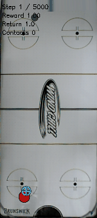

Existing checkpoint clip published2026-11-02;2 physical/1 sensed juggles in200steps at20fps. This is one early episode, not an aggregate or a hardware-safety demonstration. Heading is actual publication time in America/Chicago.

## E057 — 2026-11-01 18:33:29 -0600 — Compare physical motion over equal per-start prefixes

Equal-prefix diagnostics show lower sampled jerk with weak regularization at1.4M, while juggling still varies substantially across training seeds.

**Completed offline analysis; training ongoing:** coefficient .0005/gamma .995, seeds0/1, frozen saved1.4M eight-start5k validations. Each reset seed uses equal prefixes of at most250positions in both policies. Median paired position-derived p95 jerk ratios versus historical baseline are0.752062/0.825276 for the two seeds; full episodes average10.5/1.875 physical juggles and742/167.375 steps versus baseline6.75/612.875. Different visited states and one baseline seed limit inference. Six analytic/protocol tests pass;97 live/queued hash entries match. No new rollout or simulator/control/DR changes. Eleven user GPUs remain allocated. Related: [E054](experiment_logbook.md#e054), [E056](experiment_logbook.md#e056).

[Detailed method, table and reproduction](../notes/scratch/experiments/2026-11-02_00-33_paired-prefix-motion.md); [seed0 raw pairs](assets/juggling/smooth-paired-prefix-1m4-seed0-20261102.json); [seed1 raw pairs](assets/juggling/smooth-paired-prefix-1m4-seed1-20261102.json). No new figure; the note reports the small comparison directly as a table. Heading is actual documentation time in America/Chicago; source checkpoint validations are historical artifacts. Hardware stop behavior remains unverified.

## E056 — 2026-11-01 18:27:30 -0600 — Complete discount-matched first-million-step smoothness comparison

Longer-discount weak regularization lowers sampled motion but yields fewer early juggles than its discount-matched baseline.

**Comparison completed; training ongoing:** gamma .999, penalty .0005, seeds0/1, online/target,1M steps,32 reused starts/20k horizon. Physical juggles0.46875–0.84375 and74.78125–94.28125 steps versus baseline2.25–2.46875 juggles and210.0625–221 steps. CPU job115884 completed exit0; all eight fresh learners continue unchanged toward6M. Eleven user GPUs including three preexisting allocations. Independent long-reference job remains live; partial long episodes do not establish infinite reliability or robot safety. Related: [E051](experiment_logbook.md#e051), [E054](experiment_logbook.md#e054).

[Detailed results and reproduction](../notes/scratch/experiments/2026-11-02_00-27_long-discount-1m-comparison.md); [raw episodes](assets/juggling/smooth-longdiscount-1m-episodes-20261102.csv); [provenance](juggling-longdiscount-baseline-1m-launch.json).

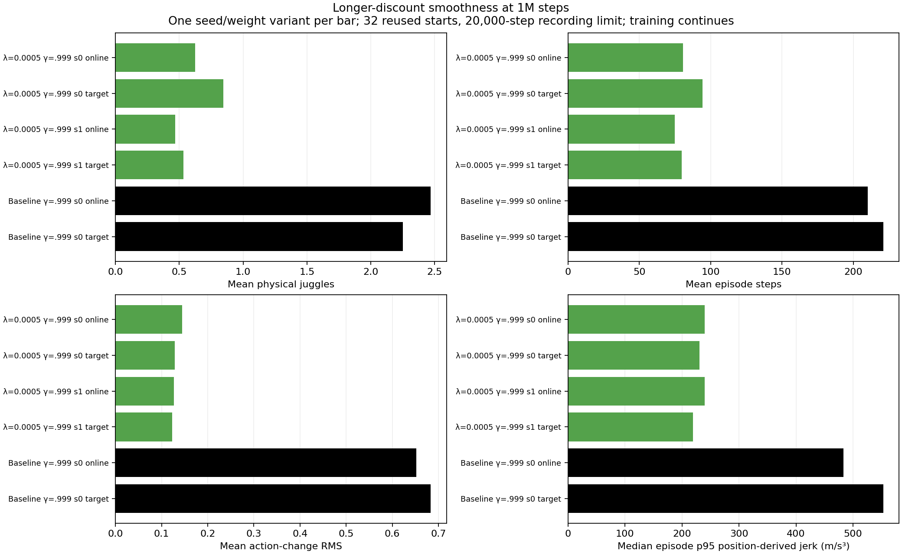

Generated2026-11-02 from saved summaries and trajectories; separate seed/weight bars show lower command changes/position-derived jerk alongside weaker early juggling. Motion comparisons involve different episode lengths and are not hardware stop thresholds. Heading records actual documentation time in America/Chicago.

## E055 — 2026-11-01 18:11:51 -0600 — Verify final-command history after holds and overrides

Deployment history now follows final normalized commands, while 9,146 retained-policy normal actions remain exactly unchanged.

**Completed offline verification:** nine implementation tests cover history/adapted-RMA neural interfaces, holds, nonzero overrides, resets/rollovers, callback ordering, failed steps and stateless actors. Normal action parity remains exact across 32 saved episodes with up to 300 actions each. Policy memory is corrected without changing PID, filters, limits, holds, stop checks or last-action-mode behavior. No robot connected or new learning/evaluation rollout. Live trainer and queued CPU source hashes remain unchanged; hardware timing/stop risk remain unverified. Related: [E054](#e054).

[Detailed fix and reproduction](../notes/scratch/experiments/2026-11-02_00-09_history-command-feedback.md); [post-change parity/source hashes](assets/juggling/history-deployment-parity-command-feedback-20261102.json). Heading uses America/Chicago; the detailed note filename uses UTC writeup time. No performance figure is generated for this bookkeeping change.

## E054 — 2026-11-01 17:57:03 -0600 — Complete original fixed 1M comparisons and verify normal deployment parity

The original six-trial 1M comparison shows mixed weak-penalty performance and lower motion, without a consistent high-performance improvement.

**Completed comparisons, training ongoing:** coefficients 0.0005/0.002/0.008, seeds 0/1, online/target weights; 32 reused starts/20k limit. Weak coefficient 0.0005 seed 0 reaches 1.71875/2.25 physical juggles and 155.34375/185.25 steps online/target, while seed 1 reaches 0.78125/0.9375 and 78/85.3125. Stronger coefficients reach 0.1875–0.71875 juggles and 68.8125–80.375 steps. Baseline online/target is 1.25/1.09375 juggles and 147.25/154.6875 steps. Effective configs match; CPU baseline job 115874 exited 0. No final-budget conclusion or gate; longer-discount tests remain pending at snapshot. Separately, the fixed retained 3.6M target exactly matches 9,146 normal deployment-adapter commands across 32 saved episodes. Holds/overrides remain outside that parity check and have a documented history-bookkeeping limitation. No robot connected. Related: [E048](#e048), [E051](#e051), [E052](#e052).

[Detailed comparison/parity evidence](../notes/scratch/experiments/2026-11-01_23-54_first-1m-smoothness-comparison.md); [raw episodes](assets/juggling/smooth-first-1m-episodes-20261101.csv); [normal-adapter parity](assets/juggling/history-deployment-parity-20261101.json). Heading records analysis time; actual worker milestones are in the note/provenance.

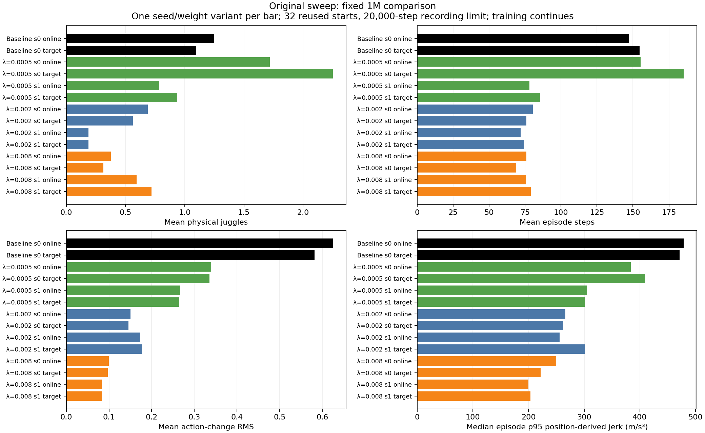

Dated figure generated 2026-11-01: mean physical juggles, episode steps and command changes, plus median episode-p95 position-derived jerk. One seed/weight variant per bar; lower motion has mixed early performance and no reliable high-performance policy yet.

## E053 — 2026-11-01 17:33:50 -0600 — Queue terminal-state continuation for the fixed long-reference test

Queued a CPU-only continuation of the same fixed-policy cohort after Slurm denied extending the still-live original reference allocation.

**Queued, not completed:** job 115869 depends on afterany:115864, then independently checks terminal accounting state. Reuses valid completed episodes; evaluates only missing/partial cases from the same 32 reset seeds and frozen actor. No restart due to polling delay, no new policy training or simulator/sensing/control/DR changes. Parent remains live at its original four-hour limit. Three artifact-reuse tests passed and the existing first 100k/1,403-juggle trajectory validates. GPU count remains 11; the continuation uses none. No aggregate result or new figure yet. Related: [E049](#e049), [E052](#e052).

[Detailed note and reproduction](../notes/scratch/experiments/2026-11-01_23-32_long-reference-continuation.md); [exact dependency/manifest](juggling-long-reference-completion-queue.json). Heading records documentation time; queue timestamp is retained in provenance.

## E052 — 2026-11-01 17:19:12 -0600 — Publish physical-motion curves with a matched historical control

Matched early checkpoint measurements show reduced sampled motion with regularization, while physical juggling remains below one per episode at 500k.

**Completed analysis, learners running:** added historical coefficient-0 seed-0 checkpoints on the same eight starts/5k horizon and physical displacement-speed/acceleration/jerk curves. At 500k, baseline averages 0.375 physical juggles/85 steps; coefficient 0.002 seeds 0/1 average 0.500/0.375 juggles and 73.625/72.375 steps, with lower sampled episode-p95 acceleration/jerk. Coefficient 0.008 also has lower motion but weak juggling. No full-budget conclusion or binary gate. Duration/visited-state confounding and position-vs-velocity definitions remain explicit. Verified 33 summaries against 264 raw episode rows; no new rollouts or simulator/learner changes. Related: [E048](#e048), [E050](#e050), [E051](#e051).

[Detailed snapshot and reproduction](../notes/scratch/experiments/2026-11-01_23-18_smoothness-motion-curves.md); [raw episode metrics](juggling-smooth-sweep-episodes.csv); [moving report](juggling-smooth-sweep.md).

Figure generated 2026-11-01 from saved checkpoint trajectories: each point is the median episode-p95 position-derived motion statistic. Historical control is dashed black. These are sampled diagnostics with different durations/states, not UR5 safety thresholds.

## E051 — 2026-11-01 17:10:39 -0600 — Launch a weak-penalty longer-discount pair from scratch

Two new fresh trials test coefficient 0.0005 with gamma 0.999 while the six gamma-0.995 learners continue.

**Running jobs:** 115866/115867, seeds 0/1, 6M-step budgets. Simulator/control/sensing/DR unchanged; exact config differences and reviewed source hashes passed. Checkpoints every 500k reduce storage; matched online/target tests remain at 1M/3M/6M on reused 32-start 20k protocol. Eleven total user GPU requests including existing jobs, below 16. Hypothesis motivated by prior longer-discount results, not early selection of a winner. No performance result yet from the new pair. Goal remains active; no binary gates or new real-robot operation. Related: [E048](#e048), [E049](#e049), [E050](#e050).

[Detailed note and reproduction](../notes/scratch/experiments/2026-11-01_23-09_smooth-long-discount-pair.md); [launch provenance](juggling-smooth-longdiscount-launch.json); [raw progress](juggling-smooth-sweep.md). Heading records documentation time; exact submission/runner times are preserved in provenance. New-pair figures are unavailable until its first 500k validation.

## E050 — 2026-11-01 17:01:00 -0600 — Verify actual PID-target motion with exact saved-action replays

Exact replays show that the historical target-change metric is a displacement-request proxy and differs from actual filtered PID-target changes.

**Completed diagnostic:** 64 saved episodes and 10,111 prefix steps reproduce all observations, rewards, termination flags and true body positions exactly. Actual PID-target change RMS averages 0.054785 m baseline versus 0.014940 m penalty 0.05; same-prefix scaled-action proxy averages 0.076177 m versus 0.009675 m. Different exposure and visited states remain confounders. Earlier raw values are preserved; interpret `target_delta_rms_m` as the scaled displacement-change proxy. No new policy-quality test or training. Published the existing strong-penalty 106-step/one-juggle GIF. Six weaker learners and the long reference test remain live. Related: [E047](#e047), [E048](#e048), [E049](#e049).

[Detailed measurement correction and reproduction](../notes/scratch/experiments/2026-11-01_22-59_pid-target-replay-audit.md); [baseline replay](assets/juggling/baseline-pid-target-replay.json); [strong-penalty replay](assets/juggling/strong-smooth-pid-target-replay.json).

Existing historical GIF copied 2026-11-01: seed 700000, 106 steps / one physical juggle. It illustrates the strong-penalty failure, not average performance.

## E049 — 2026-11-01 16:53:48 -0600 — Test the fixed retained target on 32 longer new starts

A CPU-only test now measures the unchanged retained 3.6M target over 32 new starts with a 100k-step recording limit.

**Running:** job 115864; seeds 9000000–9000031; same frozen actor SHA256 as the earlier independent test. Passed canonical sensing/scratch-environment checks and prior simulator hashes. Full original DR, dynamics and control remain unchanged. Results will report raw episode steps, physical/sensed juggles, reward and sampled motion, with no binary acceptance gate. No result or figure yet. This is independent reference evidence for the already-fixed actor; future reuse must be labeled. Six fresh learners remain live and total user GPUs remain nine. Related: [E048](#e048), [E039](#e039).

[Detailed note](../notes/scratch/experiments/2026-11-01_22-52_long-juggle-reference.md); [launch and frozen-model evidence](juggling-long-reference-launch.json). Worker start 2026-11-01 16:52:36.988738 -0600; heading records documentation time.

## E048 — 2026-11-01 16:49:01 -0600 — Launch six weaker-penalty scratch trials and measure sampled physical motion

Six fresh history policies are training with weaker action-change penalties to seek useful juggling and smoother motion together.

**Running:** coefficients 0.0005, 0.002 and 0.008 × seeds 0/1; 6M steps each; Slurm jobs 115858–115863. Only coefficient/run-name/seed differ from original history seed 0. Nine total user GPUs including three preexisting jobs, under the authorized 16-GPU cap; counted pending/running requests before each submission. Canonical config/scratch guards, prior reviewed simulator hashes and actual saved trainer arguments passed. Matched online/target 32-start 20k tests at 1M/3M/6M and built-in validation remain separate. No result yet from these trials. Read-only trajectory analysis adds sampled speed/acceleration/jerk distributions; three analytic tests passed. No simulator/sensing/control/DR change, warm start, hardware rollout or claim of infinite juggling/robot safety. Related: [E047](#e047).

[Campaign note and reproduction](../notes/scratch/experiments/2026-11-01_22-48_weaker-smoothness-sweep.md); [launch provenance](juggling-smooth-sweep-launch.json); [progress report](juggling-smooth-sweep.md). All six runners recorded start at 2026-11-01 16:46:53 -0600; heading records this documentation time. New-trial figures are unavailable until the first saved evaluation.

## E047 — 2026-11-01 11:08:04 -0600 — Complete smoothness trial: smaller command changes accompany lost juggling

The completed 6M action-change penalty trial reduced command changes but averaged roughly one physical juggle and 95–97 episode steps in final matched tests.

**Completed:** job 115589 exited 0 after 7:05:18, including all queued 1M/3M/6M online/target tests. Final online/target physical juggles averaged 0.84/1.00 and episode steps 94.84/97.31, versus baseline 77.53/138.41 juggles and 5,447.00/9,859.81 steps on identical 32 reused starts. Action-change RMS fell from 0.40835/0.39745 to 0.04960/0.04763 (about 88%). This is an unsuccessful juggling setting despite smaller commands. Unequal episode lengths confound peak-motion comparisons; one seed per setting and reused starts limit inference. No binary acceptance gate. This dated completion update preserves [E046](#e046); no new experiments or simulator/control/DR changes.

[Detailed results and reproduction](../notes/scratch/experiments/2026-11-01_17-06_smooth-history-results.md); [raw episodes](assets/juggling/smooth-results-episodes.csv); [summaries](assets/juggling/smooth-results-summary.csv); [completion evidence](juggling-smooth-training-completion.json). Runner final evaluation completed 2026-11-01 00:47:49 -0500; milestone testing completed 00:48:37 -0500, before the DST change. Heading timestamp records this analysis after that change.

Historical figure generated 2026-11-01: mean physical juggles, episode steps and action-change RMS, plus largest recorded acceleration. Lower command changes accompany much shorter episodes; peak-motion comparisons have unequal observation durations.

## E046 — 2026-10-31 17:43:56 -0500 — Launch fresh action-smoothness history trial with matched milestone tests

Started fresh history training with an action-change penalty and queued descriptive comparisons at 1M, 3M and 6M steps.

**Running, not a completed result:** Slurm job 115589 on slurm-node-003; 6M-step budget, random actor/critics/history encoder. Only action-change coefficient (0 to 0.05) and run name differ from history seed 0. Fixed online/target tests use 32 reused starts, 20k recordings and frozen copies; built-in validation uses eight starts and 5k recordings. Report physical/sensed juggles, episode steps, reward, command changes and paddle speed/acceleration without binary acceptance gates. No quality conclusion yet; figures unavailable for the new trial. Canonical config/scratch guards and reviewed simulator hashes passed; no sensing, dynamics, control or DR change. Related: [E045](#e045), [A045](agent_logbook.md#a045).

[Detailed note and reproduction](../notes/scratch/experiments/2026-10-31_22-43_smooth-history-scratch.md); [launch provenance](juggling-smooth-training-launch.json); [orchestrator source](juggling-smooth-training-watch-source.txt). Actual runner launch: 2026-10-31 17:43:21 -0500; this heading records documentation time.

## E045 — 2026-10-31 14:02:11 -0500 — Plot raw juggling, reward and episode steps through completed 6M trials

Saved evaluations and training logs show juggle counts, reward and episode steps across all four completed history trials.

Completed retrospective analysis; no new training or rollouts. Corrects the queued/running statuses in [E041](#e041) and [E042](#e042): all four trials completed. The final longer-discount target averages 198.63 physical juggles and 14,141.53 steps on the 32 reused 20k starts; the historical 3.6M target averages 225.06 and 15,427.63 on those starts. No binary success gates are used for this report. Checkpoint curves show eight reused starts per point, a 5k recording limit, online actors, and physical/sensed counts separately; exploratory training reward and episode steps use 100k-step bins. Limited horizons truncate both durations and counts. Each variant has one training seed except the separately shown history replication.

[Detailed analysis and reproduction](../notes/scratch/experiments/2026-10-31_19-00_history-training-plots.md); [raw checkpoint episodes](assets/juggling/history-checkpoint-episodes.csv); [raw training episodes](assets/juggling/history-training-episodes.csv). Figures generated 2026-10-31 from historical saved artifacts:

The four panels show unsmoothed episode means over training steps, with physical and sensed juggle counts separated.

Means of exploratory training episodes in fixed 100k-step bins; no per-training-episode juggle counter was logged. Related: [A044](agent_logbook.md#a044).

## E044 — 2026-10-29 21:18:16 -0500 — Retrospective fixed 2 M baseline duration distribution

The fixed 2 M baseline averages 50.9 seconds and 9.44 physical juggles across 32 saved episodes, independent of the 10 k cutoff.

**Completed retrospective analysis; no new rollouts:** median 31.65 seconds;20/32 last 25 seconds,11/32 last 50 seconds,3/32 last 100 seconds. Longest 236.1 seconds/40 juggles; excluding it leaves 44.89 seconds on average. All 32 failed before 10 k, so the cutoff does not affect these durations. One training seed and reused evaluation seeds limit generalization. End labels do not identify root causes.

[Detailed analysis](../notes/scratch/experiments/2026-10-30_02-18_baseline-2m-duration-review.md); [episode CSV](juggling-baseline-2m-duration.csv); [summary JSON](juggling-baseline-2m-duration.json). Related: [E015](experiment_logbook.md#e015). Recording timestamp above is analysis time; original rollout timestamps were not reconstructed.

## E043 — 2026-10-29 18:24:12 -0500 — Reconstruct independent target-test physics and inspect marginal failures

Reconstructing all32 independent-test resets confirms exact initial observations and shows failures across the sampled physics range.

**Completed diagnostic, not a new policy test:** reconstructed randomized paddle density, puck damping and gravity for seeds800000–800031 using isolated resets without actions. All32 initial observations match the saved NPZ arrays bitwise, and every sampled parameter lies within the established full ±25% range. The original18/32 cap result is unchanged. [Raw parameter CSV](juggling-history-selected-target-physics.csv); [descriptive summary](juggling-history-selected-target-physics-summary.json).

Sorting each parameter separately into four groups of eight cases gives cap counts **3,3,6,6** from low to high paddle density, **5,5,4,4** for damping, and **3,5,6,4** for numerical gravity (negative values; first group has greatest magnitude). Each case contains all three randomized parameters plus its own reset and sensor randomness. These post-test marginal summaries are exploratory, correlated and small; they do not isolate causes or establish significant group differences. Failures occur across all sampled marginal quartiles, so there is no supported single-range fix. Preserve the full distribution.

Command: `.venv/bin/python -m scripts.analysis.juggle_physics_audit --results runs/td3/noisy_history_20261029_seed0/independent_selected_target_3m6_20k_eval/results.json --out docs/juggling-history-selected-target-physics.csv`. No new rollout, model update, simulator change or training initialization. Three existing GPU learners and six final evaluator PIDs were confirmed live; the actor-LR queue remains waiting. Related: [E039](experiment_logbook.md#e039), [E041](experiment_logbook.md#e041), [E042](experiment_logbook.md#e042).

## E042 — 2026-10-29 18:21:39 -0500 — Queue final history comparisons and conditional scratch actor-LR trial

Final frozen online/target evaluations are queued for all three full-budget history trials, followed conditionally by a fresh lower-actor-learning-rate trial.

**Queued, not completed:** six CPU evaluators wait for each trainer to return successfully after its full6M budget and produce final8-case validation in `train/survival_eval/results.json`. Final weights live in `train/`, not `checkpoint_6000000`. Each evaluator checks reviewed simulator/config hashes, enforces canonical sensing/DR, freezes weight hash, and tests32 reused selection starts700000–700031 at20k. Target views are inference-only symlinks to the same scratch run's saved target weights. Existing final32-start10k tests and validation checkpoint selectors remain independent processes. See [launches](juggling-history-final-6m-watch.json) and [exact watcher source](juggling-history-final-6m-watch-source.txt).

**Queued, not launched:** after original seed0 completes and both final20k comparisons finish, reuse its allocation112937 for `noisy_history_low_actor_lr_20261029_seed0`. The scratch actor, critics and history encoder initialize randomly. Only `policy_lr` changes from0.0003 to0.0001 (plus run name); gamma0.995,6M budget,50-step deployable memory, ±25% DR and every other recipe field match the original history trial. The hypothesis is that smaller actor updates improve stability; online/target score differences alone do not establish that cause. If either final original-run variant reaches32/32 caps, defer this launch for independent review instead. Parent failure/interruption, failed final comparison, changed reviewed hashes, existing output or allocation launch failure halt the queue without overwriting artifacts. See [configuration](../configs/td3/sustained/noisy_history_low_actor_lr_scratch.yaml), [queue provenance](juggling-history-low-actor-lr-queue.json), [exact queue source](juggling-history-low-actor-lr-queue-source.txt).

Before queuing, compared effective YAMLs (exactly actor LR/run-name changes), ran canonical scratch guards, and reviewed simulator diff versus merge94acd81932c59f3cd3b827d6f39a0283747a1beb: preexisting reward/terminal bookkeeping and default-false optional history sampling only. Existing reviewed simulator hashes remain unchanged. No dynamics/sensing edits or randomization changes. Python source compilation, live waiting-status checks, documentation links/TOCs and `git diff --check` validate this queue; they are not new rollout or learning results. Related completed results: [E041](experiment_logbook.md#e041).

## E041 — 2026-10-29 18:19:33 -0500 — Fixed 5M results retain target candidate; independent failures rendered

The fixed 5M variants do not displace the retained 3.6M target actor, and independent-test failure GIFs reproduce the saved trajectories exactly.

The completed 5M online/target evaluations on reused selection seeds700000–700031 (32 starts,20k horizon) reached **16/32 and14/32** genuine caps, with bounded means **13719.65625 and13493.125** steps. The retained3.6M target scored20/32 and15427.625 on this cohort. All six variants share case seeds/configurations; these are selection results from one original training seed, not independent evidence of improvement. Online5M minus online4M mean is+32.5625 steps (paired episode bootstrap95% interval[-3688.4914,3684.2016]); online5M minus retained target is−1707.96875[-5296.6008,1985.3109]. Neither resolves a population difference. Bootstrap uses10000 draws, NumPy default_rng(42). See [six-variant scores/hashes](juggling-history-six-variant-comparison.json) and [episode CSV](juggling-history-target-comparison.csv).

The queued fixed2M tests of both newer trials are now **complete**:

| Trial at 2M | Weights | Mean bounded steps | Genuine 20k caps |
|---|---|---:|---:|
| History seed1 | online | 3446.4375 | 0/32 |
| History seed1 | target | 10779.84375 | 7/32 |
| Long discount seed0 | online | 3065.46875 | 0/32 |
| Long discount seed0 | target | 4729.71875 | 1/32 |

These four tests reuse the same selection cohort. Seven caps from seed1's target weights are promising but still leave25 failures; early checkpoints do not determine full-budget outcomes. The three fresh-initialization GPU learners remain running toward6M each. No simulator, observation, action smoothing, randomization or training recipe changed for this report.

The retained candidate's separate locked independent test (seeds800000–800031) remains **18/32 genuine20k caps,14 failures**, bounded mean13761.03125; unchanged SHA256 `c8a1df78ade41cfbe6845a84f4b21480f512973be7a89f0baf66daf5d452b31b`. It remains unaccepted. No additional independent quality test was run for this unchanged candidate.

Two replay GIFs generated2026-10-29 expose its failures. First independent case800000 fails at4407 steps after64 physical-trajectory juggles; the clip shows its final20 seconds. Case800012 is the shortest observed failure, selected after inspecting results:27 steps,0 physical juggles,full1.35-second episode. It is deliberately a negative example, not representative. Neither clip adds a test case. Renderer contact counts are contact timesteps, not distinct juggles. Each replay matches all eight original NPZ arrays byte-for-byte (including observations, actions and true body positions), and GIF compaction preserves duration and final frame; the short clip has a final50ms frame. See [hashes and raw paths](juggling-history-selected-target-failure-gifs.json).

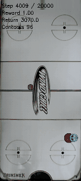

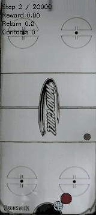

Related: [previous independent result](experiment_logbook.md#e039), [queued2M tests](experiment_logbook.md#e040), [new2M results and hashes](juggling-history-new-trials-2m-results.json). Raw checkpoints/NPZ/results remain under ignored `runs/td3/`; JSON provenance records exact paths. Frozen replay reproduction: `.venv/bin/python -m scripts.td3.juggle_survival --run-dir runs/td3/noisy_history_20261029_seed0/target_actor_3m6_bundle --out-dir <unused-output> --scenario-set training --horizon 20000 --episodes 1 --seed-base 800000 --gif-steps 400` (substitute800012 for shortest case).

## E040 — 2026-10-29 17:56:56 -0500 — New history validation caps and fixed 2M tests queued

Both newer scratch trials have genuine 5k validation caps by 1.6M, and their fixed 2M online/target comparisons are queued.

**Completed validation:** At1.6M, seed1 mean2836.25 and3/8caps; gamma.999 mean1349.875 and1/8caps. Full history shows seed1 first capped at1.2M (mean906.5,1/8), while gamma first capped at1.6M. [Checkpoint/per-start evidence](juggling-history-new-trials-caps.json), [detailed record](../notes/scratch/experiments/2026-10-29_22-56_new-history-caps-2m-queue.md). Reused8starts; no independent replication or gamma-advantage claim.

**Waiting:** Four online/target watchers,32used700000starts at20k after2M. [Queue/source metadata](juggling-history-new-trials-2m-watch.json). No result yet. All three learners and both5M long tests continue, unchanged simulator/DR and no new training launch. No new GIF. [A039](agent_logbook.md#a039).

## E039 — 2026-10-29 17:36:52 -0500 — Selected target reaches eighteen new-seed 20k caps

The selected 3.6M target completes 20k on 18/32 new starts, with 14 failures still preventing reliable sustained juggling.

**Completed:** Mean13,761.03125,median at20k cap,min27,200.34375physical juggles. No starts excluded. Seed800000range was unused before the locked test and is now consumed. [Per-start data](juggling-history-selected-target-independent.csv), [motion audit](juggling-history-selected-target-independent-motion.csv), [detailed record](../notes/scratch/experiments/2026-10-29_22-36_selected-target-independent-result-5m-queue.md), [unaccepted candidate](juggling-candidate.json). New cohort differs from selection's20/32; no paired-improvement claim.

**Waiting:** Fixed5M online/target watchers1349083/1349084, same32used700000starts at20k. [Queue/source metadata](juggling-history-5m-watch.json). No result yet. All three learners continue; no new training or simulator/DR changes. No new GIF; E038 has the selected policy clip. [A038](agent_logbook.md#a038).

## E038 — 2026-10-29 17:21:46 -0500 — Four-way comparison selects 3.6M target for new-seed testing

The completed matched comparison selects the 3.6M target at 20/32 caps, and its new-seed 20k test is running.

**Completed:** On reused 700000–700031 starts, online3.6M/target3.6M/online4M/target4M achieve 14/20/15/14 genuine caps. Means are 13,099.8125/15,427.625/13,687.09375/13,074.8125. Paired intervals include zero; averaging is not consistently better. [Selection and uncertainty](juggling-history-four-variant-selection.json), [per-start matrix](juggling-history-target-comparison.csv), [detailed record](../notes/scratch/experiments/2026-10-29_22-21_history-four-variant-selection-new-test.md).

**Running:** Selected target hash locked before 32 previously unused 800000–800031 starts, cap20k. [Provenance](juggling-history-selected-target-independent-provenance.json), [unaccepted candidate](juggling-candidate.json). No outcome yet. Same scratch lineage; no new training/warm start or simulator/DR change.

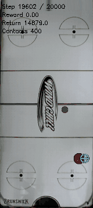

First reused selection case, 20k cap,270 physical juggles; all eight replay arrays byte-exact. Final20seconds, generated2026-10-29, duration preserved. This known success does not establish reliability. [A037](agent_logbook.md#a037).

## E037 — 2026-10-29 17:06:06 -0500 — Target3.6M reaches twenty paired20k caps;4M target test starts

The frozen3.6M target actor reaches20/32paired20k caps versus14/32online, but uncertainty and12failures prevent a reliability claim.

**Completed:** Target mean15,427.625,median at20k cap,225.0625physical juggles; online mean13,099.8125. Paired gain2327.8125,95% bootstrap interval[-834.57109375,5445.16328125],including zero. [Per-start data](juggling-history-target-comparison.csv), [detailed record](../notes/scratch/experiments/2026-10-29_22-06_history-target-3m6-result-4m-start.md). Same reused seeds; target is an in-run Polyak average from the original scratch initialization, not a new warm-started learner.

**Running:** Frozen4M target on same32used starts at20k, alongside existing4M online test. [Locked provenance](juggling-history-target-4m-test-provenance.json). Results unknown; candidate unchanged pending comparison/new-seed evaluation. Three learners continue; no simulator/DR change, new training or GIF. [A036](agent_logbook.md#a036).

**Supporting offline audit 2026-10-29 17:09:08 -0500:** All20capped target episodes span at least1.393m longitudinally and0.810m laterally, with at least98.36% of samples beyond combined body radii plus2cm. [Per-start motion](juggling-history-target-3m6-motion.csv), [driver](../scripts/analysis/juggle_body_motion.py). This supports real flight, not exact contact counting or reliable survival.

## E036 — 2026-10-29 17:01:05 -0500 — Fixed4M history benchmark reaches sixteen shared10k caps

The fixed4M checkpoint completes10k on16/32shared starts, leaving16failures and a longer paired test still running.

**Completed:** Mean7335.59375,median9989.5,107.21875physical juggles. Same starts as3M's14/32caps and6662.65625mean; paired difference672.9375,bootstrap95% interval[-1236.88671875,2529.1328125],including zero. [Per-start CSV](juggling-history-benchmark.csv), [detailed record and commands](../notes/scratch/experiments/2026-10-29_22-01_history-4m-shared-result.md). Reused research benchmark, single training seed; no acceptance claim.

**Running:** Frozen4M on same32used700000starts as3.6M,cap20k; target-actor test also running. [Pre-test provenance](juggling-history-4m-test-provenance.json). Candidate remains3.6M pending long results. Three learners continue; no new training or simulator/DR changes. No new GIF. [A035](agent_logbook.md#a035).

## E035 — 2026-10-29 16:51:47 -0500 — Frozen target actor enters paired evaluation

The3.6M target actor is under paired20k evaluation to test existing Polyak-averaged weights; its outcome is not yet known.

**Running:** Same32reused starts700000–700031 as the online actor, cap20k. Target weights differ (L2norm0.7766), source hash and canonical bundle reload verified. Target lineage is the same random-initialized scratch run; no new training or warm start. [Provenance](juggling-history-target-actor-test-provenance.json), [source review and command](../notes/scratch/experiments/2026-10-29_21-51_history-target-actor-paired-test.md). No independent acceptance claim. Three learners and4M watcher continue; no simulator/DR change or new GIF. [A034](agent_logbook.md#a034).

## E034 — 2026-10-29 16:46:28 -0500 — History3.6M reaches fourteen independent20k caps

The validation-selected3.6M checkpoint completes20k on14/32previously unused starts, with18failures still preventing reliable sustained juggling.

**Completed:** Mean13,099.8125,median14,790,min629,197.4375physical juggles;20/32last beyond10k. Frozen hash matched before/after test, and seeds700000–700031 were unused in the campaign before launch. They are now consumed. [Detailed results and command](../notes/scratch/experiments/2026-10-29_21-46_history-3m6-independent-result.md), [per-start CSV](juggling-history-3m6-independent.csv), [research pointer](juggling-candidate.json).

Compared with3M's5/32caps and9,116.5625mean, the observed result is higher on a different cohort; no paired-gain claim. One training seed and reused validation limit conclusions. This completes E032's running test. No new GIF; E031clips are from3M. Three learners and fixed4M watcher continue; no simulator/DR changes. [A033](agent_logbook.md#a033).

## E033 — 2026-10-29 16:40:22 -0500 — Policy-memory adapters match across rollover and resets

Training-wrapper and evaluation-agent memory windows and actions match exactly over256noisy steps and three automatic resets.

**Completed diagnostic:** Frozen3.6M model,50×8history, maximum action difference0.0. [Driver](../scripts/analysis/verify_history_policy_parity.py), [JSON](juggling-history-policy-parity.json), [scope and command](../notes/scratch/experiments/2026-10-29_21-40_history-policy-parity.md). Temporary73-step episode budgets exercise reset handling; sensing, dynamics and DR are unchanged and no data enters training. CPU eager adapter check only, not survival quality, compiled equivalence or two-stream RNG parity. The independent3.6M test is still running; no outcome yet. No new diagnostic GIF. [A032](agent_logbook.md#a032).

## E032 — 2026-10-29 16:35:02 -0500 — First eight-of-eight validation caps trigger a new frozen test

History3.6M becomes the first checkpoint with all eight reused5k validation caps, and its independent20k test is running.

**Validation completed; independent test running:** Verified all prior saved cap fractions below1.0. Selected3.6M before testing32previously unused campaign seeds700000–700031; froze model hash and checked canonical environment first. [Pre-test provenance](juggling-history-3m6-test-provenance.json), [detailed record](../notes/scratch/experiments/2026-10-29_21-35_history-clips-perfect-validation-test.md). No independent result yet; validation reuse and checkpoint selection preclude an acceptance claim. Existing4M watcher and all three learners remain live; no simulator/DR change or new training launch. [A031](agent_logbook.md#a031).

## E031 — 2026-10-29 16:35:02 -0500 — Rendered 3M success and failure reproduce exactly

Both rendered 3M episodes match all eight original test arrays exactly, showing a selected cap and the first test seed’s failure.

**Completed:** Selected seed600013 caps20k with310physical juggles; first test seed600000 fails at8862 with133. Aggregate remains5/32independent20k caps and27failures. [Detailed command and context](../notes/scratch/experiments/2026-10-29_21-35_history-clips-perfect-validation-test.md), [array digests](juggling-history-3m-gif-provenance.json).

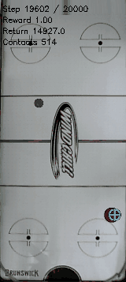

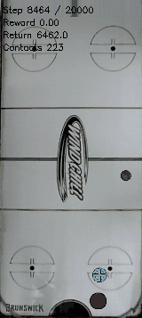

Different episodes; final20seconds each, generated2026-10-29, duration preserved. On-screen Contacts is contact timesteps. No new independent reliability claim. [A031](agent_logbook.md#a031).

## E030 — 2026-10-29 16:30:02 -0500 — Longer-discount history first checkpoint confirms updates

The gamma .999 history trial executes the intended learning updates but has no early validation caps.

**Completed:** At100k,62,500critic updates and populated actor/critic optimizer states; gamma .999 and scratch/canonical guards verified from saved files. Eight reused validation starts: mean62.75,median58,0.5physical juggles,0/8caps at5k. [Portable evidence](juggling-history-long-discount-first-checkpoint.json), [detailed record](../notes/scratch/experiments/2026-10-29_21-30_history-discount-first-checkpoint.md). This verifies runtime, not the hypothesis or reliable juggling.

**Waiting:** Fixed4M original-history benchmark watcher1322650 is live;32reused starts,10k cap. No result yet. Three history learners continue, no new training launch or simulator/DR changes. No new early-policy GIF. [A030](agent_logbook.md#a030).

## E029 — 2026-10-29 16:26:07 -0500 — History seed1 first checkpoint confirms updates, not replication success

The seed1 history run executes learning updates but remains weak at its100k checkpoint.

**Completed check:** Saved state has62,500critic updates,48actor and72critic optimizer entries, modehistory and50×8memory. Eight reused validation starts: mean64.25,median45.5,0.5physical juggles,0/8caps at5k. [Portable raw evidence](juggling-history-seed1-first-checkpoint.json), [detailed context](../notes/scratch/experiments/2026-10-29_21-26_survival-stop-history-discount-start.md). This establishes pipeline operation, not useful performance or replication of seed0's gain. Training continues from its own scratch initialization; no model was loaded and no sensing/dynamics changed. No new early-policy GIF. [A029](agent_logbook.md#a029).

## E028 — 2026-10-29 16:26:07 -0500 — Interrupt survival trial and launch longer-discount history

The survival recipe is interrupted after4M with no validation caps, and a new random-initialized history trial changes only gamma to .999.

**Interrupted:** Last logged4,049,999, latest saved4M; unfinished6M budget is not reported as complete. Selected3M checkpoint on32reused starts averages811.25 with0/32caps. All checkpoints preserved; adaptive resource choice does not rule out later improvement. [Per-start data](juggling-survival-selected.csv), [detailed record](../notes/scratch/experiments/2026-10-29_21-26_survival-stop-history-discount-start.md).

**Running:** History gamma .999 starts 2026-10-29T21:23:40.035965+00:00 UTC in step112936.6, launcher1320884,selector1321073. Only gamma/run name differ from original history; random actor/critics/encoder, original reward and canonical sensing/control/DR. Passed20k exploration; no quality result yet. [Launch provenance](juggling-history-long-discount-launch.json). Both existing history seeds continue; no new GIF. [A029](agent_logbook.md#a029).

## E027 — 2026-10-29 16:21:30 -0500 — Baseline completes 6M; fresh history seed1 starts

The baseline finishes its full 6M budget with no 10k benchmark caps, and its freed allocation starts a random-initialized history replication.

**Completed baseline:** Final6M mean890.84375, median915,0/32 on seeds200000–200031; selected2.2M mean1091.46875, median718,0/32 on seeds400000–400031. Different reused seed sets; no paired-gain claim. [Per-start data](juggling-baseline-6m.csv), [timestamps and detailed record](../notes/scratch/experiments/2026-10-29_21-21_baseline-complete-history-replication.md). All artifacts preserved; no interruption.

**Running replication:** Actual start 2026-10-29T21:18:15.860119+00:00 UTC, root `noisy_history_20261029_seed1`, Slurm112935.6, launcher1317877, selector1319154. Random actor/critics/encoder; only seed/run name changed. Passed20k random exploration and advanced beyond35k; no quality result yet. [Launch evidence](juggling-history-seed1-launch.json). Canonical simulator/config hashes and scratch guards pass. Seed0 history and survival continue. No new random-policy GIF; latest verified clips are in E025. [A028](agent_logbook.md#a028).

## E026 — 2026-10-29 16:13:02 -0500 — History 3M improves shared survival; independent reliability remains low

The fixed 3M history checkpoint reaches 14/32 shared 10k caps and 5/32 independent 20k caps, leaving sustained reliability unsolved.

**Completed:** Shared mean 6,662.65625, median 9,635.5; independent mean 9,116.5625, median 7,998, 133.875 physical juggles and 27 failures. Previously unused seeds 600000–600031 were checked before launching a hash-locked checkpoint; this range is now consumed. Shared paired improvement over 2.1M is 1,777.375, bootstrap 95% interval [-15.5625, 3582.86640625], including zero. Single training seed and reused shared starts limit conclusions.

**Evidence:** [Detailed record and commands](../notes/scratch/experiments/2026-10-29_21-13_history-3m-independent.md), [shared CSV](juggling-history-benchmark.csv), [independent CSV](juggling-history-3m-independent.csv), [updated candidate hash/provenance](juggling-candidate.json). The E024 watcher completed. No new GIF; E025 clips show the earlier 2.1M checkpoint. All three learners continue; no new training launch or simulator/DR change. [A027](agent_logbook.md#a027).

## E025 — 2026-10-29 15:58:07 -0500 — All four long history episodes eventually fail

Extending the four 20k successes reveals failures between 27,936 and 57,811 steps, so reliability remains insufficient during long play.

**Completed:** Selected reused seeds 500014/500016/500018/500021 fail at 57,811/38,023/27,936/28,246 steps with 838/577/466/479 physical juggles. All eight original 20k prefix arrays match exactly for each extension. Retaining the other 28 already observed failures gives the original cohort an uncensored mean of 9,316.78125 steps; all 32 eventually fail. This is derived cohort accounting, not a new independent test.

**Evidence:** [Detailed record and commands](../notes/scratch/experiments/2026-10-29_20-58_history-extended-failures.md), [per-start data](juggling-history-2m1-uncensored.csv), [summary](juggling-history-2m1-uncensored.json). No simulator/DR changes or new training. The fixed-3M watcher and all three learners remain live.

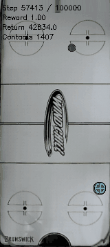

Final 20 seconds of the selected 48-minute simulated episode; full renderer replay matches all eight arrays exactly. Generated 2026-10-29, duration preserved. This illustration does not establish reliable survival. [A026](agent_logbook.md#a026).

## E024 — 2026-10-29 15:47:58 -0500 — Fixed history 3M benchmark queued

A live watcher is waiting to evaluate the exact3M history checkpoint after its training validation completes.

**Waiting, no result yet:**32reused shared starts300000–300031,cap10000; watcher PID1302296 confirmed live. [Detailed guard behavior and command](../notes/scratch/experiments/2026-10-29_20-47_history-fixed-3m-queued.md). Fixed milestone, no new policy initialization or validation-based selection. Existing three learners continue; no simulator/DR change and no new GIF. [A025](agent_logbook.md#a025).

## E023 — 2026-10-29 15:45:09 -0500 — Survival 3M improves validation but remains weak on shared starts

The combined survival recipe reaches a new validation best at3M but fails all32 shared10k benchmark starts.

**Completed:** Validation mean963,0/8caps, versus prior best544.625; shared benchmark mean717.65625,median708,5.8125physical juggles,0/32caps. [Detailed evidence and command](../notes/scratch/experiments/2026-10-29_20-45_survival-3m-assessment.md), [per-start comparison](juggling-history-benchmark.csv). Reused starts and one training seed; multiple recipe differences prevent a reward-only attribution.

**Decision:** Proposed interruption was not executed after observing the new validation best. All three learners continue; baseline is approaching6M. History seed1 replication remains prepared, not launched. No simulator/randomization changes. No new GIF; [E022](#e022) contains latest verified clips. [A024](agent_logbook.md#a024).

## E022 — 2026-10-29 15:30:37 -0500 — Selected 20k history replay reproduces exactly

The selected successful20k episode reproduces all eight saved arrays exactly while rendering the new GIFs.

**Completed replay:** Frozen2.1M history checkpoint, known cap seed500014,20000steps,295physical juggles. Rendering preserved the full trajectory bitwise. [Detailed command and evidence](../notes/scratch/experiments/2026-10-29_20-30_history-20k-selected-gifs.md). This is selected illustration: aggregate reused32-start20k test remains4/32caps and28failures. No independent acceptance claim.

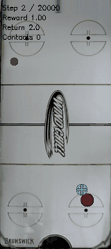

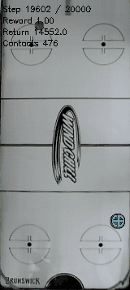

Same episode with a time gap; end clip finishes at the cap. GIFs generated2026-10-29 at10fps, durations preserved; on-screen Contacts counts contact timesteps, not distinct juggles. [A023](agent_logbook.md#a023).

## E021 — 2026-10-29 15:27:48 -0500 — Reconstruct randomized physics of the longer history test

All32 reconstructed evaluation resets match saved initial observations exactly and recover in-range randomized physics.

**Completed diagnostic:** [Driver](../scripts/analysis/juggle_physics_audit.py), [CSV](juggling-history-2m1-physics.csv), [detailed record and command](../notes/scratch/experiments/2026-10-29_20-27_history-physics-audit.md). Four20k caps all occur in the upper half of sampled paddle density; however overall survival/density correlation is0.056 and the post-hoc subgroup is too small for a causal conclusion. Gravity and density cover nearly their full configured ranges. Established DR is retained unchanged. No policy actions, training launch or new GIF in this reset-only analysis. [A022](agent_logbook.md#a022).

## E020 — 2026-10-29 15:19:59 -0500 — History 2.1M reaches nine shared benchmark caps

The continued scratch history learner reaches9/32 genuine10k shared-start caps while23starts still fail.

**Completed:** Mean4885.28125, median3190,74.34375 physical-trajectory juggles, versus1.6M mean3519.375 and3/32 caps. Paired difference1365.90625, bootstrap95% interval[-332.4703125,3050.4234375],21/32 wins. Reused benchmark; single training seed. [Detailed results and exact command](../notes/scratch/experiments/2026-10-29_20-19_history-2m1-milestone.md); [per-start CSV](juggling-history-benchmark.csv).

**Running:** Paired20k test on previously used500000–500031; no outcome yet. Three scratch training jobs remain active. No simulator changes, no new training initialization. No new GIF for this milestone; see [E019 clips](#e019). [A021](agent_logbook.md#a021).

**Status update 2026-10-29 15:25:44 -0500:** The paired20k test completed: mean7066.28125, median5100.5,4/32 genuine caps,28failures. Previous1.6M on identical starts: mean3606.6875,0/32caps. Paired difference3459.59375,95% bootstrap interval[1170.4515625,5843.27734375]. [Per-start comparison](juggling-history-20k-comparison.csv). Both seed sets are reused research tests; candidate pointer updated, no acceptance claim.

## E019 — 2026-10-29 15:15:24 -0500 — History improves survival; fresh 20k test still fails

The scratch 50-step-history policy improves matched bounded survival but fails every independent 20k start.

**Completed:** At1.6M, shared32-start10k benchmark mean3519.375 and3/32 genuine caps versus matched feed-forward580.21875 and0/32. Fixed checkpoint independent seeds500000–500031: mean3606.6875, median2010.5,0/32 at20k; two exceed10k. These previously unused seeds are now consumed. One selected favorable seed lasted17049steps with235 physical juggles before failing. Single training seed; shared benchmark reused; no reliability or indefinite-survival claim.

**Evidence:** [Detailed record](../notes/scratch/experiments/2026-10-29_20-15_history-benchmark-independent.md), [matched CSV](juggling-history-benchmark.csv), [independent CSV](juggling-history-independent.csv), [checkpoint provenance](juggling-candidate.json), [live curves](juggling-noisy-progress.md). Baseline selected through3M averages920.3125 on the shared benchmark. All three learners remain running; no simulator or randomization changes.

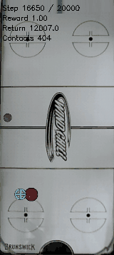

Selected seed300017 ending in failure; distinct first-benchmark failed episode is embedded in the detailed record. GIFs generated2026-10-29, duration preserved. [A020](agent_logbook.md#a020).

## E018 — 2026-10-29 14:40:03 -0500 — Aim-point and critic-action-context CPU smokes pass

Two independently configured scratch candidates pass CPU training/reload checks, while their full GPU learning performance remains untested.

**Completed implementation checks:** [Aim-point candidate](../configs/td3/sustained/noisy_absolute_target_scratch.yaml) changes only actor output representation; [critic-context candidate](../configs/td3/sustained/noisy_critic_context_scratch.yaml) adds the known previous action only to the critic. Same original noisy observations, reward, PID/smoothing, geometry, limits and DR. Both 96-step CPU runs completed at actual timestamps in the [detailed record](../notes/scratch/experiments/2026-10-29_19-40_actor-critic-cpu-smokes.md); each saved state confirms three critic updates and populated actor optimizer state. Frozen checkpoint reload and evaluation passed. Full 6M GPU candidates are **planned, not launched**. No teacher, residual base or reused weights.

**Validation:** All 32 targeted tests passed, including gradients, legacy/new actor round trips, successor action context, terminal masking and CQL shapes. [Raw CPU compatibility verification](juggling-update-compatibility.json): disabled flags match prior `c4c422b` actor/critic outputs and parameter gradients bitwise on both tested no-CQL/CQL cases. No CUDA equivalence claim. No meaningful learned-policy figure from the short smoke runs; local random smoke clips exist but are not performance evidence.

**Decision:** Preserve running trials. In particular, history improved to 612.875 mean steps at 1.4M (0/8 caps), so weak early results alone do not justify ending it. Both new flags remain false in existing/default configurations. [A019](agent_logbook.md#a019).

## E017 — 2026-10-29 14:09:34 -0500 — Reject a fixed observer after negative offline estimates

One fixed nominal-physics puck observer estimates saved physical states worse than the E010 learned regressors, so it will not enter an active policy.

**Completed offline:** Same saved E010 trajectories and reused eight comparison seeds (16 frozen-actor episodes). No new rollout, policy/regressor training or parameter fit. Filter uses latest puck xy/flag, nominal mean physics, approximate wall reflection, 25 ms latency compensation and fixed noise settings; no sampled DR factors or true state as input. Position/velocity-proxy errors **5.1748 cm / 1.2656 m/s**, versus E010 memory regressor **4.1023 / 0.6587** and larger current-input regressor **4.2508 / 0.7438**. Different inputs and approximate impact/velocity modeling limit causal interpretation; one setting does not rule out the broader filter family.

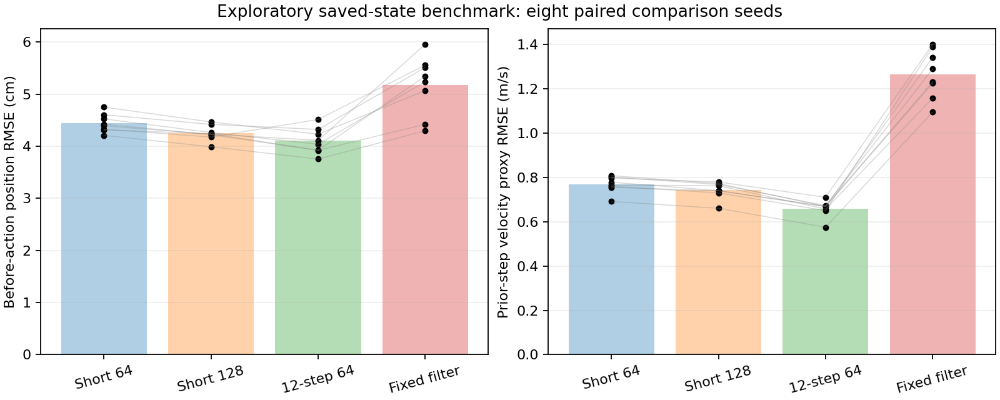

Figure generated 2026-10-29 from saved data. Paired dots represent eight reused environment seeds averaged across two actors; this is not a juggling-performance test. [Raw results](juggling-filter-observability.json), [methods and commands](../notes/scratch/experiments/2026-10-29_19-09_fixed-observer-negative.md), [analysis code](../scripts/analysis/juggle_filter_observability.py). Experimental observer remains isolated under scripts/analysis; no active trainer/evaluator uses it. All three RL jobs continue. [A018](agent_logbook.md#a018).

## E016 — 2026-10-29 13:49:22 -0500 — Interrupt low-exploration pilot and launch survival-focused scratch trial

The reduced-exploration pilot is intentionally stopped after its 2M milestone and its GPU now trains the prepared combined survival/actor-stability candidate from scratch.

**Dated E005 status correction:** Reduced-exploration 6M budget is **interrupted**, not completed. Validation best remained at 1M (894.125); fixed-2M mean 392.0, no caps. Last logged step 2,074,999; latest saved 2M; actual final executed step unknown. Interruption recorded 2026-10-29T13:44:39.832949-05:00. Stopped only step 112936.3 and its old waiter, preserved all artifacts and both other learners. This adaptive resource decision does not prove later training could never improve.

**Partial selection completed:** Best saved checkpoint 1M, 32 seed-400000 starts, cap 10k: mean 824.40625, median 544.5, physical-trajectory juggles 7.90625, 0/32 caps. [Raw results](../runs/td3/noisy_iteration2_20261029_low_explore/selected_eval/results.json); status records interrupted training. These are different starts from the 300000 benchmark, not training progress. No full 6M actor.

**E014 now running:** Actual start 2026-10-29T13:44:40.128064-05:00; root `runs/td3/noisy_survival_20261029_seed0/`, allocation 112936, step .5, launcher 1250064, waiter 1251615. [Training config](../configs/td3/sustained/noisy_survival_scratch.yaml), [environment](../configs/new_juggle/sustained/noisy_survival.yaml). Fresh actor/critics, no reused weights; 6M planned. Exactly three allowed environment reward differences; all sensing/dynamics/control/DR unchanged. First 100k validation: 76.375 mean steps, 0.5 physical-trajectory juggles, 0/8 caps; an early result, not a conclusion. Judge survival plus repeated juggling, not raw reward or stationary capped behavior.

[Detailed decision, validation history and commands](../notes/scratch/experiments/2026-10-29_18-49_survival-candidate-start.md). No new learned-policy figure for this initial run; E015 contains current meaningful rollout GIFs. Baseline and history trials remain running. [A017](agent_logbook.md#a017).

## E015 — 2026-10-29 13:49:22 -0500 — First noisy capped rollout and fixed-2M benchmark

The baseline first completes a 5k validation rollout, but its best demonstrated episode fails at 6,859 steps and every shared 10k benchmark episode still fails.

**Completed milestone:** At 1.9M, validation seed 10005 completes 5,000 steps with 59 physical-trajectory juggles; other seven starts fail (mean 1236.875). Extended that specifically selected seed to 20k: failed at **6,859** (`puck_passed_paddle`), **75** physical-trajectory juggles, about 5 min 43 s. All eight saved NPZ fields match the original prefix exactly through 5,000 steps. A selected favorable validation seed is not independent reliability evidence.

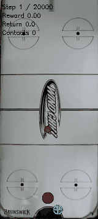

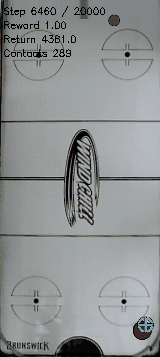

New 2026-10-29 clips from the same episode: first 10 seconds and last 20 seconds, with an intentional time gap. Original 20 fps clips remain local; compact copies are 160×357, 10 fps, 64 colors with duration preserved. No clean sensing used.

**Shared 32-start benchmark (300000–300031, cap 10k):** baseline selected 1.9M 827.9375 mean steps; baseline fixed 2M **1017.34375** / 9.4375 physical juggles; reduced exploration fixed 2M **664.4375** / 6.0625; prior selected incumbent 816.9375 / 7.75. All **0/32** cap completions. Baseline 2M minus reduced exploration paired mean +352.90625, bootstrap 95% interval [−128.93, 832.44], wins 24/32; versus prior incumbent +200.40625, interval [−270.88, 701.06]. One training seed; shared starts reused. Best measured mean is not proven robust superiority.

Ongoing 2.2M validation: 1681.125 mean steps and 1/8 cap, now seed 10004 (39 physical-trajectory juggles). Still reused validation starts.

[Detailed results, uncertainty and reproduction](../notes/scratch/experiments/2026-10-29_18-49_first-noisy-cap-2m-results.md), [per-start CSV](juggling-2m-benchmark.csv), [curves including cap fraction](juggling-noisy-progress.md). Baseline continues toward 6M. [A016](agent_logbook.md#a016).

## E014 — 2026-10-29 13:31:51 -0500 — Prepare survival-focused scratch candidate; not launched

A reward-focused scratch candidate is prepared for assessment after the current 2M milestones, with canonical dynamics, observations and DR still locked.

**Planned only:** [Environment config](../configs/new_juggle/sustained/noisy_survival.yaml) retains the original upper-half task and adds existing reward-only fields: survival bonus +1 on nonterminal steps and puck-loss penalty 5. [Training config](../configs/td3/sustained/noisy_survival_scratch.yaml): 6M planned, seed 0, gamma 0.999, actor LR 1e-4, two actor updates per cycle, training-only action-delta penalty 0.005, existing low-exploration recipe. This is a combined candidate, not an isolated causal ablation. The actor penalty does not filter or remap deployed actions. No policy weights loaded and no production trial started.

**Why:** Current runs show repeated checkpoint regressions and no cap completions. This candidate tests a longer-horizon survival objective plus more conservative actor optimization. E013 history trial remains running. At latest inspected validation: baseline 1.8M 495.875 mean steps, reduced exploration 1.7M 513.25, history 200k 93.0; each 0/8 caps.

**Guard/validation:** Only `enable_survival_bonus`, `survival_bonus_per_step`, `puck_loss_penalty` can differ at the top level; values are type/finite/nonnegative checked. Task, termination rules, sensing, history sampling, PID, smoothing, geometry, contact parameters, workspace and DR still require exact canonical equality. All 23 targeted tests pass. A paired run through actual puck-loss termination has bitwise-identical observations/terminal flags and exactly the expected reward differences. This is implementation validation, not a learned-policy result. No figure or checkpoint exists for the planned candidate.

**Future command, not run:** `.venv/bin/python -u -m scripts.td3.juggle_noisy_scratch --root <new-survival-root> --args-file configs/td3/sustained/noisy_survival_scratch.yaml`. [A015](agent_logbook.md#a015).

## E013 — 2026-10-29 13:22:22 -0500 — Interrupt width pilot and launch fresh policy-memory trial

The width pilot remains weak through 1M, so its GPU now trains a fresh long-history policy while the two small-network controls continue.

**Dated E005 correction/status:** The planned 6M width trial is **intentionally interrupted**, not completed. It underperformed the smaller reduced-exploration actor at all ten matched 100k checkpoints through 1M (last means 152.625 versus 894.125). Correlated checkpoints, one training seed; this is a resource-allocation choice, not proof it could never catch up. Last logged step 1,024,999; latest saved checkpoint 1M; exact final executed step unknown. Interrupted status recorded 2026-10-29 13:18:44 -05:00. Stopped only step 112937.3, preserved allocation/checkpoints and both other learners.

**Partial selection completed:** Best saved validation checkpoint 900k (204 mean steps) evaluated on 32 seed-400000 benchmark starts, cap 10k: mean **225.8125**, median 188.5, physical-trajectory juggles **1.9375**, 0/32 caps. [Raw results](../runs/td3/noisy_iteration2_20261029_large_low_explore/selected_eval/results.json). No 6M final actor. Local GIF exists in that directory; no new tracked figure for this weak partial trial. [Progress curves and explicit runner statuses](juggling-noisy-progress.md).

**E011 full history trial now running:** Actual start 2026-10-29 13:18:44.949 -05:00; root `runs/td3/noisy_history_20261029_seed0/`, existing allocation 112937, step .5. [Config](../configs/td3/sustained/noisy_history_scratch.yaml), 6M planned, seed 0, same low-exploration recipe, learned 50-step policy memory. Random actor/critics/encoder, no privileged actor input or reused weights. Canonical noisy sensing/dynamics and DR verified unchanged. Initial 20k random collection completed; GPU learning then advanced to about 65k before publication, with no checkpoint evaluation available yet. [Full evidence, commands and limits](../notes/scratch/experiments/2026-10-29_18-22_width-stop-history-start.md), [A014](agent_logbook.md#a014).

## E012 — 2026-10-29 13:03:57 -0500 — One-million-step exploration comparison and shared benchmark

Reduced exploration leads the matched 1M checkpoint validation but does not establish a better incumbent on the shared 32-start benchmark.

**Running E005 milestone:** At 1M, baseline mean survival 266.25 and physical-trajectory juggles 2.125 versus reduced exploration 894.125 and 6.625 on the same eight validation starts; both 0/8 5k-cap completions. Reduced exploration also leads at 800k and 900k, after a near tie at 600k. The larger network remains slower, 165 mean steps at 700k, no capped completions.

**Completed fixed-checkpoint benchmark:** New 1M actor: mean **695.375**, median 553, physical-trajectory juggles **6.09375**, 0/32 10k-cap completions. Existing selected 1.8M incumbent on the same seed-300000 starts: **816.9375**, median 612, juggles **7.75**, 0/32. New-minus-incumbent mean −121.5625, paired episode-bootstrap 95% interval [−469.88, 210.23], wins 16/32. One training seed; these shared benchmark starts are no longer untouched and training budgets differ. No reliable superiority claim. Retain E008 incumbent; keep current training running.

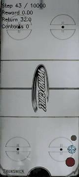

New clip generated 2026-10-29, first episode's last 20 seconds, 10 fps/64 colors, duration preserved. [Detailed methods, commands and limitations](../notes/scratch/experiments/2026-10-29_18-03_exploration-1m-benchmark.md), [per-start CSV](juggling-exploration-1m-benchmark.csv), [refreshed curves](juggling-noisy-progress.md). Policy inputs remain canonical noisy observations; physical trajectories are diagnostic only. [A013](agent_logbook.md#a013).

## E011 — 2026-10-29 12:50:01 -0500 — Long-history scratch path passes CPU smoke; full trial planned

A 96-step CPU smoke test validates fresh long-history TD3 training and evaluation under unchanged canonical sensing; sustained-control performance remains untested.

**Completed:** Actual start/end 2026-10-29 12:48:15–12:48:34 -05:00. Canonical noisy simulator plus established DR, random actor/critics/encoder, 50-step policy memory, no checkpoint or residual base. Eager CPU, 96 environment steps, three critic updates and actor updates confirmed in saved optimizer states. Checkpoint at 64, metadata/bundle reload and frozen-policy evaluation succeeded. Raw status/training/args/checkpoints live under `runs/td3/noisy_history_smoke_20261029/`.

**Validation/limitations:** All 20 targeted tests pass, including exact equality of canonical sensor/reward/termination traces with and without appended policy memory, plus scratch/privileged-mode rejection. This smoke does not validate CUDA compilation, learning quality or long survival. No meaningful learned-policy figure available from 96 steps.

**Planned, not launched:** [6M-step history config](../configs/td3/sustained/noisy_history_scratch.yaml), same low-exploration algorithm recipe and DR as E005, learned 50-step memory added inside policy. No E010 regression weights or smoke weights will be reused. Current three production trials continue uninterrupted. [Detailed setup and commands](../notes/scratch/experiments/2026-10-29_17-50_scratch-history-smoke.md), [A012](agent_logbook.md#a012).

## E010 — 2026-10-29 12:45:50 -0500 — Offline state estimation supports a memory-policy trial

Twelve-step deployable history modestly improves held-out physical-state estimation over the current observation alone, without demonstrating improved juggling.

**Completed offline diagnostic:** 64 saved E008 actor episodes, split by seed into 48 training and 16 held-out episodes (eight distinct held-out environment seeds shared across two actors). Fresh supervised MLPs, 3,000 updates each, no actor/critic training or new rollouts. Width-64 current-input / width-128 current-input / width-64 memory position RMSE: 4.444 / 4.251 / 4.102 cm; prior-step mean velocity RMSE: 0.769 / 0.744 / 0.659 m/s. Memory improves velocity error 11.4% over the larger current-input control. Only one regressor training seed; this frozen-policy dataset does not establish control performance.

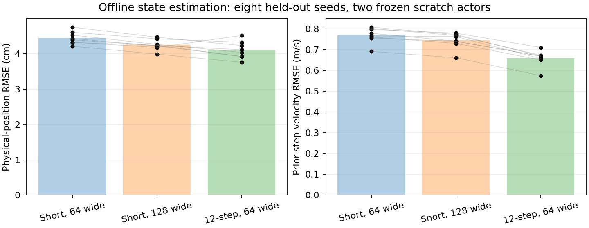

Figure generated 2026-10-29 from saved trajectories. Paired dots represent eight held-out seeds, each averaging two frozen-actor episodes. [Detailed methods, limitations and command](../notes/scratch/experiments/2026-10-29_17-45_noisy-state-observability.md), [raw JSON](juggling-observability.json), [diagnostic script](../scripts/analysis/juggle_observability.py). No weights retained or authorized for initializing an actor; all future policies still start from scratch.

**Running E005 update:** At 600k, baseline mean survival 311.5 versus reduced exploration 308.375; both 0/8 cap completions. Thus E009's 500k lead is not yet robust. Continue the declared comparison; a from-scratch history architecture is a candidate if these trials fail. [A011](agent_logbook.md#a011).

## E009 — 2026-10-29 12:39:35 -0500 — Reduced exploration leads at the 500k checkpoint

The reduced-exploration scratch trial has higher mean survival at 500k than the matched baseline, but neither completes the evaluation cap.

**Running E005 status:** Same eight reused validation starts (10000–10007), 5k cap. At 500k, baseline mean survival **149.75** and physical-trajectory juggle heuristic **0.625**; reduced exploration **233.125** and **1.75**. Both 0/8 cap completions. At 400k the ranking was reversed (183.0 versus 154.625), so this single checkpoint is encouraging but insufficient to establish a reliable advantage. The larger-network trial is slower and has only reached its 300k checkpoint: 86.625 mean steps, 0/8 cap completions. Compare capacity at matched steps later.

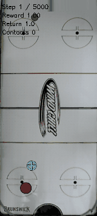

Newly published 2026-10-29 from the first checkpoint-validation episode, 160×357, reduced to 10 fps/64 colors with duration preserved. Individual rollout only. [Updated learning curves](juggling-noisy-progress.md), [CSV including optional physical-trajectory counts](juggling-noisy-progress.csv). Original artifacts: `runs/td3/noisy_iteration2_20261029_low_explore/train/checkpoint_500000/survival_eval/`.

**Decision:** Continue the predeclared 6M-step comparisons. Exploration primitives anneal to the low floor at 500k; the current point does not yet measure extended learning at that floor. No policy, reward, sensing, physics, randomization or configuration changes. All three training processes and all three selected-evaluation waiting workers remain live. [Task A010](agent_logbook.md#a010).

## E008 — 2026-10-29 12:31:39 -0500 — Validation-selected scratch checkpoint doubles paired survival

The validation-selected 1.8M scratch checkpoint outperforms the final actor on fresh paired starts, but both fail every 10k-cap episode.

**Completed:** Frozen policies, same 32 starts (300000–300031), canonical noisy sensing and established DR. Selected checkpoint: mean survival **816.94**, median 612, physical-trajectory juggle heuristic **7.75** per episode. Final actor: **415.31**, median 358.5, physical-trajectory juggles **3.84**. Both 0/32 cap completions. Selected actor wins 20/32 pairs; paired mean gain 401.625 steps, episode-bootstrap 95% interval [174.59, 660.10]. One training seed; no seed-robustness claim. Checkpoint selected on the earlier eight validation starts, not these fresh starts.

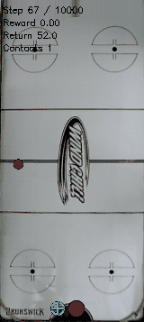

New simulation clip generated 2026-10-29, first paired episode tail, compacted to 10 fps/64 colors while preserving duration; not aggregate evidence. [Detailed note and commands](../notes/scratch/experiments/2026-10-29_17-31_scratch-paired-checkpoints.md), [per-start CSV](juggling-paired-checkpoints.csv). No training or simulator changes for this paired test. This is a stronger incumbent, not a solved policy.

**Next evaluation change:** Attached live selected-checkpoint evaluation workers to all three E005 trials. After training and final benchmark, selection uses validation-only genuine-cap fraction then mean survival; selected policy evaluated on seeds 400000–400031, 10k cap. New worker refuses overlap with checkpoint validation/final benchmark seeds and checks canonical config (allowing only trainer-saved top-level episode seed normalization). Cross-recipe winner still requires untouched acceptance seeds. [A009](agent_logbook.md#a009).

## E007 — 2026-10-29 12:24:45 -0500 — Verify read-only physical-trajectory diagnostics

A two-start replay confirms that physical-trajectory logging leaves all historical observations and actions bitwise unchanged, while the observed juggle heuristic can disagree with the physical-trajectory heuristic.

**Experiment completed:** Reran the final E004 actor on seeds 200000 and 200001, training-distribution scenario, 10k cap, no GIF rendering. Mean survival 199.0 steps, no cap completions. Every prior trajectory field (`observation`, `next_observation`, `action`, `reward`, `terminated`, `truncated`) exactly matches the corresponding saved final-evaluation NPZ on both starts. These are repeated diagnostic starts, not new independent performance evidence.

**Finding:** Noisy-observation/physical-trajectory juggle counts are 2/2 and 3/2 respectively. Both use the same contact-distance/direction-reversal heuristic; physical-trajectory counts remove sensor corruption but are still heuristic, not a formal contact-event ground truth. No historical metric was overwritten. New reports expose both.

**Implementation:** Evaluator records actual Box2D body positions directly, without invoking sensor-producing `get_current_state` or advancing RNG. These values are stored in NPZ fields `true_paddle_xy` / `true_puck_xy` and used only for diagnostics, never policy inputs. Existing legacy observed-count summaries remain comparable. No sensing, physics, randomization or training changes.

**Reproduction:** `.venv/bin/python -u -m scripts.td3.juggle_survival --run-dir runs/td3/noisy_scratch_20261028_seed0/train --scenario-set training --episodes 2 --horizon 10000 --seed-base 200000 --gif-steps 0 --out-dir runs/td3/noisy_scratch_20261028_seed0/truth_diagnostic`. [Raw results](../runs/td3/noisy_scratch_20261028_seed0/truth_diagnostic/results.json). Compare all six old NPZ keys using `numpy.testing.assert_array_equal`. No new figure for this measurement check. [Task A008](agent_logbook.md#a008).

## E006 — 2026-10-29 12:19:36 -0500 — Full learning-curve and failure-action analysis

Saved checkpoint evaluations show continued improvement with large fluctuations; terminal actions are more often saturated, without evidence that saturation causes failure.

**Analysis, completed now:** Reconciled all 19 saved checkpoint evaluations from E004 (100k–1.9M steps). Eight reused validation starts, 5,000-step cap: best observed mean survival 771.875 at 1.8M versus 663.375 at 1.9M; no genuine cap completions. The final actor's separate 32-start result is 416.125 steps and 3.78125 observed juggles. These different seed sets cannot measure a matched final-checkpoint regression.

Historical figure generated 2026-10-29 from saved E004 results; this task ran no policy evaluations. [Report and reproduction context](juggling-noisy-progress.md), [raw CSV](juggling-noisy-progress.csv), [report generator](../scripts/analysis/juggle_progress.py). Generate with `.venv/bin/python -m scripts.analysis.juggle_progress --roots runs/td3/noisy_scratch_20261028_seed0 runs/td3/noisy_iteration2_20261029_long runs/td3/noisy_iteration2_20261029_low_explore runs/td3/noisy_iteration2_20261029_large_low_explore --out docs/juggling-noisy-progress.md`.

**Failure diagnostics:** Computed from 32 saved final-evaluation NPZ trajectories, equally weighting episodes: normalized action components with absolute value >0.95 occupy 35.83% of all steps/components and 63.75% in the last ten steps. Latest puck-frame occlusion rates average 9.33% overall and 10.94% in the last ten steps. These are observational associations, not controlled causal tests; no sensing modifications are justified. The occlusion rate here measures observed flags, not the simulator's configured per-event probability.

**Live experiment:** E005 trials confirmed as live Slurm processes, completed initial collection and began CUDA-graph updates; approximately 25k–30k steps at inspection. No checkpoint evaluations yet. No additional experiments launched. [Task A007](agent_logbook.md#a007).

## E005 — 2026-10-29 12:17:15 -0500 — Scratch run completed; longer-training comparison launched

The 2M-step scratch policy improved but failed every fresh 10,000-step rollout; three new scratch trials now test training duration, exploration and network capacity.

**Completed E004:** Finished 2026-10-28 13:57:31 -05:00 including final evaluation. On 32 independent starts (200000–200031), mean survival 416.1 steps, mean contact timesteps 20.4, genuine cap completions 0/32. Contact timesteps are not distinct juggle cycles. [Raw final results](../runs/td3/noisy_scratch_20261028_seed0/final_eval/results.json). These results supersede E004's running status; the goal remains unsolved.

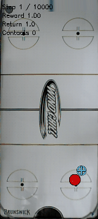

The existing evaluation clip was copied on 2026-10-29; it shows one rollout and does not establish aggregate reliability.

**New experiment, running:** Three 6M-step seed-0 trials, all fresh random actor/critics: [long baseline](../configs/td3/sustained/noisy_long.yaml), [reduced exploration](../configs/td3/sustained/noisy_low_explore.yaml), and [256-wide networks plus reduced exploration](../configs/td3/sustained/noisy_large_low_explore.yaml). Low exploration changes Gaussian noise 0.1→0.03 and primitive probability floor 0.05→0.001, annealed over 500k steps. Everything else matches E004. Baseline controls duration; second controls exploration; third compares capacity at matched exploration. One seed each limits generalization.

**Contract audit:** Compared simulator code against `94acd81932c59f3cd3b827d6f39a0283747a1beb`: optional history sampling remains false, original history path retained; base-env changes concern reward/terminal handling. Exact canonical sensing/control config plus established three-parameter DR checked for each trial. No simulator changes in this task.

**Artifacts/reproduction:** Roots `runs/td3/noisy_iteration2_20261029_{long,low_explore,large_low_explore}`; status.json and training.log record actual starts/progress. Existing allocations 112935/112936/112937. Command within allocation: `.venv/bin/python -u -m scripts.td3.juggle_noisy_scratch --root <root> --args-file <config>`. Final evaluation: 32 starts, seeds 200000–200031, cap 10k. Those starts are now a repeated benchmark, not a new untouched test; use new seeds for subsequent acceptance testing. No new trial performance available at recording time. [Related task](agent_logbook.md#a006).

## E004 — 2026-10-28 12:36:09 -05:00 — Noisy-simulator training from scratch

A new TD3 policy is training from randomly initialized actor and critics in the canonical noisy simulator.

**Timing/status:** Started 2026-10-28 12:35:26 -05:00; running at this entry's recording time. No performance results yet.

**Setup:** Seed 0, 2M steps, gamma 0.995, canonical upper-half reward, random initial exploration for 20k steps, 25 critic and six actor updates every 32 environment steps. No checkpoint load or residual base. Simulator parameters exactly match the canonical noisy recipe; established three-parameter physics DR retained, episode cap 10,000. No dynamics or observation code changes.

**Evaluation:** Planned checkpoint validation every 100k steps, eight starts with 5,000-step cap, training-distribution scenario. Final actor evaluation uses 32 fresh starts (200000–200031), 10,000-step cap; the runner does not select checkpoints on these final starts.

**Artifacts/reproduction:** [TD3 config](../configs/td3/sustained/noisy_scratch.yaml), [guarded runner](../scripts/td3/juggle_noisy_scratch.py). Run command: `.venv/bin/python -u -m scripts.td3.juggle_noisy_scratch --root runs/td3/noisy_scratch_20261028_seed0` inside existing Slurm allocation 112935. Runner refuses an existing root. Local status, training log and saved launch args are under that run directory; training outputs under `train/`, final results under `final_eval/`.

**Figures and limits:** No rollout figure or learned-policy result available yet. One training seed cannot establish seed robustness or infinite survival.

**Related task:** [A005](agent_logbook.md#a005).

## E003 — 2026-10-22 10:09:00 -05:00 — Original-sensing fine-tuning regression

All three original-sensing fine-tuned actors regressed relative to the matched original actor.

**Question/setup:** Preserve canonical sysid-v2 sensing/control while fine-tuning source or clean-trained actors with fresh critics and discounts 0.99/0.995. Three trials, 1M training steps each, one training seed each, established three-parameter ±25% physics randomization. Validation: 32 shared starts (100000–100031), 10,000-step cap.

**Timing and status:** Completed historical results; `84620a0` records the matched baseline correction, not experiment execution time.

| Actor | Mean steps | Median steps | Mean juggles | Genuine cap completion |
|---|---:|---:|---:|---:|
| Original, no new training | 660.1 | 264 | 8.625 | 0/32 |
| Source fine-tune, gamma 0.995 | 179.2 | 136.5 | 1.000 | 0/32 |
| Clean warm start, gamma 0.995 | 282.7 | 175 | 2.156 | 0/32 |
| Source fine-tune, gamma 0.99 | 342.8 | 246 | 2.844 | 0/32 |

**Interpretation and limits:** The campaign's selected trial was best among new actors, not better than the baseline. Retain the original actor as reference. These 32 starts were also used for selection; they are not an independent post-selection test. The earlier 16-start baseline is not a matched comparator.

**Figures:** No tracked GIF for this study is available in `docs/assets/juggling/`; local rollout paths are recorded in the [result note](../notes/scratch/experiments/2026-10-22_01-45_original-sensing-juggle.md).

**Artifacts and reproduction:** [Full setup, commands and baseline correction](juggling-original-sensing.md), [environment config](../configs/new_juggle/sustained/original_sensing.yaml), [launcher](../scripts/td3/juggle_original_sensing.py). Local raw results/checkpoints: `runs/td3/original_sensing/`, including `source_matched_validation/`. Baseline checkpoint: `latest_models/canonical/hist2_motion0_v2/` (local availability not checked).

**Related task:** [A003](agent_logbook.md#a003).

## E002 — 2026-10-21 19:46:27 -05:00 — Clean-simulation iterations and failed transfer

Clean-simulation training achieved long bounded juggling but failed when simulated sensing corruption returned.

**Question/setup:** Compare upper-half reward, survival shaping and policy memory, then continuation, replication and a longer discount. Clean sensing and disabled physics randomization make these diagnostic trials outside the current training contract. Iteration 1 used 300k steps per trial; iteration 2 targeted 1M total steps. Each trial had one training seed; validation used 16 starts with a 5,000-step cap.

**Timing and status:** Completed historical studies; author-commit milestone `76d1d2c` records final clips/results, not execution timing.

**Results:** Iteration 1 upper/survival/memory mean lengths were 1011.9/1188.6/234.6 steps, with genuine cap completion 2/16, 1/16, 0/16. Iteration 2 continuation/replication/long-discount achieved 14/16, 15/16, 16/16. The selected policy completed the independent 20,000-step clean cap on 28/32 fresh starts; four failed within 334 steps. Sensor-corrupted transfer tests completed 0/32 for both nominal physics (80.4 mean steps) and 100 ms camera lag (78.4).

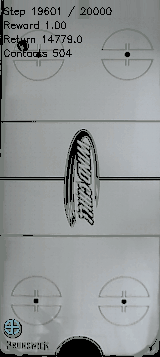

This individual episode illustrates clean bounded survival; it is not aggregate evidence.

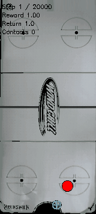

The corrupted-sensing rollout illustrates the transfer failure; it is simulation, not a hardware test.

**Interpretation and limits:** Long clean survival does not establish noisy-sim robustness or infinite juggling. Contact/pinning artifacts are excluded using a repeated-juggle heuristic, which still needs visual inspection.

**Artifacts and reproduction:** [Setup, commands, raw-data/checkpoint paths](juggling-iterations.md), [iteration 1 report](../notes/scratch/experiments/2026-10-21_21-14_clean-juggle-iteration-1.md), [iteration 2 report](../notes/scratch/experiments/2026-10-21_21-41_clean-juggle-iteration-2.md), [tracked GIF index](assets/juggling/README.md), [launcher](../scripts/td3/juggle_iterations.py). Local runs are under `runs/td3/juggle_iterations/`; availability is machine-dependent.

**Related task:** [A002](agent_logbook.md#a002).

## E001 — 2026-10-21 15:50:04 -05:00 — Initial sustained-juggling studies

The initial campaign explored continuing-task TD3, scratch/warm-start training and residual CQL without establishing indefinite juggling.

**Question/setup:** Improve sustained juggling using corrected time-limit bootstrapping, longer discounts, warm starts and residual learning; the detailed recipes and budgets are preserved in the [study documentation](../notes/docs/training/sustained-juggling.md) and [experiment index](../notes/scratch/experiments/INDEX.md).

**Timing and status:** Historical implementation/recording milestone `4a64790`; individual pilot outcomes are recorded in the source notes, not inferred from the commit. Full campaign completion is not independently verified here.

**Results and limits:** Sensor-robust trials did not solve sustained juggling, as reported in the [subsequent analysis](juggling-iterations.md). No numerical aggregate is reconstructed without a matched saved report. Changes included an optional history-sampling mode, so this campaign must not be treated as proof under the preserved simulator contract.

**Figures:** No aggregate figure is available in the reviewed tracked study documentation.

**Artifacts and reproduction:** [Campaign launcher](../scripts/td3/juggle_campaign.py); commands/configurations and local checkpoint locations are documented in the study documentation. Do not rerun its historical recipes as the new noisy-simulator objective.

**Related task:** [A001](agent_logbook.md#a001).
