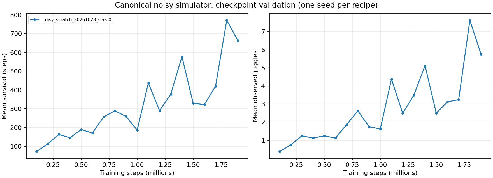

# Noisy juggling progress

Generated 2026-10-29T17:18:54.089202+00:00 from saved evaluations; no new rollouts.

Validation curves use repeatedly evaluated starts, not independent acceptance tests. Each point is an episode mean for one training seed. Check the CSV for episode counts, seeds and caps. Observed juggle counts use noisy camera positions and a direction-reversal filter. Contact timesteps are not distinct juggles.

[Raw validation table](juggling-noisy-progress.csv)

| Run | Latest validation step | Mean survival | Mean juggles | Genuine cap fraction |
|---|---:|---:|---:|---:|
| noisy_scratch_20261028_seed0 | 1,900,000 | 663.4 | 5.75 | 0.0% |
| noisy_iteration2_20261029_long | No saved validation | — | — | — |
| noisy_iteration2_20261029_low_explore | No saved validation | — | — | — |
| noisy_iteration2_20261029_large_low_explore | No saved validation | — | — | — |

Final-actor evaluations (separate starts):

- [noisy_scratch_20261028_seed0](../runs/td3/noisy_scratch_20261028_seed0/final_eval/results.json): 416.1 mean steps, 3.78 mean juggles, 0.0% cap completion; 32 starts from seed 200000, cap 10000.

The final-start benchmark is reused across recipes. A selected policy requires untouched seeds and longer horizons before acceptance. Bounded survival does not prove infinite survival.
