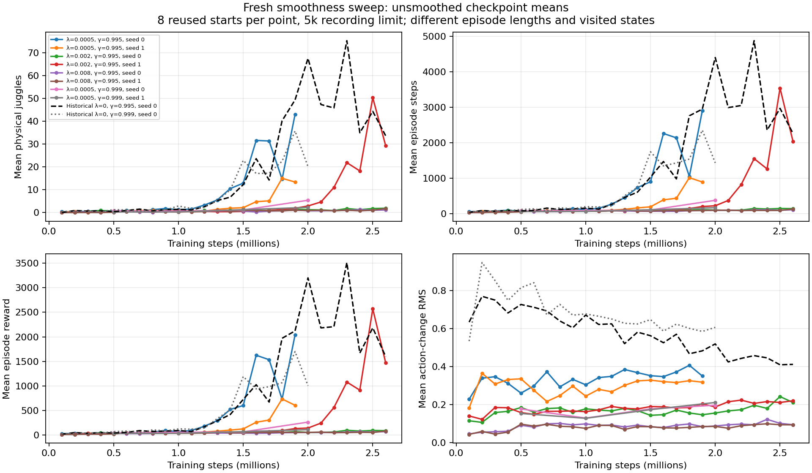
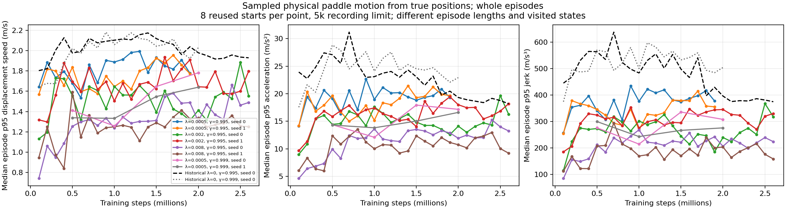

# Smoothness sweep progress

Generated 2026-11-02T01:05:35.948028+00:00 from saved artifacts; no new rollouts.

Original sweep: each coefficient (0.0005, 0.002, 0.008) has two fresh training seeds at gamma 0.995. An additional pair uses coefficient 0.0005 and gamma 0.999. Original checkpoints are every 100k steps; the additional pair saves every 500k for storage. All budgets are 6M. Simulator, sensing, control and DR remain unchanged. GPU ceiling: 16 total user allocations, including other jobs. Training seeds remain separate curves; starts within one run are not training-seed replications.

| Run | Slurm job | Saved runner status |
|---|---|---|
| noisy_history_smooth_0005_20261101_seed0 | 115858 | training |
| noisy_history_smooth_0005_20261101_seed1 | 115859 | training |
| noisy_history_smooth_002_20261101_seed0 | 115860 | training |
| noisy_history_smooth_002_20261101_seed1 | 115861 | training |
| noisy_history_smooth_008_20261101_seed0 | 115862 | training |
| noisy_history_smooth_008_20261101_seed1 | 115863 | training |
| noisy_history_smooth_0005_g0999_20261101_seed0 | 115866 | training |
| noisy_history_smooth_0005_g0999_20261101_seed1 | 115867 | training |

[Raw summary CSV](juggling-smooth-sweep.csv); [per-episode metrics](juggling-smooth-sweep-episodes.csv); [original launch provenance](juggling-smooth-sweep-launch.json); [longer-discount pair](juggling-smooth-longdiscount-launch.json); [matched longer-discount baseline](juggling-longdiscount-baseline-1m-launch.json).

Curves use saved 8-start 5k online-actor validation only, including historical unregularized seed-0 controls at gamma 0.995 and 0.999 on exactly the same seeds/horizon. Each control is shown only through the latest checkpoint in its own discount group. The CSV separately labels historical checkpoints, 32-start 20k online/target tests, and available archived unregularized 1M/3M comparisons at both discounts; do not mix protocols. Archived comparisons use the same 32 starts and are not plotted as 8-start curves. The 3M control launches are documented for [gamma .995](juggling-baseline-3m-comparison-launch.json) and [gamma .999](juggling-longdiscount-baseline-3m-launch.json); pending results are omitted. No interpolation supplies missing checkpoints. Latest points can be at different training budgets; compare the same x-coordinate, not each curve’s last point. Physical juggles use true simulated trajectories; reward is the environment episode sum. Recording limits truncate counts and durations.

Motion curves show the median across episodes of each episode’s p95 speed, acceleration or jerk, using finite differences of true paddle positions at the control rate. These are whole-episode distributions, with different lengths and visited states. They exclude the reset-position sample and do not capture all substep spikes, joint torques or UR5 controller behavior. Position-difference displacement speed is not cached body velocity; solver/workspace position corrections can contribute, so do not equate these estimates to the simulator velocity cap. They are not robot-safety thresholds. Per-episode diagnostics remain beside the original local results in `motion_metrics.json`. Action-change RMS remains a separate command diagnostic, not measured motor energy.

Curves are descriptive repeated-validation results. Independent longer tests and qualitative review follow candidate comparison; no binary acceptance gate is used.

Measurement clarification: [actual PID-target replay audit](../notes/scratch/experiments/2026-11-01_22-59_pid-target-replay-audit.md). Legacy `target_delta_rms_m` is a scaled displacement-change proxy, not direct PID-target telemetry.
