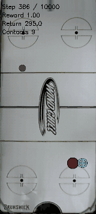

# Scratch history policy: matched and independent evaluations

Recorded 2026-10-29 15:15:24 -0500; evaluation timestamps are available in local artifacts. All evaluations below completed; three training runs remain active. No simulator changes or new training launches in this task.

The frozen 1.6M checkpoint of `runs/td3/noisy_history_20261029_seed0` substantially improves bounded survival, but does not solve reliable sustained juggling. Random actor, critics and history encoder; no warm start or privileged inputs. Config: `configs/td3/sustained/noisy_history_scratch.yaml`. Canonical noisy sensing/control and ±25% established DR retained. Model SHA256: `ac1858279d66766166fe74a65b31abd9da053dd15aeefca98e3bbf17952d7fbf`.

| Frozen policy | Seeds / horizon | Mean steps | Median | Physical juggles | Genuine caps |
|---|---|---:|---:|---:|---:|
| History 1.6M | 300000–300031 / 10000 | 3519.375 | 2103 | 51.3125 | 3/32 |
| Matched feed-forward low exploration 1.6M | Same | 580.21875 | 394 | 4.875 | 0/32 |
| Baseline validation-selected through 3M (2.2M checkpoint) | Same | 920.3125 | 634.5 | 8.78125 | 0/32 |
| History 1.6M, independent test | 500000–500031 / 20000 | 3606.6875 | 2010.5 | 51.65625 | 0/32 |

The shared benchmark has been reused across recipes. Paired history minus matched control mean difference: 2939.15625 steps; paired bootstrap 10,000 resamples, NumPy default_rng(42), 95% interval [1760.0390625, 4203.165625]; 25/32 wins. Single training seed; history architecture/trainer changes both actor and critic context, so this does not isolate critic memory. Physical juggle counts use read-only body trajectories and a heuristic, not exact distinct-contact instrumentation.

The checkpoint was fixed before the independent test; no earlier noisy-campaign result used those 32 seeds. All 32 independent starts failed before 20k (minimum495, maximum16509); two lasted beyond10k. These seeds are now consumed research tests and must not be described as untouched for future candidates. No matched independent control was run.

A deliberately favorable shared-benchmark cap seed300017 was extended to20k: failed at17049 steps (852.45 simulated seconds),235 physical juggles. All eight saved trajectory arrays exactly match the original first10000 steps. This is a selected demonstration, not aggregate evidence. Baseline selected seed10004 failed at5366; its eight arrays matched the original5000-step prefix.

## Published figures and data

Final20seconds of selected seed300017, including failure after17049steps. Generated2026-10-29 from the saved evaluation; compacted160×357,10fps,64colors, duration preserved.

A different episode: first benchmark seed300000 failed at785steps. This clip illustrates a failure alongside the favorable selected example.

[Per-start matched data](../../../docs/juggling-history-benchmark.csv), [independent data](../../../docs/juggling-history-independent.csv), [candidate provenance](../../../docs/juggling-candidate.json), [learning curves](../../../docs/juggling-noisy-progress.md). Checkpoint files and raw rollouts remain local and are ignored by Git.

## Raw evidence and reproduction

All roots below are under `runs/td3/`:
- `noisy_history_20261029_seed0/milestone_1m6_benchmark/results.json`
- `noisy_history_20261029_seed0/independent_1m6_20k_eval/results.json`
- `noisy_history_20261029_seed0/milestone_1m6_selected_stretch/results.json`
- `noisy_iteration2_20261029_low_explore/matched_history_1m6_benchmark/results.json`
- `noisy_iteration2_20261029_long/through3m_selected_benchmark/results.json`
- `noisy_iteration2_20261029_long/through3m_selected_stretch/results.json`

Use `python -m scripts.td3.juggle_survival --help` for frozen evaluation arguments. Match the checkpoint above, scenario-set training, recorded seed range, episode count32 and horizon; choose a new output directory. The saved args/config and rma_meta are required beside model.pth. Never use this checkpoint to initialize new training.

The progress report now discovers additional saved benchmark phases while excluding selected stretch/diagnostic phases. Regenerated from saved data, without new rollouts. This task validates artifact links, logbook anchors/TOCs and whitespace; earlier implementation tests are historical, not rerun here.
