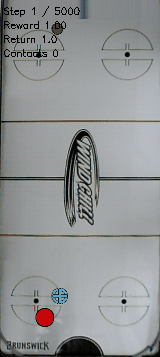
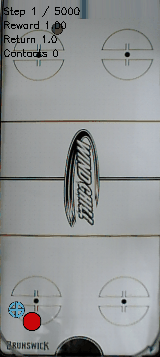

# Matched early-checkpoint GIFs show both weak-penalty seeds and the baseline

- **Date**: 2026-11-02 00:38 UTC publication/review; source clips were generated earlier by checkpoint validation, not by this task.
- **Status**: artifact review/publication done; eight scratch learners and independent long-reference test in-flight.
- **Run dirs**: saved `train/checkpoint_1500000/survival_eval/` under the three source runs in [provenance](../../../docs/assets/juggling/weak-1m5-gif-provenance-20261102.json).
- **Configs**: [weak seed0](../../../configs/td3/sustained/noisy_history_smooth_0005_seed0.yaml), [weak seed1](../../../configs/td3/sustained/noisy_history_smooth_0005_seed1.yaml).

## Comparison

Published the first saved episode (reset seed10000) of the same eight-start5k checkpoint-validation protocol at1.5M training steps: gamma .995 historical baseline versus fresh coefficient .0005 policies with training seeds0/1. Each GIF is the existing `training_start.gif`, copied byte-for-byte. First200 frames/10seconds are shown where available; the weaker seed1 episode ends after182frames/9.1seconds. No new simulation or policy inference, no video retiming or synthetic frames. One case is qualitative evidence, not the distribution across starts or training seeds.

| Variant | Clip steps | Physical/sensed juggles in clip | Full episode steps | Full episode physical/sensed juggles |
|---|---:|---:|---:|---:|
| baseline | 200 | 3/4 | 377 | 3/7 |
| weak-seed0 | 200 | 2/1 | 512 | 7/5 |
| weak-seed1 | 182 | 1/2 | 182 | 1/2 |

Counts in clips are recomputed from the saved true/observed trajectory prefixes with the existing juggle counter. The rendered contact overlay is a different counter. Baseline and seed0 clips stop before their episodes end; all three full episodes eventually lose the puck. This is an early checkpoint, not evidence of infinite juggling or protective-stop safety. For wider quantitative context see [fixed1M results](2026-11-01_23-54_first-1m-smoothness-comparison.md) and [equal-prefix physical motion at1.4M](2026-11-02_00-33_paired-prefix-motion.md).

## baseline

First 200 control steps, 10.0s at20fps; 3 physical/4 sensed juggles in this clip. Published2026-11-02; source/hash and full-episode context are in provenance.

## weak-seed0

First 200 control steps, 10.0s at20fps; 2 physical/1 sensed juggles in this clip. Published2026-11-02; source/hash and full-episode context are in provenance.

## weak-seed1

First 182 control steps, 9.1s at20fps; 1 physical/2 sensed juggles in this clip. Published2026-11-02; source/hash and full-episode context are in provenance.

## Verification and reproduction

Verified all three published GIFs are byte-identical to their source files, width160, matching frame counts and50ms frame delays. Inspected first/middle/last frames side-by-side; published first episodes include both seeds rather than selecting a favorable trajectory. The source results retain full episode outcomes. Source JSON and GIF SHA256 hashes, frame durations and exact paths are stored in [provenance](../../../docs/assets/juggling/weak-1m5-gif-provenance-20261102.json). No new figure beyond these preexisting GIFs, no implementation change or new test run for publication. Relative links/images, logbook anchors/TOCs and whitespace are checked before push.

To reproduce a published clip, copy its `source` path from provenance to its `published` path; `sha256sum` must match `source_sha256`. No renderer or model checkpoint is needed for copying the existing clip. Prefix counts use `scripts.td3.helper.juggle_counter.count_juggles_from_arrays` on the first `frames` rows of `true_paddle_xy`/`true_puck_xy`, or `next_observation[:,12:14]`/`[:,27:29]` with `[:,29]` for sensing, from the recorded episode NPZ.

## Next

Continue all existing6M budgets and scheduled3M/6M fixed evaluations. These GIFs make current behavior inspectable; they do not justify promoting an early checkpoint or changing simulator/control settings. No robot is connected.
