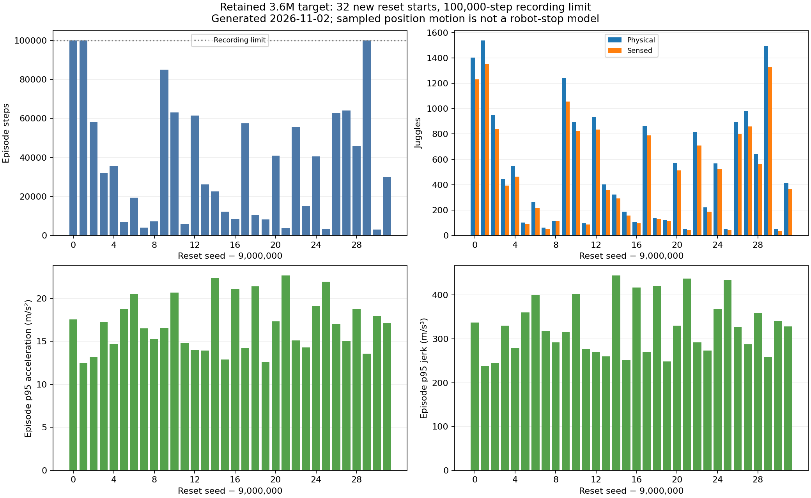
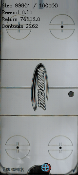

# Long independent reference episodes average 546 physical juggles but still end in puck loss

- **Date**: 2026-11-02 01:16 UTC collection/writeup. Original CPU job submitted2026-11-01 22:52:35UTC, reports completion2026-11-02 01:10:37UTC; continuation reports completion01:10:42UTC.
- **Status**: done; active scratch smoothness training continues separately.
- **Run dirs**: `runs/td3/juggle_long_reference_20261101`, `runs/td3/juggle_long_reference_20261101_completion`.
- **Configs**: frozen `frozen_target_3m6/{args.yaml,config.yaml,rma_meta.json}` under the original run root, hashed in the [continuation manifest](../../../docs/juggling-long-reference-completion-queue.json).

## Setup and completion

Fixed previously selected3.6M target actor from the historical scratch history seed0 run; model SHA256 `c8a1df78ade41cfbe6845a84f4b21480f512973be7a89f0baf66daf5d452b31b`. Tested32 new reset starts9000000–9000031 under the unchanged original sensing/control/simulator and established full DR, with100000-step recording limits. No actor selection on this cohort, checkpoint warm start or new learning. It is a new reset cohort for one fixed policy, not independent training-seed replication. Future reuse must be labeled accordingly.

Original CPU-only job115864 finished COMPLETED/exit0 in2h18m01s, within its original4h limit. The afterany continuation115869 finished COMPLETED/exit0 in5s, validated/reused all32 complete original trajectories and ran **zero new cases**. The previously denied time extension was unnecessary in the end; original completed evidence was preserved. The standard evaluator JSON, independent trajectory-derived outcomes, actor/trajectory hashes and sample counts agree. Follow-ups to [launch](2026-11-01_22-52_long-juggle-reference.md) and [continuation](2026-11-01_23-32_long-reference-continuation.md); their running/queued descriptions remain historical.

## Raw outcomes

| Metric | Mean | Minimum | p25 | Median | p75 | Maximum recorded |
|---|---:|---:|---:|---:|---:|---:|
| Episode steps |37131.03125|3036|8339.5|30926.5|58873.25|100000|
| Physical juggles |546.25|48|118|429|896|1539|
| Sensed juggles |482.9375|37|113.5|380|803.25|1350|
| Episode reward |28335.3125|2306|6223|23727|44688.25|76948|

Across32 episodes this records1188193 control steps and17480 physical juggles. Twenty-nine episodes end with the recorded reason `puck_passed_paddle`; the three other records stop at100000steps with1403,1539 and1492 physical juggles (seeds9000000/9000001/9000029). Their true later durations/counts are unknown. The recording boundary is descriptive censoring, not an acceptance gate. The shortest failure already has48 juggles, but a wide spread and29 recorded puck losses show this fixed policy does not juggle indefinitely in these tests. No binary success fraction is used.

Mean episode action-change RMS is0.3552117534. Median across episodes of each episode's sampled p95 motion: speed1.860357534m/s, acceleration16.783682253m/s², jerk321.712989243m/s³. These use true paddle-position finite differences at20Hz without prepending the reset sample, with unequal episode lengths and visited states. Solver/workspace position corrections can contribute; they do not directly measure motor energy, joint loads, all substep spikes or UR5 protective-stop likelihood. These whole-long-episode values cannot be treated as an equal-duration comparison against short early checkpoints.



Figure generated2026-11-02 from the completed standard result JSON and independently verified saved trajectories. Each bar is a reset seed offset from9000000. All32 episodes are shown; the dotted line is the100000-step recording limit. Bottom panels show per-episode position-derived p95 acceleration/jerk. The single policy/seed and finite horizon limit inference.

[Raw32 episode CSV](../../../docs/assets/juggling/long-reference-100k-20261102.csv); [summary, quantiles and source/code/model hashes](../../../docs/assets/juggling/long-reference-100k-20261102.json). The CSV preserves full seed numbers, recorded end reasons, termination flags, motion, trajectory paths and SHA256 hashes. Large original NPZs and the frozen model remain in ignored local run directories identified by provenance.

## Existing long-duration performance GIF



Byte-identical copy of the existing evaluator GIF, published2026-11-02. Shows only steps99801–100000 of the first predeclared reset seed9000000,200frames/10seconds at20fps, width160. That full episode records1403 physical/1230 sensed juggles across100000steps; those totals do not describe just the displayed window. No selection by a high juggle count and no new rollout/rendering/retiming. The renderer's contact overlay is distinct from the physical juggle counter. [GIF source/hash/timing/full-episode provenance](../../../docs/assets/juggling/long-reference-100k-gif-provenance-20261102.json). Inspected first/middle/last frames, including the100000-step overlay. A short clip from one finite episode is not reliability or hardware-safety proof.

## Verification and reproduction

Both authoritative Slurm terminal states/exit codes checked before collecting. All32 primary outcomes match the continuation's NPZ-derived physical/sensed counts and durations; all trajectory/model/source hashes and scalar summary/quantile/motion values checked. Added a read-only [publisher](../../../scripts/analysis/plot_juggle_long_reference.py) which rejects mismatched cohort, outcomes, rewards, hashes or control rate. It ran on all32 actual cases; no training or fresh rollout for publication. Code compilation, rendered figure/GIF review, relative links/images, unique ordered logbook anchors/TOCs and whitespace are checked before push. No new implementation tests for this artifact publisher; trajectory/kinematic helper tests were already recorded with their implementations.

```sh
.venv/bin/python -m scripts.analysis.plot_juggle_long_reference --results runs/td3/juggle_long_reference_20261101/independent_100k_eval/results.json --verified-trajectories runs/td3/juggle_long_reference_20261101_completion/raw_results.json --out-prefix /tmp/long-reference-100k --policy-label 'Retained 3.6M target'
```

Original inference command and worker/batch sources are in the [original launch manifest](../../../docs/juggling-long-reference-launch.json). Rebuild from saved results instead of rerunning the2h18m experiment merely for figures.

## Next

Keep the eight from-scratch smoothness learners at their existing full6M budgets and compare the scheduled frozen3M/6M online/target tests against [matched historical3M controls](2026-11-02_01-06_completed-3m-controls.md). This long reference quantifies room for reliability improvement and does not establish a smooth hardware-ready policy. Later candidate long-duration tests must identify whether starts are reused for paired comparison or fresh for independent evaluation. No simulator/sensing/control/DR change, robot operation or claim of infinite reliability. Total user GPUs remain11 including three preexisting jobs, below16.
