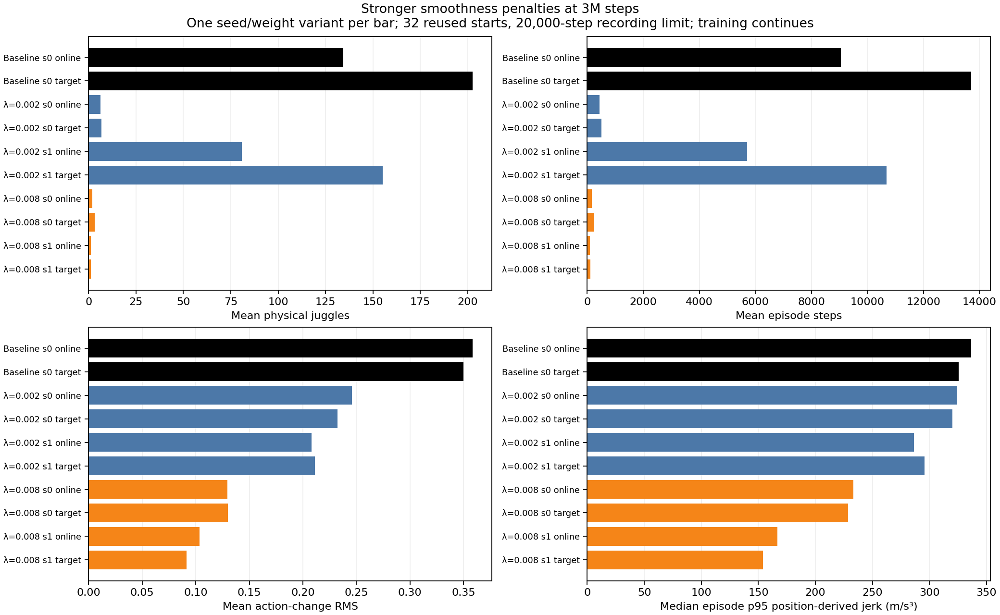

# Moderate regularization retains some 3M juggling in one seed, with a modest physical-motion reduction

- **Date**: 2026-11-02 01:44 UTC collection/writeup. These are completed frozen3M milestone evaluations of still-running6M training jobs; the heading is not a run start/end time.
- **Status**: four-trial3M subset comparisons done; all eight scratch learners still in-flight.
- **Run dirs**: `runs/td3/noisy_history_smooth_{002,008}_20261101_seed{0,1}`, frozen3M online/target bundles and `paired_3000000_{online,target}_20k_eval` outputs; `runs/td3/juggle_history_baseline_3m_20261102` for the control.
- **Configs**: four original-discount configs in the [launch provenance](../../../docs/juggling-smooth-sweep-launch.json); unchanged simulator/sensing/control/DR and actor/critic/encoder initialization from scratch.

## Scope and protocol

Compare coefficients0.002/0.008, training seeds0/1, both online/target actors at exactly3M steps to the historical unregularized gamma .995 seed0 control, matching its weight role. Every row uses32 reused selection starts700000–700031 and20000-step recording limits. These four faster trials reached3M first; the two original-discount weak0.0005 trials and two longer-discount weak0.0005 trials are excluded from this dated subset. It is not the full sweep or final6M finding. All jobs remain live, and completed milestone runners now wait for6M with no recorded errors.

There is one historical baseline training seed and two regularized seeds. Online/target actors share a learner and are not independent replications. Reused starts are selection evidence; this table is not an independent long-duration generalization test. Environment reward remains unchanged and excludes the actor-only regularization term. Action-change RMS is not motor energy.

## Completed 3M outcomes

| Variant | Weights | Physical juggles | Sensed juggles | Steps | Reward | Action-change RMS | Whole-episode median p95 jerk (m/s³) |
|---|---|---:|---:|---:|---:|---:|---:|
| Baseline seed0 | online | 134.25000 | 118.37500 | 9049.28125 | 6775.84375 | 0.35854 | 336.60024 |
| Baseline seed0 | target | 202.62500 | 178.81250 | 13708.56250 | 10279.34375 | 0.35004 | 325.45011 |
| λ=0.002 seed0 | online | 6.21875 | 5.28125 | 446.37500 | 295.84375 | 0.24588 | 324.49329 |
| λ=0.002 seed0 | target | 6.75000 | 6.50000 | 501.87500 | 352.15625 | 0.23226 | 320.26769 |
| λ=0.002 seed1 | online | 80.87500 | 73.28125 | 5707.53125 | 4193.62500 | 0.20791 | 286.52240 |
| λ=0.002 seed1 | target | 155.09375 | 137.31250 | 10690.31250 | 7913.00000 | 0.21127 | 295.56543 |
| λ=0.008 seed0 | online | 1.90625 | 1.81250 | 165.84375 | 110.46875 | 0.12953 | 233.34893 |
| λ=0.008 seed0 | target | 3.12500 | 2.71875 | 239.00000 | 160.65625 | 0.13008 | 228.76045 |
| λ=0.008 seed1 | online | 1.09375 | 0.90625 | 99.40625 | 58.18750 | 0.10354 | 166.77950 |
| λ=0.008 seed1 | target | 1.12500 | 1.00000 | 111.40625 | 69.75000 | 0.09136 | 154.10868 |


Juggles, durations, rewards and command changes are episode means. Whole-episode jerk is the median of per-episode p95 true-position third differences at20Hz, without prepending the reset sample. Different episode lengths and visited states confound whole-episode motion. No binary acceptance gate or protective-stop threshold is used.



Figure generated2026-11-02 from ten completed variant summaries/320 raw episode records. It shows physical juggles, steps, command changes and whole-episode position-derived jerk separately for each seed/weight. [Fixed summaries](../../../docs/assets/juggling/smooth-first-3m-summary-20261102.csv), [raw320 episodes](../../../docs/assets/juggling/smooth-first-3m-episodes-20261102.csv), [all frozen bundle/config/source hashes](../../../docs/assets/juggling/smooth-first-3m-provenance-20261102.json). The [moving reward/training/motion report](../../../docs/juggling-smooth-sweep.md) is refreshed separately and labels8-start5k validation versus32-start20k tests.

## Equal-prefix physical-motion audit

For each of the eight regularized actors, compare its trajectory with the same-role baseline actor on each reset seed. Each member uses exactly the first min(250,baseline steps,candidate steps) true paddle positions. Compute per-episode p95 speed/acceleration/jerk and the candidate/baseline ratio, then take the median across32 pairs. Each comparison has32 valid derivative ratios;256 comparisons total. These are medians of ratios, not ratios of the displayed aggregate medians. Longer histories and policy inputs are untouched; analysis reads only saved arrays.

| Coefficient | Training seed | Weights | Paired prefix range (steps) | Median paired speed ratio | Acceleration ratio | Jerk ratio |
|---|---|---|---|---:|---:|---:|
| 0.002 | 0 | online | 93–250 | 0.799644 | 0.937256 | 0.890105 |
| 0.002 | 0 | target | 50–250 | 0.831008 | 0.936720 | 0.913387 |
| 0.002 | 1 | online | 250–250 | 0.823698 | 0.921992 | 0.866311 |
| 0.002 | 1 | target | 50–250 | 0.845204 | 0.954291 | 0.885122 |
| 0.008 | 0 | online | 22–250 | 0.706413 | 0.703611 | 0.610691 |
| 0.008 | 0 | target | 34–250 | 0.730300 | 0.718071 | 0.609771 |
| 0.008 | 1 | online | 25–191 | 0.632480 | 0.534267 | 0.410338 |
| 0.008 | 1 | target | 72–187 | 0.633863 | 0.547152 | 0.448616 |


[Paired summary CSV](../../../docs/assets/juggling/smooth-first-3m-paired-motion-20261102.csv) links all eight detailed per-pair JSON records, including trajectory/source/code hashes and raw baseline/candidate distributions. Prefix durations differ across seeds and across policy comparisons; even equal-duration pairs visit different states. Ratios are descriptive rather than matched-state causal effects. Position differences can include solver/workspace corrections and omit substep spikes. None measures UR5 joint loads, command tracking or stop risk.

The most capable regularized actor in this subset is coefficient0.002 seed1 target:155.09375 physical juggles/10690.3125 steps versus baseline202.625/13708.5625. Its mean action-change RMS .211272 versus .350038 is substantially lower, but paired p95 acceleration/jerk ratios .954291/.885122 show only about5%/11% reductions in those physical diagnostics. The larger command-proxy reduction must not be described as an equally large physical-motion reduction. Its other training seed still averages fewer than7 juggles. Coefficient0.008 reduces paired sampled jerk more strongly (ratios .410338–.610691), while averaging only1.09375–3.125 juggles. There is no consistently high-performance smooth policy established here.

## Verification and reproduction

All eight frozen model hashes match their respective original3M online/target checkpoint files. The standard outcome records,32-start20k protocols, summary means/whole-episode motion medians, all320 records,256 equal-prefix pairs, output/source/config/model/trajectory hashes and live protected-source manifests are checked. Rendered fixed figure, relative links/images, ordered unique logbook anchors/TOCs and whitespace are validated before push. No implementation changes, extra rollout or new implementation tests for this saved-data analysis; the existing paired/kinematic helpers retain their previously recorded tests.

```sh
.venv/bin/python -m scripts.analysis.juggle_smooth_sweep
.venv/bin/python -m scripts.analysis.plot_juggle_fixed_comparison --summary docs/assets/juggling/smooth-first-3m-summary-20261102.csv --out /tmp/first-3m.png --title 'Stronger smoothness penalties at 3M steps'
.venv/bin/python -m scripts.analysis.juggle_paired_motion --baseline runs/td3/juggle_history_baseline_3m_20261102/paired_target_20k_eval/results.json --candidate runs/td3/noisy_history_smooth_002_20261101_seed1/paired_3000000_target_20k_eval/results.json --out /tmp/paired-002-seed1-target.json
```

## Next

Continue all eight full6M budgets without early stopping; collect the remaining3M actors when available. Preserve these frozen candidates for later comparison, with broader/longer testing needed before promoting one. The retained historical reference's [complete100k test](2026-11-02_01-16_long-reference-results.md) establishes a separate long-horizon reliability gap, not a same-policy3M comparison. New policies remain trained from scratch; no simulator/sensing/control/DR changes, robot operation or infinite-juggling claim. Total user GPUs remain11 including three preexisting jobs, below16.
