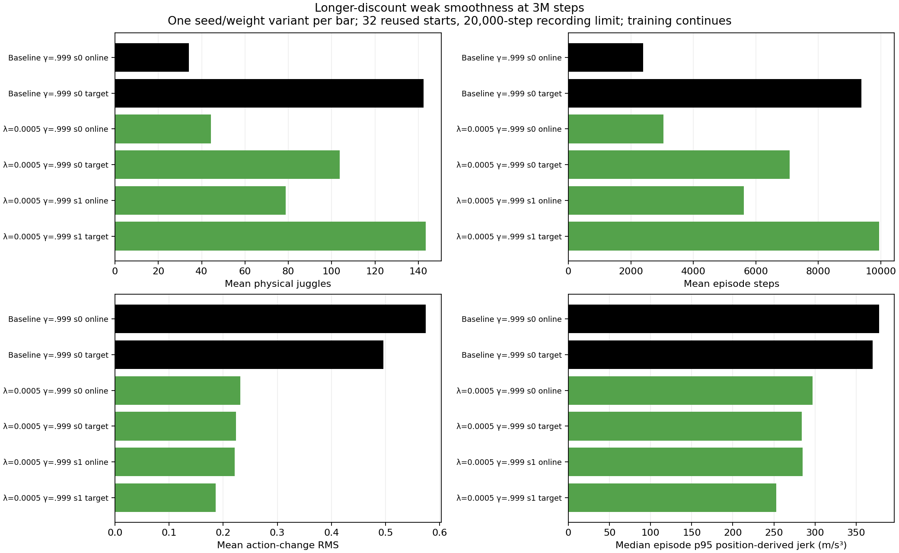

# One longer-discount target matches baseline juggling with lower sampled jerk at 3M

- **Date**: 2026-11-02 02:06 UTC collection/writeup; completed3M milestone tests of ongoing6M scratch runs, not a run start/end timestamp.
- **Status**: both longer-discount3M comparisons done; all eight learners and the separate paired100k candidate test remain in-flight.
- **Run dirs**: `runs/td3/noisy_history_smooth_0005_g0999_20261101_seed{0,1}`, `paired_3000000_{online,target}_20k_eval`; historical control `runs/td3/juggle_history_longdiscount_baseline_3m_20261102`.
- **Configs**: [seed0](../../../configs/td3/sustained/noisy_history_smooth_0005_g0999_seed0.yaml), [seed1](../../../configs/td3/sustained/noisy_history_smooth_0005_g0999_seed1.yaml); [launch/config/source provenance](../../../docs/juggling-smooth-longdiscount-launch.json).

## Protocol and scope

Coefficient0.0005/gamma .999, two from-scratch training seeds, frozen online/target actors at exactly3M steps; same-discount historical unregularized seed0 control. All six rows use32 reused selection starts700000–700031,20000-step recording limit. Both milestone runners completed both roles without recorded errors and now wait for6M; training continued throughout. This subset excludes the other six active trials; [four stronger original-discount trials](2026-11-02_01-44_first-3m-smoothness-comparison.md) have their own fixed comparison, while the original-discount weak pair remains separate. Simulator/sensing/control/DR stay unchanged. Historical seed0 is one baseline learner; online and target weights share training and are not independent replications.

## Completed outcomes

| Variant | Weights | Physical juggles | Sensed juggles | Steps | Reward | Action-change RMS | Whole-episode median p95 jerk (m/s³) |
|---|---|---:|---:|---:|---:|---:|---:|
| Baseline seed0 | online | 34.12500 | 30.40625 | 2391.53125 | 1683.28125 | 0.57400 | 377.72600 |
| Baseline seed0 | target | 142.37500 | 129.50000 | 9376.62500 | 6915.43750 | 0.49599 | 370.09000 |
| λ=.0005 seed0 | online | 44.18750 | 38.96875 | 3046.18750 | 2111.46875 | 0.23166 | 297.03684 |
| λ=.0005 seed0 | target | 103.78125 | 90.37500 | 7084.28125 | 5111.65625 | 0.22398 | 283.89662 |
| λ=.0005 seed1 | online | 78.71875 | 69.46875 | 5619.12500 | 4141.81250 | 0.22136 | 285.14898 |
| λ=.0005 seed1 | target | 143.34375 | 126.21875 | 9942.09375 | 7259.43750 | 0.18594 | 252.89179 |


Juggles, durations, environment rewards and command changes are episode means. Environment reward excludes the actor-only regularization term. Whole-episode motion is the median of per-episode p95 true-position finite differences at20Hz, excluding the reset sample; different lengths and visited states confound interpretation. Action-change RMS is a command proxy, not motor energy.



Figure generated2026-11-02 from six complete variant summaries/192 episode records; separate bars preserve each seed and actor role. [Fixed summaries](../../../docs/assets/juggling/smooth-longdiscount-3m-summary-20261102.csv), [raw192 episodes](../../../docs/assets/juggling/smooth-longdiscount-3m-episodes-20261102.csv), [frozen bundle/config/source hashes](../../../docs/assets/juggling/smooth-longdiscount-3m-provenance-20261102.json). The [moving training/reward/motion curves](../../../docs/juggling-smooth-sweep.md) keep8-start5k validation separate from32-start20k comparisons. No binary acceptance gate is used.

## Equal-prefix physical-motion diagnostics

For each of the four regularized actors, each reset seed uses exactly the first min(250,baseline steps,candidate steps) true paddle positions in both actors, comparing the same online/target role. Compute per-episode p95 speed/acceleration/jerk, candidate/baseline ratios, then medians across32 pairs. All128 paired initial noisy observations match exactly; effective scenario configs also match. Each row has32 valid ratios; the128 windows are descriptive repeated comparisons, not independent training replications.

| Training seed | Weights | Paired prefix range (steps) | Speed ratio | Acceleration ratio | Jerk ratio |
|---|---|---|---:|---:|---:|
| 0 | online | 39–250 | 0.889851 | 0.845252 | 0.700311 |
| 0 | target | 81–250 | 0.873950 | 0.850321 | 0.757173 |
| 1 | online | 24–250 | 0.910496 | 0.907160 | 0.758353 |
| 1 | target | 125–250 | 0.875949 | 0.859820 | 0.749614 |


[Paired summary CSV and detailed JSON links](../../../docs/assets/juggling/smooth-longdiscount-3m-paired-motion-20261102.csv) preserve per-pair baseline/candidate distributions, exact windows and trajectory/source/code hashes. The displayed values are medians of paired ratios, not ratios of aggregate medians. Prefix lengths differ across seeds/variants, and equal durations do not enforce equal visited states. Position-derived motion includes potential solver/workspace corrections and omits some substep spikes; these are not UR5 joint-load or stop-risk predictions.

Both regularized online actors exceed the single historical online control's juggling means. The seed1 target gives143.34375 physical juggles/9942.09375 steps versus baseline142.375/9376.625, with paired p95 jerk ratio .749614 (about25% lower sampled jerk) and acceleration ratio .859820. Its whole-episode median p95 jerk252.891786 versus370.090001 uses a different window/aggregation and must not be confused with that paired ratio. Mean command-change RMS .185937 versus .495988 falls more than either physical metric. Seed0 target reaches103.78125 juggles/7084.28125 steps, below the historical target, despite lower jerk. A favorable seed1 tradeoff is not a consistent replication or statistical superiority claim. The current outcome does not establish infinite reliability or robot safety.

## Verification and reproduction

Checked all four frozen actors against their original3M checkpoint roles, source/config/bundle/trajectory hashes, six full32-start20k protocols,192 raw records, summary means/whole-episode motion medians,128 paired ratios and exact initial-observation equality. Code/data helper behavior remains unchanged; no extra rollout or implementation test for publication. Fixed figure review, relative links/images, unique ordered logbook anchors/TOCs and whitespace are checked before push. Existing paired/kinematic tests are recorded in their implementation notes.

```sh
.venv/bin/python -m scripts.analysis.juggle_smooth_sweep
.venv/bin/python -m scripts.analysis.plot_juggle_fixed_comparison --summary docs/assets/juggling/smooth-longdiscount-3m-summary-20261102.csv --out /tmp/longdiscount-3m.png --title 'Longer-discount weak smoothness at 3M steps'
.venv/bin/python -m scripts.analysis.juggle_paired_motion --baseline runs/td3/juggle_history_longdiscount_baseline_3m_20261102/paired_target_20k_eval/results.json --candidate runs/td3/noisy_history_smooth_0005_g0999_20261101_seed1/paired_3000000_target_20k_eval/results.json --out /tmp/paired-longdiscount-seed1-target.json
```

## Next

Continue all eight full6M budgets and their scheduled frozen tests. Preserve these3M target candidates for broader/longer comparison without treating repeated validation as independent selection evidence. The separate [0.002 seed1 target paired100k test](2026-11-02_01-48_regularized-target-long-test.md), job115892, remains live; its incomplete episodes are not averaged into this report. No checkpoint warm start, simulator/control/DR change or real-robot operation; eleven total user GPUs including three preexisting jobs remain below16.
