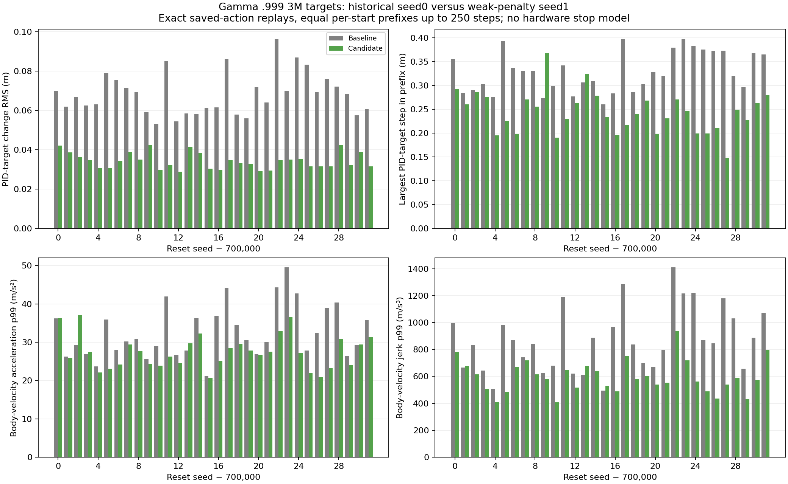

# Typical filtered target changes fall substantially, while large command jumps persist

- **Date**: 2026-11-02 02:30 UTC writeup. Replays completed before collection; exact wall-clock start/end timestamps were not separately captured.
- **Status**: done; eight scratch learners continue. This diagnostic concerns the gamma .999 weak0.0005 seed1 target, distinct from the gamma .995 coefficient0.002 long-test candidate.
- **Run dirs**: frozen3M target evaluations `runs/td3/juggle_history_longdiscount_baseline_3m_20261102/paired_target_20k_eval` and `runs/td3/noisy_history_smooth_0005_g0999_20261101_seed1/paired_3000000_target_20k_eval`.
- **Related**: [completed3M outcomes](2026-11-02_02-06_long-discount-3m-comparison.md), [earlier PID-target/proxy correction](2026-11-01_22-59_pid-target-replay-audit.md).

## Method and verification

Replayed only saved actions under the original effective simulator configuration and reset seeds. The actor was not run or trained. Every before/after observation, reward, termination/truncation flag and true paddle/puck position matched its saved array exactly. Both policies replay32 episodes and7875 steps,15750 verified steps total. Each reset seed uses exactly the first min(250,baseline length,candidate length) actions;31 pairs use250steps and one uses125. Initial noisy observations must also match. All sensing, noise, occlusion, history sampling, delay, PID, action smoothing, geometry, contacts, limits and DR remain unchanged; no sensor-sampling calls are added by diagnostics.

Extended the existing [replay helper](../../../scripts/analysis/juggle_control_replay.py) with optional paired-input guards/cropping and p99/maximum fields. Existing unpaired use remains supported; prior records are preserved as historical output. Reads the cached final filtered PID target after each control step and cached Box2D body velocity. Target changes exclude the reset-to-first-target edge. Velocity acceleration/jerk use first/second differences at20Hz; these differ from the position-derived diagnostics used in the sweep. A cached final target is not the complete substep target trace or a hardware handoff measurement.

## Results

| Diagnostic | Unit | Baseline | Candidate | Candidate/baseline |
|---|---|---:|---:|---:|
| Actual PID-target change RMS (mean episode RMS) | m | 0.068384 | 0.034358 | 0.502429 |
| PID-target step p99 (median episode p99) | m | 0.272471 | 0.173211 | 0.635703 |
| Largest PID-target step across prefixes | m | 0.397894 | 0.367065 | 0.922520 |
| Largest cached body speed | m/s | 2.000000 | 2.000000 | 1.000000 |
| Cached-velocity acceleration p95 (median) | m/s² | 22.586022 | 17.566375 | 0.777754 |
| Cached-velocity acceleration p99 (median) | m/s² | 30.342375 | 27.240826 | 0.897782 |
| Largest cached-velocity acceleration | m/s² | 58.777786 | 50.302085 | 0.855801 |
| Cached-velocity jerk p95 (median) | m/s³ | 551.257912 | 351.710592 | 0.638015 |
| Cached-velocity jerk p99 (median) | m/s³ | 842.887637 | 579.487300 | 0.687502 |
| Largest cached-velocity jerk | m/s³ | 1691.641787 | 1063.852317 | 0.628887 |


Mean RMS averages episode-level RMS values, not all pooled edges. Median p99/p95 aggregates episode percentiles; largest values are maxima across all recorded prefixes. Both policies use identical per-reset exposure but visit different states. Neither average nor tail reductions predict UR5 joint loads or protective stops.



Figure generated2026-11-02 from64 exact saved-action replays. Each pair of bars is one shared reset seed: actual target RMS and largest target step, plus cached-body-velocity acceleration/jerk p99. [Raw64 replay rows](../../../docs/assets/juggling/longdiscount-3m-pid-replay-comparison-20261102.csv), [scalar summaries](../../../docs/assets/juggling/longdiscount-3m-pid-replay-comparison-20261102-summary.csv), [source/publisher hashes](../../../docs/assets/juggling/longdiscount-3m-pid-replay-comparison-20261102.json). Full [baseline](../../../docs/assets/juggling/longdiscount-3m-baseline-paired-pid-replay-20261102.json) and [candidate](../../../docs/assets/juggling/longdiscount-3m-candidate-paired-pid-replay-20261102.json) records retain primary/paired source hashes, trajectory hashes, replay-source hash, exactness and explicit windows.

The mean filtered-target change RMS approximately halves (.068384m to .034358m), but the largest sampled target jump only falls from .397894m to .367065m. Both still reach the unchanged roughly2m/s cached body-speed cap. Cached-velocity jerk p99 and maxima fall, yet remain sizeable numerical values without a hardware safety model. Smooth typical behavior must not be described as elimination of large jumps. The initial target handoff, joint-space behavior and substep extrema remain unverified.

Selection performance remains the [same saved3M result](2026-11-02_02-06_long-discount-3m-comparison.md):143.34375 physical juggles/9942.09375 steps versus same-discount baseline142.375/9376.625 on32 reused20k starts. The replay does not add an independent policy-quality cohort. One historical baseline seed and a selected candidate training seed limit inference. No binary safety/acceptance gate.

## Reproduction and checks

```sh
CUDA_VISIBLE_DEVICES='' .venv/bin/python -m scripts.analysis.juggle_control_replay --results runs/td3/juggle_history_longdiscount_baseline_3m_20261102/paired_target_20k_eval/results.json --paired-results runs/td3/noisy_history_smooth_0005_g0999_20261101_seed1/paired_3000000_target_20k_eval/results.json --out /tmp/baseline-replay.json --prefix-steps 250
# Repeat with --results and --paired-results swapped for /tmp/candidate-replay.json.
.venv/bin/python -m scripts.analysis.plot_juggle_control_replay --baseline /tmp/baseline-replay.json --candidate /tmp/candidate-replay.json --out-prefix /tmp/control-replay-comparison --title 'Gamma .999 3M target comparison'
```

Added a read-only [publisher](../../../scripts/analysis/plot_juggle_control_replay.py) validating reciprocal paired sources, exact replay flags and equal per-case windows before aggregation. Verified all64 full-array replays,7875steps per policy, summary means/medians/extrema, source/code/trajectory hashes, CSV counts, rendered figure, relative links/images, ordered unique logbook anchors/TOCs and whitespace. These actual saved-record replays are functional implementation verification; no extra unit tests mirror the publisher. No active trainer/evaluator/simulator source changed; current live source guards match.

## Next

Continue the eight full6M runs and later broader/longer evaluations. Improvements in typical commands and jerk are useful evidence, but large target jumps and the separate reliability results still prevent a robot-readiness conclusion. No real robot is connected and no new pretrained/warm-start policy was introduced.
