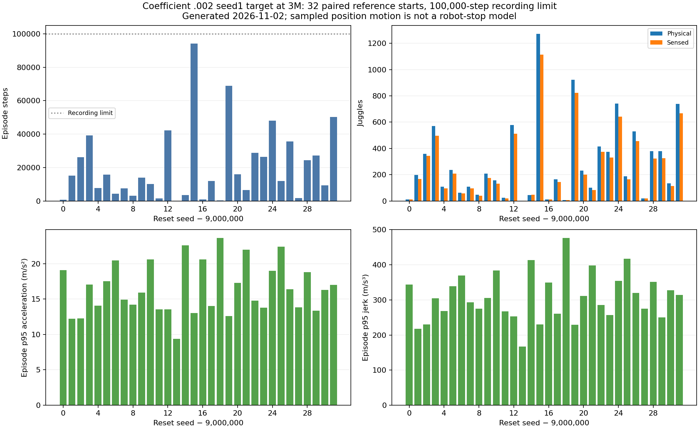
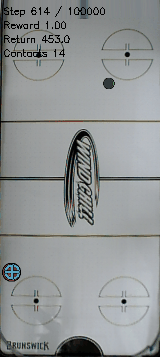

# The early coefficient0.002 target loses long-duration reliability with little paired jerk reduction

- **Date**: 2026-11-02 02:37 UTC collection/writeup; CPU job115892 submitted2026-11-02 01:48:47UTC, worker completed02:12:34UTC, Slurm elapsed23m47s.
- **Status**: fixed candidate long test done; eight scratch learners continue toward6M.
- **Run dirs**: `runs/td3/juggle_smooth_002_seed1_target3m_long_20261102/paired_reference_100k_eval`, private `frozen_target_3m` bundle.
- **Configs**: frozen gamma .995/coefficient0.002 seed1 target at3M; model/config/source hashes and original command in [launch/completion provenance](../../../docs/juggling-smooth-3m-long-reference-launch.json).

## Protocol and completion

Follow-up to [the running launch record](2026-11-02_01-48_regularized-target-long-test.md), preserving its historical in-flight status. Job115892 finished COMPLETED/exit0. All32 candidate episodes are newly evaluated under the frozen model; no historical reference trajectory is reused as a candidate outcome.32 shared reference starts9000000–9000031,100000-step recording limit, unchanged original simulator/sensing/control/full DR. This cohort was already used by the retained3.6M target and is labeled **paired reference**, not globally unseen. The candidate had been selected on separate700000-start20k results.

Reference: retained historical gamma .995 seed0 target at3.6M, SHA256 `c8a1df78ade41cfbe6845a84f4b21480f512973be7a89f0baf66daf5d452b31b`. Candidate: gamma .995 seed1 coefficient0.002 target at3M, SHA256 `0a8cb0d061acc1839c8905bc7fb36f61cd879388237db4b1c42691a1d0774601`. Different training seeds/budgets and prior checkpoint selection prevent a causal regularization conclusion. This directly compares two fixed policies' behavior on the same reset starts/horizon.

## Raw long outcomes

| Metric | Retained reference | Candidate |
|---|---:|---:|
| Mean physical juggles |546.25|291.75|
| Median physical juggles |429|193|
| Physical juggle min/p25/p75/max |48/118/896/1539|1/58.5/389/1272|
| Mean sensed juggles |482.9375|256.53125|
| Median sensed juggles |380|167|
| Mean episode steps |37131.03125|20432.4375|
| Median episode steps |30926.5|13011.5|
| Step min/p25/p75/max |3036/8339.5/58873.25/100000|100/4117/27664.25/94110|
| Mean reward |28335.3125|15232.625|
| Mean action-change RMS |0.3552117534|0.2108333610|

All32 candidate episodes end in recorded puck loss before100k; some have multiple recorded end reasons. Reference has29 puck-loss ends and three recordings ending at100k whose later outcomes remain unknown. The reference's censored durations/counts must not be treated as known full episode outcomes. No success/cap fraction or acceptance gate. Candidate records653838 control steps/9336 physical juggles total. Paired candidate-minus-reference step differences average−16698.59375 and have median−17058, using the recorded boundaries.

Individual outcomes remain important: candidate seed9000015 lasts94110steps/1272 physical juggles versus reference12134/188, while candidate9000000 ends after813steps/12 juggles versus reference's100000-step recording/1403. It is not uniform dominance by either actor. The candidate's100-step/one-juggle minimum and much lower duration distribution do not support promoting it as the requested reliable robot policy.



Figure generated2026-11-02 from32 completed candidate outcomes and independently recounted saved trajectories. All starts are shown, with the100k dotted recording boundary. Bottom panels show whole-episode position-derived p95 acceleration/jerk, not joint-space motion. [Candidate raw32 CSV](../../../docs/assets/juggling/regularized-3m-long-candidate-20261102.csv), [summary/quantiles/model/source hashes](../../../docs/assets/juggling/regularized-3m-long-candidate-20261102.json), [all verified trajectory metrics/hashes](../../../docs/assets/juggling/regularized-3m-long-verified-trajectories-20261102.json). [Reference figure/data](2026-11-02_01-16_long-reference-results.md) preserves the same protocol's historical result.

## Paired physical-motion comparison

All32 initial noisy observations match exactly, and effective scenario configs match. For each reset seed, compare the first min(250,reference steps,candidate steps) true paddle positions:31 windows250steps, one100steps,7850positions per policy. Median across per-episode candidate/reference p95 ratios: speed .859941, acceleration .962303, jerk .961086. Thus paired sampled jerk is only about4% lower against the retained reference, alongside substantially worse long-duration juggling. Different visited states remain; same exposure is not a matched-state causal test.

Whole-episode candidate median per-episode p95 speed/acceleration/jerk are1.422685m/s,16.087927m/s²,304.688405m/s³ versus reference1.860358/16.783682/321.712989. Durations/states confound this other aggregation. Position derivatives can include solver/workspace corrections, miss substep spikes and do not measure motor energy, UR5 loads or protective-stop risk. The larger reduction in the action-change proxy must not be described as an equally large physical-jerk reduction.

[Raw per-start outcome differences and motion ratios](../../../docs/assets/juggling/regularized-3m-long-reference-pairs-20261102.csv); [all32 paired motion windows/source/trajectory/code hashes](../../../docs/assets/juggling/regularized-3m-long-reference-paired-motion-20261102.json). The [separate cached-PID audit](2026-11-02_02-30_paired-pid-target-tail-audit.md) concerns another actor (gamma .999 coefficient .0005 seed1 target), and its larger target/velocity reductions must not be attributed to this candidate.

## Existing first-episode failure GIF



Existing evaluator GIF copied byte-for-byte on2026-11-02, showing steps614–813 of the first predeclared seed9000000,200frames/10s at20fps/width160. Full episode has12 physical/12 sensed juggles and ends with `puck_passed_paddle`; those totals do not describe only this short window. Not selected for favorable performance and not newly replayed/rendered. [Source/hash/frame timing/full-episode context](../../../docs/assets/juggling/regularized-3m-long-gif-provenance-20261102.json). Inspected first/middle/last frames; renderer contact overlay differs from physical juggle count. A simulation failure clip is not a hardware measurement.

## Verification and reproduction

Verified authoritative Slurm completion/exit0 and worker status; all32 primary outcomes against independently read/recounted NPZs; source/model/config/trajectory hashes; initial observation equality; exactly32 candidate records and32 reference partners, distinct from the shorter milestone tables. Scalar means/quantiles, whole-episode medians, paired ratios, CSV totals, GIF bytes/frame timing, figure, relative links/images, ordered unique logbook anchors/TOCs and whitespace are checked before push. No additional training/rollout for publication. The saved-data publisher now accepts an explicit cohort label so this figure says paired reference starts; prior dated figures remain unchanged. No new implementation test for this label option.

```sh
.venv/bin/python -m scripts.analysis.plot_juggle_long_reference --results runs/td3/juggle_smooth_002_seed1_target3m_long_20261102/paired_reference_100k_eval/results.json --verified-trajectories docs/assets/juggling/regularized-3m-long-verified-trajectories-20261102.json --out-prefix /tmp/regularized-long --policy-label 'Coefficient .002 seed1 target at 3M' --cohort-label 'paired reference starts'
.venv/bin/python -m scripts.analysis.juggle_paired_motion --baseline runs/td3/juggle_long_reference_20261101/independent_100k_eval/results.json --candidate runs/td3/juggle_smooth_002_seed1_target3m_long_20261102/paired_reference_100k_eval/results.json --out /tmp/regularized-reference-paired.json
```

## Next

Retain the earlier reference and continue all eight6M budgets rather than promote this3M candidate. Evaluate later frozen actors and the longer-discount candidate on broader/longer protocols, preserving selection/cohort labels. The current result demonstrates a remaining reliability/smoothness gap, not a completed objective. No simulator/sensing/control/DR modifications, pretrained/warm-start learning or robot operation. Eleven total user GPUs including three preexisting jobs remain below16.
