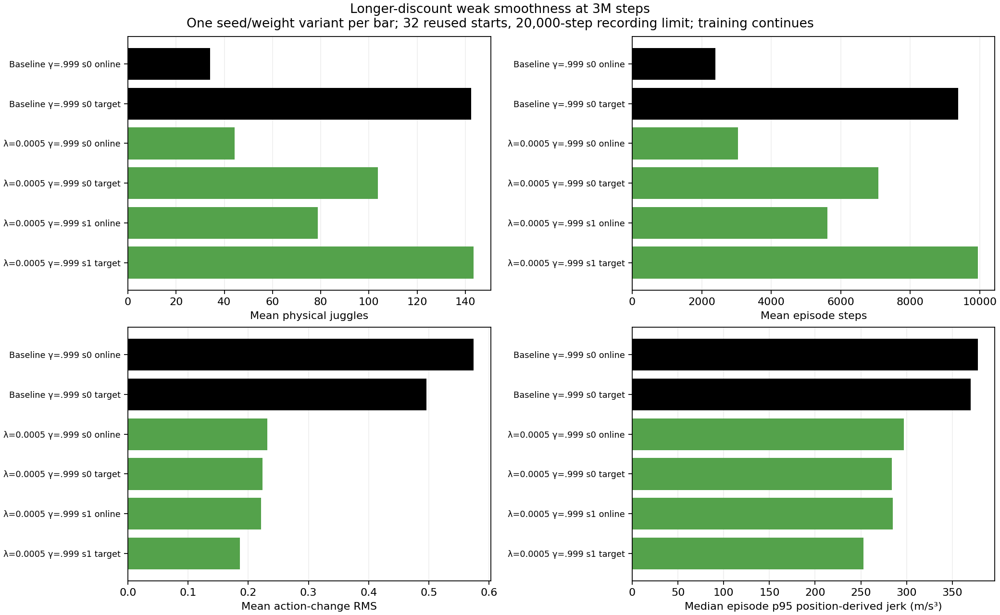

# The longer-discount target enters paired long testing after the first candidate trails

- **Date**: 2026-11-02 02:52 UTC submission, exact02:52:03.022945; documentation time is later and recorded in the logbooks.
- **Status**: in-flight
- **Run dirs**: `runs/td3/juggle_smooth_0005_g0999_seed1_target3m_long_20261102`, private `frozen_target_3m`, fresh `paired_reference_100k_eval`.
- **Configs**: copied frozen `args.yaml`/`config.yaml`/`rma_meta.json` from `runs/td3/noisy_history_smooth_0005_g0999_20261101_seed1/frozen_3000000_target`, all file/source hashes in [launch provenance](../../../docs/juggling-longdiscount-3m-long-reference-launch.json).

## Question and selection

Test whether the gamma .999/coefficient0.0005 seed1 target retains useful juggling and lower motion over longer episodes. The [completed3M comparison](2026-11-02_02-06_long-discount-3m-comparison.md) found143.34375 physical juggles/9942.09375 steps versus matching historical control142.375/9376.625 on32 reused700000-start20k episodes; paired position-derived p95 jerk ratio .749614. The [cached-controller audit](2026-11-02_02-30_paired-pid-target-tail-audit.md) exactly replayed7875steps per policy and found actual target-change RMS .034358m versus .068384m, while the largest sampled target jump remains .367065m. These data justify longer testing, not hardware readiness.



Existing figure generated2026-11-02 from six completed3M variants; seed1 target is the chosen candidate. It is not an outcome figure for this pending long test. No new long-performance figure is available yet. One historical baseline learner and selected candidate seed limit inference; this is not consistent replication or a safety gate.

The separate coefficient0.002/gamma .995 target's [completed long test](2026-11-02_02-37_regularized-target-long-results.md) averaged291.75 physical juggles/20432.4375 steps versus retained reference546.25/37131.03125, with only about4% paired position-derived jerk reduction. That candidate is not promoted. This new target differs in coefficient, discount and weights; none of its long-test outcomes was known when frozen/selected.

## Fixed protocol

Job115914: CPU-only6CPUs/16GiB/4h, no GPU resources, empty CUDA_VISIBLE_DEVICES, Slurm RUNNING on node006 at inspection. Freeze model SHA256 `727a455df07e9129250d82b4872d85170ea3f24b7c262d5a7ac5a32aff2f0646`, byte-identical to the verified3M target. Evaluate32 starts9000000–9000031,100000-step recording limit, original canonical sensing/control and established DR. Fresh output/private bundle; **no reference/earlier-candidate NPZ is reused as a new candidate outcome**. No training, checkpoint warm start, pretrained/residual initialization, simulator/control change or active learner restart.

These starts already supplied retained3.6M reference and coefficient0.002 candidate outcomes. This is a **globally reused paired development cohort**, not an independent unseen cohort. The candidate was selected using separate700000-start3M data; later independent claims need separately identified evaluation. The retained reference differs in training seed, budget and discount, so the comparison measures fixed-policy behavior rather than a causal regularization effect. Recording boundaries censor future outcomes rather than define success/acceptance.

Worker records raw counts, steps, rewards, physical/sensed arrays, action changes, end reasons and first-episode GIFs through the unchanged evaluator, then analyzes saved-data physical motion. Source/simulator/renderer/history and frozen-bundle hashes are verified before/after. Actual actor inputs remain deployment observations; physical telemetry is diagnostic only. All eight original6M training budgets continue unchanged.

## Verification and reproduction

Checked source actor/target hash, gamma/seed/penalty, null model path/no history warm start, history mode, exact saved simulator-YAML equality to `original_sensing.yaml`, and original reviewed source hashes before copying/submission. Worker compiled; submitted source/batch match local files; Slurm and worker status confirm live evaluation. Eleven total user GPUs remain allocated including three preexisting jobs, below16; this test adds zero. No implementation change or extra implementation tests for launching the existing evaluator.

```sh
CUDA_VISIBLE_DEVICES='' .venv/bin/python -m scripts.td3.juggle_survival --run-dir runs/td3/juggle_smooth_0005_g0999_seed1_target3m_long_20261102/frozen_target_3m --scenario-set training --episodes 32 --horizon 100000 --seed-base 9000000 --gif-steps 200 --out-dir /tmp/longdiscount-target-long-reproduction
```

This reproduction command uses a fresh destination. Do not submit a duplicate while115914 remains live. [Provenance](../../../docs/juggling-longdiscount-3m-long-reference-launch.json) preserves exact submitted commands, source/batch text, model/config/code hashes, cohort label and source selection evidence. Relative links/images, logbook anchors/TOCs and whitespace are checked before push.

## Next

Collect complete32-case outcomes and authoritative terminal state before computing full-cohort means. Compare durations/juggles and equal-prefix/whole-episode physical motion against the retained reference, while preserving differing training budgets and reused-cohort labels. Continue the eight6M learners and scheduled tests. No infinite-juggling, motor-energy or real-robot stop-risk conclusion; no hardware is connected.
