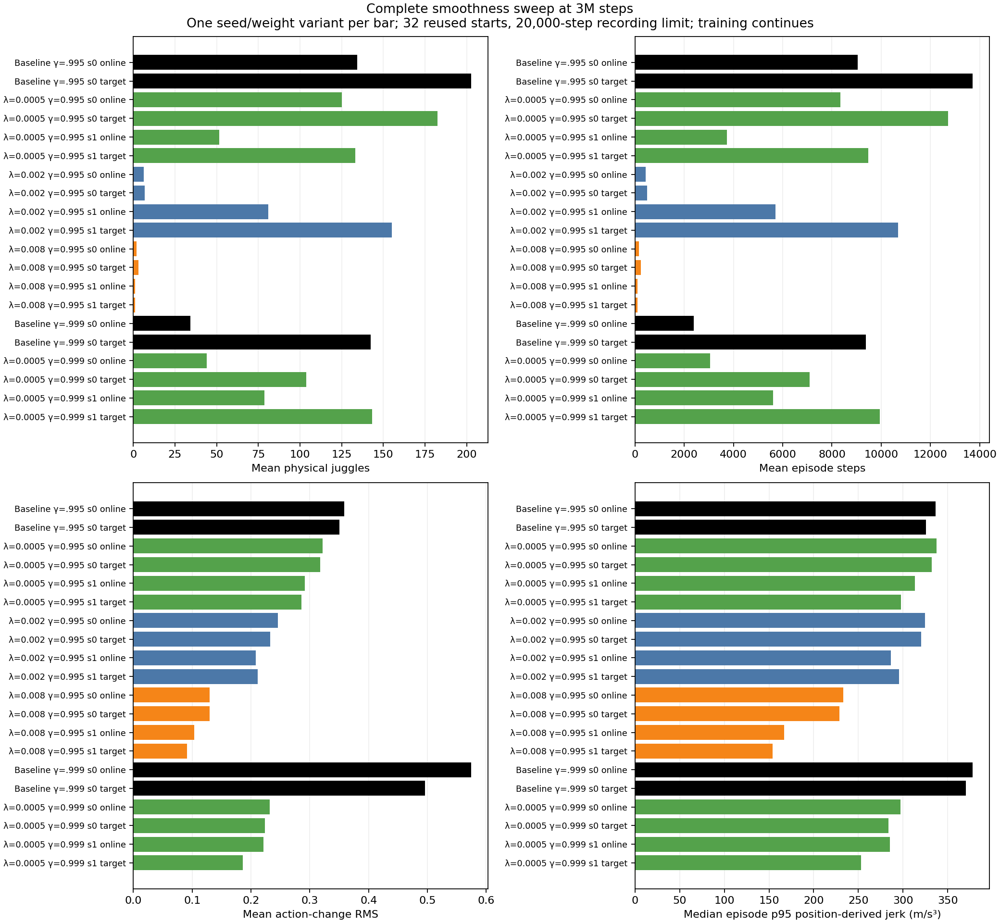

# Complete 3M sweep shows useful individual tradeoffs but no consistent high-performance smoothness result

- **Date**: 2026-11-02 03:21 UTC collection/writeup; all frozen3M tests completed before collection. This is not a run start/end timestamp.
- **Status**: all eight learners'3M online/target comparisons done; full6M training still in-flight.
- **Run dirs**: the eight `runs/td3/noisy_history_smooth*20261101_seed{0,1}` run directories in the launch manifests; frozen3M bundles and `paired_3000000_{online,target}_20k_eval`; two historical3M control roots.
- **Configs**: [original six-trial manifest](../../../docs/juggling-smooth-sweep-launch.json), [longer-discount pair](../../../docs/juggling-smooth-longdiscount-launch.json), [historical gamma .995 control](../../../docs/juggling-baseline-3m-comparison-launch.json), [gamma .999 control](../../../docs/juggling-longdiscount-baseline-3m-launch.json).

## Scope and protocol

Complete the partial [stronger-penalty subset](2026-11-02_01-44_first-3m-smoothness-comparison.md) and [longer-discount pair](2026-11-02_02-06_long-discount-3m-comparison.md) without rewriting their dated snapshots. Newly available original-discount coefficient0.0005 targets complete the full matrix:16 regularized seed/weight variants plus4 historical seed0 control variants,20 total/640 episode records. Every row is exactly3M training steps,32 reused starts700000–700031,20000-step recording limit. Compare the same discount and actor role. All eight milestone runners now wait for6M without recorded errors, while training continues.

These are eight new training runs and two historical control runs, not20 independent training seeds. There are two new seeds per setting and one historical baseline seed per discount; online/target weights share training. Repeated starts are selection evidence. Models began from scratch; no actor/critic warm start or residual policy. Original simulator/sensing/control/DR remain unchanged. No binary acceptance gate or cap fraction is used.

## Target-actor table

The table keeps each training seed separate; online actors and raw rewards are included in the full CSV/figure below. Physical/sensed juggles, durations and action changes are episode means. Whole-episode jerk is a median across episode-wise p95 true-position derivatives at20Hz; paired ratio uses a different equal-prefix window defined below.

| Gamma | Coefficient | Training seed | Physical juggles | Sensed juggles | Steps | Action-change RMS | Whole-episode median p95 jerk (m/s³) | Paired p95 jerk ratio |
|---|---|---|---:|---:|---:|---:|---:|---:|
| 0.995 | 0.0 | 0 | 202.62500 | 178.81250 | 13708.56250 | 0.35004 | 325.45011 | — |
| 0.995 | 0.0005 | 0 | 182.53125 | 162.12500 | 12705.65625 | 0.31726 | 331.98425 | 0.929363 |
| 0.995 | 0.0005 | 1 | 133.15625 | 117.81250 | 9470.25000 | 0.28547 | 297.62691 | 0.878056 |
| 0.995 | 0.002 | 0 | 6.75000 | 6.50000 | 501.87500 | 0.23226 | 320.26769 | 0.913387 |
| 0.995 | 0.002 | 1 | 155.09375 | 137.31250 | 10690.31250 | 0.21127 | 295.56543 | 0.885122 |
| 0.995 | 0.008 | 0 | 3.12500 | 2.71875 | 239.00000 | 0.13008 | 228.76045 | 0.609771 |
| 0.995 | 0.008 | 1 | 1.12500 | 1.00000 | 111.40625 | 0.09136 | 154.10868 | 0.448616 |
| 0.999 | 0.0 | 0 | 142.37500 | 129.50000 | 9376.62500 | 0.49599 | 370.09000 | — |
| 0.999 | 0.0005 | 0 | 103.78125 | 90.37500 | 7084.28125 | 0.22398 | 283.89662 | 0.757173 |
| 0.999 | 0.0005 | 1 | 143.34375 | 126.21875 | 9942.09375 | 0.18594 | 252.89179 | 0.749614 |


The largest regularized target juggling mean at3M is original-discount weak seed0:182.53125 juggles/12705.65625 steps versus matched target control202.625/13708.5625. Its paired p95 jerk ratio .929363 shows a modest reduction over shared prefixes, but its whole-episode median p95 jerk331.984248 exceeds control325.450114. Those windows involve different exposure/states; neither can be substituted for the other or described as a consistent physical-motion gain.

The other original-discount weak target averages133.15625 juggles/9470.25 steps with paired jerk ratio .878056. Coefficient0.002 is highly seed-dependent (6.75 versus155.09375 target juggles);0.008 targets remain short-lived (1.125–3.125). Longer-discount weak seed1 approximately matches its historical target's juggling (143.34375 versus142.375) with paired jerk ratio .749614, while its other seed trails at103.78125. These are selected descriptive outcomes, not replicated statistical superiority or hardware readiness.



Figure generated2026-11-02 from all20 complete summaries/640 raw episodes. Explicit discount labels and increased height keep the full comparison readable. Each bar preserves one seed/weight variant. Juggling, steps, command changes and whole-episode position-derived jerk remain separate metrics. [Full summaries with gamma/coefficient/seed columns](../../../docs/assets/juggling/smooth-full-3m-summary-20261102.csv), [raw640 episodes](../../../docs/assets/juggling/smooth-full-3m-episodes-20261102.csv), [frozen model/config/source/generator hashes](../../../docs/assets/juggling/smooth-full-3m-provenance-20261102.json).

## Paired physical-motion records

[Full paired summary](../../../docs/assets/juggling/smooth-full-3m-paired-motion-20261102.csv) links all16 detailed regularized/control comparisons,512 windows over the same32 reset seeds. Each uses the same discount and online/target role, with first min(250,control steps,candidate steps) positions in both members. All512 initial noisy observations match exactly and effective scenario configs match. The512 windows are repeated comparisons, not independent training replications. Per-episode p95 candidate/control ratios are computed before taking medians. Different states and different window lengths across comparisons still limit inference.

The four newly published [weak-original seed0 online](../../../docs/assets/juggling/weak-original-3m-paired-motion-seed0-online-20261102.json), [seed0 target](../../../docs/assets/juggling/weak-original-3m-paired-motion-seed0-target-20261102.json), [seed1 online](../../../docs/assets/juggling/weak-original-3m-paired-motion-seed1-online-20261102.json), [seed1 target](../../../docs/assets/juggling/weak-original-3m-paired-motion-seed1-target-20261102.json) records complete previously published subsets. Their paired jerk ratios are .961599/.929363/.901601/.878056 respectively. Source and trajectory hashes accompany each pair. Physical state is read only from saved data, never added to policy inputs.

Position-derived diagnostics may include solver/workspace corrections and miss substep spikes. They are not motor energy, joint loads or protective-stop predictions. The [separate exact PID/velocity-tail audit](2026-11-02_02-30_paired-pid-target-tail-audit.md) demonstrates why smaller typical command changes do not eliminate large target jumps. Environment reward remains unchanged and excludes the actor-only regularization term.

## Training, broader tests and verification

The [moving reward/juggling/duration/motion report](../../../docs/juggling-smooth-sweep.md) was refreshed from saved evaluations. It keeps8-start5k validation curves separate from32-start20k milestone rows and historical controls, with no interpolation or last-point budget mixing. This dated full3M snapshot remains fixed as the moving report advances. The plotting helper now honors explicit discount metadata and supports a taller figure; no learning/evaluation implementation changed for these presentation options.

The [coefficient0.0023M paired long test](2026-11-02_02-37_regularized-target-long-results.md) already shows worse reliability than the retained reference. CPU115914's longer-discount candidate test also completed and awaits its own full saved-data reconciliation; its100k outcomes are not mixed into this20k table. All eight6M training budgets remain unchanged, with eleven total user GPUs including three preexisting jobs, below16.

Validated all20 complete protocols,640 outcomes, sixteen paired records/512 reset observations, standard summary means and whole-episode medians, source/model/config/trajectory/generator/output hashes, figure readability, relative links/images, ordered unique logbook anchors/TOCs and whitespace. No new policy rollout or implementation tests for this saved-data collection/presentation; previously recorded helpers and actual trajectory checks provide relevant verification.

```sh
.venv/bin/python -m scripts.analysis.juggle_smooth_sweep
.venv/bin/python -m scripts.analysis.plot_juggle_fixed_comparison --summary docs/assets/juggling/smooth-full-3m-summary-20261102.csv --out /tmp/full-3m.png --title 'Complete smoothness sweep at 3M steps' --height 12
```

The fixed CSV selects every `phase` beginning `32_reused_starts` at `step == 3000000` from the moving report, adding gamma/coefficient/seed from the saved bundle args. Exact frozen source/result/config paths are in provenance. No expensive training rerun is needed for reproduction.

## Next

Continue all full6M budgets and compare final/retained frozen actors on raw physical/sensed juggles, steps and motion. Use the broader paired long-test evidence alongside selected checkpoint tests. No policy has yet established the requested smooth, reliably sustained behavior; no simulator simplification, changed DR, infinite-juggling or hardware-stop claim.
