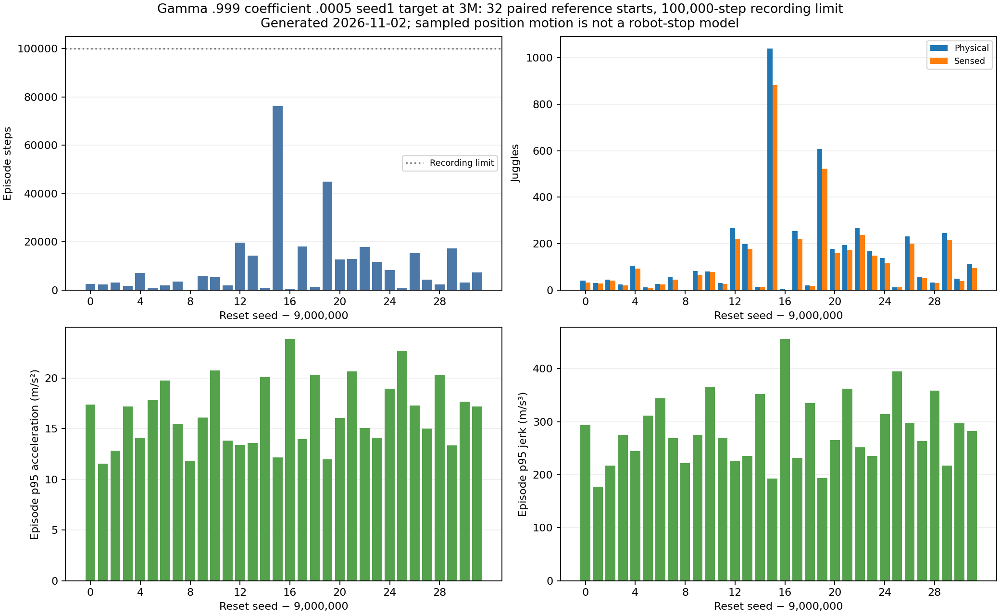
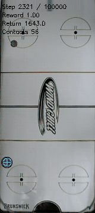

# The smoother longer-discount 3M target still trails retained-reference long reliability

- **Date**: 2026-11-02 03:36 UTC collection/writeup; job115914 submitted2026-11-02 02:52:03UTC, worker complete03:01:49UTC, Slurm elapsed9m46s.
- **Status**: fixed candidate long test done; all eight6M training budgets continue.
- **Run dirs**: `runs/td3/juggle_smooth_0005_g0999_seed1_target3m_long_20261102/paired_reference_100k_eval`, private `frozen_target_3m` bundle.
- **Configs**: gamma .999/coefficient .0005 seed1 target at3M, [frozen model/config/source/command provenance](../../../docs/juggling-longdiscount-3m-long-reference-launch.json).

## Protocol and completion

Follow-up to [the running launch record](2026-11-02_02-52_long-discount-target-long-test.md), preserving its historical in-flight status. CPU-only115914 completed/exit0. All32 candidate episodes are newly evaluated with frozen model SHA256 `727a455df07e9129250d82b4872d85170ea3f24b7c262d5a7ac5a32aff2f0646`. No historical trajectory is reused as a candidate outcome; no training or checkpoint warm start.

32 starts9000000–9000031,100000-step recording limit, original simulator/sensing/control and established DR unchanged. This is a globally reused paired development cohort, previously tested with the retained3.6M reference and coefficient0.002 candidate. It is not independent globally unseen evidence. The new candidate was selected on separate700000-start20k tests and cached-command diagnostics, without its own outcomes on this long cohort. Different training seed/budget/discount from the retained reference prevents a causal regularization conclusion.

## Completed raw outcomes

| Metric | Retained3.6M reference | Longer-discount3M candidate |
|---|---:|---:|
| Mean physical juggles |546.25|144.15625|
| Median physical juggles |429|68.5|
| Physical juggle min/p25/p75/max |48/118/896/1539|0/30/194.75/1040|
| Mean sensed juggles |482.9375|124.40625|
| Median sensed juggles |380|57.5|
| Mean episode steps |37131.03125|10147.78125|
| Median episode steps |30926.5|4854.5|
| Step min/p25/p75/max |3036/8339.5/58873.25/100000|51/1933/13192.75/76155|
| Mean reward |28335.3125|7515.8125|
| Mean action-change RMS |0.3552117534|0.1948861206|

Every candidate episode ends in recorded puck loss before100k; the shortest records zero juggles/51steps. The reference has29 puck-loss ends and three100k-censored records whose later outcomes remain unknown. This is descriptive censoring, not a success gate or cap fraction. Candidate totals are324729 control steps/4613 physical juggles. Paired candidate-minus-reference duration differences average−26983.25steps, median−25452.5, using recorded reference boundaries. The candidate does not retain the stronger reference's long-duration reliability.

Its [3M selection results](2026-11-02_02-06_long-discount-3m-comparison.md) approximate the same-discount historical target's20k juggling mean, but that was another reset cohort and a weaker comparator. Those two protocol means must not be treated as a within-cohort horizon comparison or proof of broader performance. The [cached PID audit](2026-11-02_02-30_paired-pid-target-tail-audit.md) verifies smaller typical commands on the700000 starts, not robust behavior on all initial states or hardware-stop safety.



Figure generated2026-11-02 from32 completed candidate outcomes/independently verified trajectories; all starts shown with the100k recording boundary. Bottom panels show whole-episode position-derived motion, which depends on episode duration/states. [Raw32 outcomes](../../../docs/assets/juggling/longdiscount-3m-long-candidate-20261102.csv), [summary/quantiles/model/source hashes](../../../docs/assets/juggling/longdiscount-3m-long-candidate-20261102.json), [full verified trajectory metrics/hashes](../../../docs/assets/juggling/longdiscount-3m-long-verified-trajectories-20261102.json). [Reference data/figure](2026-11-02_01-16_long-reference-results.md) preserves the same-cohort historical result.

## Physical motion with shared exposure

All32 initial noisy observations and effective scenario configs match the retained reference. Each pair uses first min(250,reference steps,candidate steps) positions: 51–250 steps, 7801 positions per policy. Median across per-episode candidate/reference p95 ratios: speed .873462, acceleration .954311, jerk .873648. That is about13% lower sampled jerk alongside a much lower duration distribution, not a solution to both objectives. Different visited states remain even when exposure matches.

Whole-episode candidate median per-episode p95 speed/acceleration/jerk are1.621885m/s,16.076027m/s²,272.063657m/s³ versus reference1.860358/16.783682/321.712989. Those different windows cannot be substituted for paired ratios. Position differences can include solver/workspace corrections, omit substep spikes and do not measure motor energy, UR5 joint loads or stop risk. The large reduction in the action-change proxy is not an equally large physical-motion reduction.

[Raw per-start outcome differences and motion ratios](../../../docs/assets/juggling/longdiscount-3m-long-reference-pairs-20261102.csv), [all32 paired motion windows/provenance](../../../docs/assets/juggling/longdiscount-3m-long-reference-paired-motion-20261102.json). No binary acceptance criterion is inferred from these diagnostics.

## Existing first-episode failure clip



Existing evaluator GIF copied byte-for-byte on2026-11-02, steps2321–2520 of first predeclared seed9000000,200frames/10s at20fps/width160. Full episode has40 physical/33 sensed juggles and ends with `puck_passed_paddle`; those totals are not just the displayed window. Not selected for favorable performance, and no new rendering/rollout/retiming. [Source/hash/timings/full-episode context](../../../docs/assets/juggling/longdiscount-3m-long-gif-provenance-20261102.json). Inspected first/middle/last frames; renderer contact overlay is distinct from physical juggle count. No real robot is shown or controlled.

## Verification and reproduction

Verified authoritative Slurm completion/exit0 and worker status, all32 primary outcomes against independently recounted NPZs, actor/source/config/trajectory hashes,32 paired reset observations, scalar means/quantiles/whole-episode medians, paired ratios, CSV totals, GIF bytes/timings, rendered figure, relative links/images, ordered unique logbook anchors/TOCs and whitespace. No implementation change, new training or fresh rollout for collecting/plotting these completed outcomes. Existing helpers perform the same checks as the prior long test.

```sh
.venv/bin/python -m scripts.analysis.plot_juggle_long_reference --results runs/td3/juggle_smooth_0005_g0999_seed1_target3m_long_20261102/paired_reference_100k_eval/results.json --verified-trajectories docs/assets/juggling/longdiscount-3m-long-verified-trajectories-20261102.json --out-prefix /tmp/longdiscount-long --policy-label 'Gamma .999 coefficient .0005 seed1 target at 3M' --cohort-label 'paired reference starts'
.venv/bin/python -m scripts.analysis.juggle_paired_motion --baseline runs/td3/juggle_long_reference_20261101/independent_100k_eval/results.json --candidate runs/td3/juggle_smooth_0005_g0999_seed1_target3m_long_20261102/paired_reference_100k_eval/results.json --out /tmp/longdiscount-reference-paired.json
```

## Next

Retain the stronger reference and continue all eight full6M budgets, comparing later frozen actors on raw performance and physical motion rather than promoting this early candidate. The [complete3M snapshot](2026-11-02_03-21_complete-3m-smoothness-sweep.md) records selection tradeoffs separately from these100k findings. Typical command changes and lower sampled jerk alone do not close the remaining reliability/tail-motion gap. Future from-scratch algorithm/reward changes must preserve canonical simulator/sensing/control/DR; none is introduced merely for this writeup. Eleven total user GPUs remain below16. No infinite-juggling or robot-safety claim.
