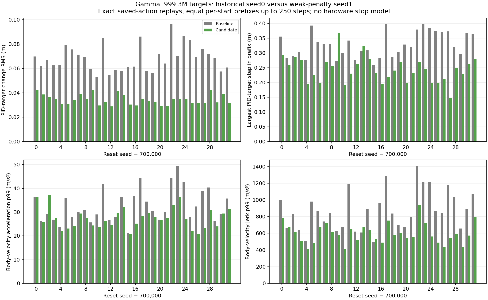

# A reward-only PID-target cost preserves saved noisy trajectories and runs through the trainer.

- **Date**: 2026-11-02 03:55:00 UTC documentation; checks ran during this turn, not a historical training run.
- **Status**: done for parity/calibration/integration; full learning with this cost is planned, not launched.
- **Run dirs**: `runs/td3/juggle_target_cost_smoke_20261102` (ignored local artifact directory).
- **Configs**: [exact smoke args](../../../docs/assets/juggling/target-cost-smoke-args-20261102.yaml); canonical [simulator config](../../../configs/new_juggle/sustained/original_sensing.yaml).

## Question

Can an isolated training reward focus on rare large changes of the actual filtered PID target while preserving the merged simulator, noisy sensing, history, actions, PID and established randomization? The prior [controller-tail audit](2026-11-02_02-30_paired-pid-target-tail-audit.md) found that lower average command motion still leaves large jumps; the completed [long tests](2026-11-02_03-36_long-discount-target-long-results.md) show that current smoother candidates lose endurance.

## Setup

[TargetStepCost](../../../scripts/td3/juggle_target_cost.py) calls the original environment step exactly once, reads only cached `last_target_position`, and returns `original_reward - coefficient * norm(target_change)^4`. Coefficient units are reward/m⁴. The first commanded target after reset has no preceding commanded target and incurs zero cost. Every later target is copied to avoid aliasing. The coefficient stays constant; replay rewards are stationary. The actor receives the same observations and history. No controller filter, target clamp or action mapping changes. This is target-motion reward shaping, not motor energy or a hardware safety limit.

The [isolated trainer](../../../scripts/td3/train_juggle_target_cost.py) validates canonical scratch settings, forbids checkpoint/privileged actor warm starts through the existing validator, and requires the history learner, one environment, zero existing actor-delta penalty, and a new explicit output directory. It wraps only the trainer module's environment factory within that process; evaluator factories remain original. It writes a hashed recipe plus 1,000-step blocks of original/shaped reward, cost and target-change statistics, flushing the last partial block. Existing trainer, evaluator and simulator source bytes remain unchanged. No full-budget run or particular learning coefficient is selected here.

[The audit](../../../scripts/analysis/juggle_target_cost_audit.py) replays already saved actions under their original noisy DR configs and seeds. Before/after observations, true paddle/puck positions, original rewards and terminal/truncation flags must match exactly. Cost is applied only to the returned reward. This is fixed-action functional verification and coefficient calibration; it cannot establish trained-policy performance.

## Results

| Saved policy used for calibration | Cases | Replayed steps | Original reward sum | Cost sum at coefficient 100 | Median within-episode cost share from largest 1% of measured changes |
|---|---:|---:|---:|---:|---:|
| Archived gamma .995 seed0 3M target | 32 | 8,000 | 5,699 | 148.623076 | 45.232% |
| Gamma .999/.0005 seed1 3M target | 32 | 7,875 | 5,378 | 46.647769 | 55.333% |

All 64 saved trajectories / 15,875 replayed steps match exactly apart from the intentional returned reward. Each window is at most250 steps; the second policy has an early125-step ending. These are separate calibration populations with different policies/discounts/seeds and exposure, not a paired estimate of a reward-cost learning effect. At coefficient100, isolated .1m/.2m/.4m changes incur .01/.16/2.56 reward cost respectively. Multiplying a coefficient scales costs linearly; no distance is an acceptance threshold.

Raw calibration records with every episode, source/trajectory hashes and code fingerprints: [archived target](../../../docs/assets/juggling/target-cost-baseline-audit-20261102.json), [longer-discount target](../../../docs/assets/juggling/target-cost-longdiscount-candidate-audit-20261102.json).

Two [unit tests](../../../scripts/td3/tests/test_juggle_target_cost.py) pass, covering known quartic arithmetic, cached-array aliasing, episode return/cost bookkeeping, unchanged actions, reset isolation and invalid coefficients. The initial attempt to invoke pytest failed because it is absent; no package was installed. A first audit invocation exposed and corrected a duplicate metadata keyword before any replay ran. Final checks use the standard-library unittest runner; no failed invocation is counted as passing.

A separate64-step CPU integration run, from random initialization, completed with **two critic updates**. Its deliberately tiny verification recipe changes only algorithm/evaluation budgets from the full recipe (learning starts16, batch8, one critic/actor update per training cycle, CPU, one16-step evaluation). It preserves canonical simulator/DR. Training original reward39, shaped37.0367032033, cost1.9632967967. The ordinary evaluator completed1×16 steps, zero physical/sensed juggles, raw reward16. These tiny numbers verify plumbing only; the checkpoint is not a learned candidate for deployment. [Checked completion record and artifact hashes](../../../docs/assets/juggling/target-cost-integration-smoke-20261102.json), [separate reward logs](../../../docs/assets/juggling/target-cost-smoke-training-20261102.csv).



Existing figure generated2026-11-02 from the earlier exact command replays, reused as motivation. It shows the remaining target/physical-motion tails; it is not a result of the new reward. No new performance GIF exists because this work changes no physics or evaluated policy behavior.

## Reproduction

```sh
.venv/bin/python -m unittest scripts.td3.tests.test_juggle_target_cost -v
.venv/bin/python -m scripts.analysis.juggle_target_cost_audit --results runs/td3/juggle_history_baseline_3m_20261102/paired_target_20k_eval/results.json --out /tmp/target-cost-baseline.json
.venv/bin/python -m scripts.analysis.juggle_target_cost_audit --results runs/td3/noisy_history_smooth_0005_g0999_20261101_seed1/paired_3000000_target_20k_eval/results.json --out /tmp/target-cost-candidate.json
# Copy saved smoke args, change log_parent_dir to a NEW path, then:
OMP_NUM_THREADS=1 MKL_NUM_THREADS=1 .venv/bin/python -m scripts.td3.train_juggle_target_cost --args-file /tmp/new-smoke-args.yaml --coefficient 100
```

## Conclusion

The implementation passes fixed-action noisy-simulator parity and a real learner/evaluator integration check. The cost emphasizes rare target changes in these saved trajectories. Its effects on learning, endurance and physical motion are unknown; no robot-stop or infinite-juggling inference follows. All eight existing6M learners remain Slurm RUNNING at the live check,11 total user GPUs including three unrelated allocations; no existing run was restarted/canceled and no new GPU training was launched. Complete the existing6M comparisons before choosing subsequent full-budget experiments.
