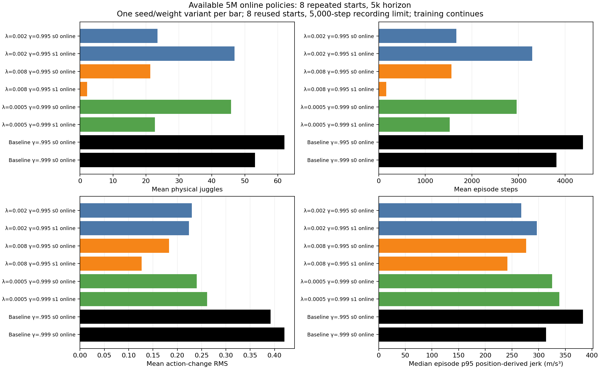
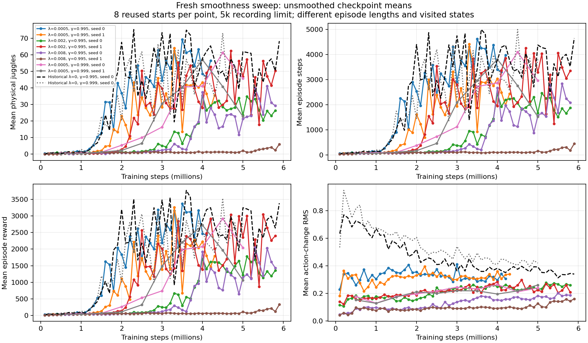
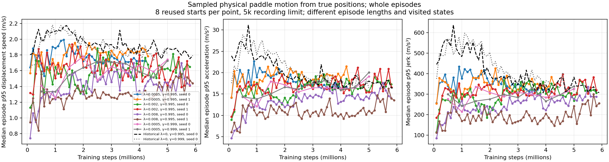

# Exact6M archived controls are running while later checkpoint validation still shows an endurance tradeoff.

- **Date**: 2026-11-02 04:03:49 UTC documentation; actual submission timestamps below.
- **Status**: in-flight for6M controls/active training; done for saved5M checkpoint analysis.
- **Run dirs**: `runs/td3/juggle_history_baseline_6m_20261102`, `runs/td3/juggle_history_longdiscount_baseline_6m_20261102`.
- **Configs**: frozen archived `args.yaml`/`config.yaml` under each `frozen_online`/`frozen_target` bundle; [canonical scratch simulator](../../../configs/new_juggle/sustained/original_sensing.yaml).

## Question

Do smoothness-regularized learners recover endurance by the full6M budget, and how do they compare with unregularized policies at exactly the same budget? The [complete3M comparison](2026-11-02_03-21_complete-3m-smoothness-sweep.md) and long tests did not establish a sufficiently reliable smoother replacement. The [new reward-only cost](2026-11-02_03-55_target-cost-parity-and-smoke.md) is verified but has not been used in full-budget learning.

## Setup

Both archived controls have `total_timesteps=6000000` in saved args, and loading their actual `training_state.pth` confirms `global_step=6000000`, `total_critic_updates=4671875`. These are already trained policies, not new learners or warm starts. Private online/target model copies plus args/config/history metadata have exact source hashes. Canonical noisy sensing/control/DR configs match, including seed normalization for comparison. The shared explicit training-arg differences versus current runs are only existing actor penalty, training seed, run/output/args locations, and gamma .999 checkpoint cadence. These differences are recorded in the launch manifests; each control is matched to its own discount.

- CPU job **115919**, submitted **2026-11-02T03:59:38.791019+00:00**, source `/scratch/cluster/mrudolph/documents/air-hockey-rl/runs/td3/noisy_history_20261029_seed0/train`, frozen online `01e1548f1bb0163bf672f39d15e132f5a5697e2319b484dbb5fced8a6b982305` and target `7fb377f4dc7da0c8dd1a7fb6f822ccd81d3e763d5e2bb14c6cddfa4143439b5d`.
- CPU job **115920**, submitted **2026-11-02T03:59:38.980026+00:00**, source `/scratch/cluster/mrudolph/documents/air-hockey-rl/runs/td3/noisy_history_long_discount_20261029_seed0/train`, frozen online `61f05e56d5cb7842b048076919143ea8c4870f0a7a7a5b0d7edadcdf7cdb074b` and target `204f6af6731cafd1dfa60d8466776908e85122f79722e2a92797033f3f05880e`.

Each job requests **zero GPUs**, two CPUs,8GB and4h; runs online then target sequentially on32 reused development starts700000–700031,20k recording limit. No candidate selection or early stop is encoded. The worker checks source fingerprints before each role, checks frozen model hashes before/after inference, and computes motion from saved true positions. Expected new output paths are `paired_online_20k_eval/results.json` and `paired_target_20k_eval/results.json`; no missing result is treated as zero. Reproduction worker and exact submitted batch are embedded in [gamma .995 launch](../../../docs/juggling-baseline-6m-comparison-launch.json) and [gamma .999 launch](../../../docs/juggling-longdiscount-baseline-6m-launch.json). The second job's inherited3M label was corrected live to `juggle-base-long-6m`; the submitted batch text is preserved as history. Its actual frozen inputs/budget are6M.

The reporting helper now recognizes available archived6M tests alongside1M/3M. Pending outputs remain omitted. Refreshed moving reports contain **487 summary rows /4856 per-episode rows**, with separate protocols retained. No evaluation protocols were mixed to draw curves.

## Available5M checkpoint evidence

Exactly8 repeated starts10000–10007,5k recording limit, online actor, all at5M training steps. Only six new runs have reached this checkpoint; the slower gamma .995/.0005 pair is omitted rather than ranked at a different budget. This small repeated validation cohort is development evidence, not an independent long-duration test. Each seed/weight variant is correlated with its other checkpoints, not a separate training-seed replication.

| Actor penalty/control | Gamma | Training seed | Mean physical juggles | Mean sensed juggles | Mean episode steps | Mean raw reward | Median episode p95 position jerk (m/s³) |
|---|---:|---:|---:|---:|---:|---:|---:|
| λ=0.002 | 0.995 | 0 | 23.5 | 20.25 | 1668.375 | 1216.5 | 267.418 |
| λ=0.002 | 0.995 | 1 | 46.875 | 41.25 | 3296.25 | 2356.75 | 296.928 |
| λ=0.008 | 0.995 | 0 | 21.375 | 19.125 | 1561.625 | 1147.125 | 276.509 |
| λ=0.008 | 0.995 | 1 | 2.125 | 1.75 | 166.125 | 112.625 | 241.64 |
| λ=0.0005 | 0.999 | 0 | 45.875 | 38.0 | 2962.0 | 2041.25 | 325.422 |
| λ=0.0005 | 0.999 | 1 | 22.75 | 19.5 | 1523.25 | 1059.0 | 338.721 |
| control | 0.995 | 0 | 62.0 | 55.875 | 4383.0 | 3247.0 | 383.253 |
| control | 0.999 | 0 | 53.125 | 48.5 | 3811.5 | 2800.0 | 314.0 |



Generated2026-11-02 from existing saved checkpoint evaluation data; no new5M rollout. [Eight summaries](../../../docs/assets/juggling/smooth-five-million-summary-20261102.csv), [64 raw episodes](../../../docs/assets/juggling/smooth-five-million-episodes-20261102.csv), [source/checkpoint/published hashes](../../../docs/assets/juggling/smooth-five-million-provenance-20261102.json).

At gamma .995, λ=.002 seed1 has lower whole-episode sampled jerk than control (296.93 vs383.25) but fewer juggles (46.875 vs62) and steps (3296.25 vs4383). λ=.008 seed0 also trades endurance for lower motion; seed1 remains poor. At gamma .999, neither weak-penalty seed exceeds its unregularized control's juggling counts or episode steps. Whole-episode motion uses different visited states and durations, so it cannot establish a causal smoothness effect or hardware stop probability. These8-start observations do not replace the pending32-start6M tests.





Moving figures regenerated2026-11-02 from saved8-start checkpoint tests; later refreshes may add points. Their immutable5M comparison and raw rows are linked above. Actual position-difference motion can include solver/workspace corrections; action-change RMS is a separate proxy, not energy. No new GIF was generated for archival control setup; the active milestone workers already capture the first evaluated episode when they run.

## Reproduction

```sh
# Only analysis of saved artifacts:
OMP_NUM_THREADS=1 MKL_NUM_THREADS=1 .venv/bin/python -m scripts.analysis.juggle_smooth_sweep
.venv/bin/python -m scripts.analysis.plot_juggle_fixed_comparison --summary docs/assets/juggling/smooth-five-million-summary-20261102.csv --out /tmp/smooth-five-million.png --title 'Available 5M online policies: 8 repeated starts, 5k horizon'
# Existing workers are live; do not resubmit them to reproduce pending work.
squeue -j 115919,115920 -o '%.18i %.9T %.10M %b %j'
```

## Conclusion / next

Both CPU controls and all eight original learner allocations are confirmed Slurm RUNNING at this turn's live check. User total remains11 GPUs including three unrelated jobs, under16. No existing trainer restarted or canceled. Source guards match all live learners. Track storage through final checkpoint saves (36GB free at the check), collect complete6M online/target comparisons, then use raw endurance and motion evidence to choose follow-up training. No full-budget target-cost trial was launched here, and no policy promotion, infinite-juggling or hardware safety conclusion is justified.
