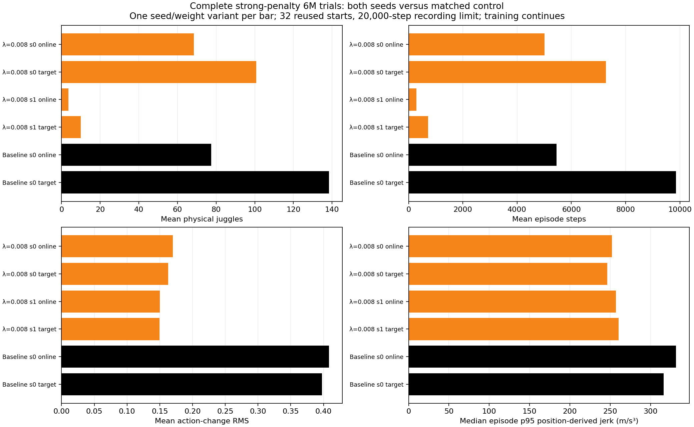
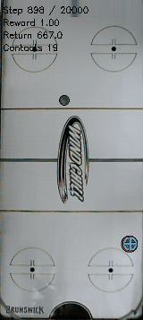

# Both strong-penalty seeds complete6M, showing a large endurance tradeoff and seed dependence.

- **Date**: 2026-11-02 04:25:20 UTC documentation; actual terminal evidence below.
- **Status**: done for these four jobs and saved-data comparisons; other sweep jobs continue.
- **Run dirs**: `runs/td3/noisy_history_smooth_008_20261101_seed0`, `...seed1`, `runs/td3/juggle_history_baseline_6m_20261102`, `runs/td3/juggle_history_longdiscount_baseline_6m_20261102`.
- **Configs**: [.008 seed0](../../../configs/td3/sustained/noisy_history_smooth_008_seed0.yaml), [seed1](../../../configs/td3/sustained/noisy_history_smooth_008_seed1.yaml), canonical original sensing/DR.

## Question / setup

Does the strongest existing actor-delta penalty recover endurance over its full6M scratch budget? Both seeds and both discount-matched archived6M control jobs now complete. No run was stopped early. Slurm115862 completed/exit0 in5h32m06s;115863 completed/exit0 in5h18m39s. CPU115919 (.995 control) completed/exit0 in12m01s;115920 (.999 control) in17m00s. Their earlier [launch note](2026-11-02_04-03_six-million-controls-and-curves.md) remains immutable history.

All results here use the same32 reused development starts700000–700031,20k recording horizon, canonical noisy sensing/control and established DR. Frozen online/target actors are inference only. Counts/durations are truncated by the finite horizon; no acceptance gate is used. The two policy seeds are separate replications; actor/target roles are correlated variants, not independent training seeds.

## Results

| Policy | Weights | Mean physical juggles | Mean sensed juggles | Mean steps | Action-change RMS | Median episode p95 position jerk (m/s³) |
|---|---|---:|---:|---:|---:|---:|
| .008 seed0 | online | 68.53125 | 60.65625 | 5006.96875 | 0.169985 | 251.931 |
| .008 seed0 | target | 100.6875 | 89.46875 | 7270.6875 | 0.163002 | 246.393 |
| .008 seed1 | online | 3.59375 | 3.25 | 290.78125 | 0.150079 | 257.068 |
| .008 seed1 | target | 9.9375 | 8.4375 | 722.875 | 0.149464 | 260.49 |
| control seed0 | online | 77.53125 | 68.03125 | 5447.0 | 0.408355 | 331.707 |
| control seed0 | target | 138.40625 | 121.71875 | 9859.8125 | 0.39745 | 316.3 |



Generated2026-11-02 from completed saved tests,192 raw episodes across six correlated variants. [Summary](../../../docs/assets/juggling/smooth-first-6m-summary-20261102.csv), [192 raw cases](../../../docs/assets/juggling/smooth-first-6m-episodes-20261102.csv), [bundle/source/output hashes](../../../docs/assets/juggling/smooth-first-6m-provenance-20261102.json). Figure's generic “training continues” subtitle refers to remaining sweep jobs; these two .008 learners are complete.

Target seed0 improves from3.125 physical juggles/239steps at3M to100.6875/7270.6875 at6M on this exact protocol. Target seed1 improves from1.125/111.40625 to9.9375/722.875. This late recovery and seed dependence argue against interpreting the early quiet behavior as a final outcome. Nevertheless both targets remain below the unregularized6M control's138.40625/9859.8125. Related3M raw evidence: [complete prior matrix](../../../docs/assets/juggling/smooth-full-3m-summary-20261102.csv).

Four same-role paired motion comparisons each use firstmin(250, own steps, control steps) positions per reset. All128 initial noisy observations match exactly. Median paired p95 jerk ratios (candidate/control): seed0 online .793060 /target .800834; seed1 online .751083 /target .788555. These are about20–25% lower sampled jerk on equal exposures, with different visited states. [All paired summaries and detailed JSON links](../../../docs/assets/juggling/smooth-first-6m-paired-motion-20261102.csv). Position differences include solver/workspace corrections and omit complete substep/joint dynamics; these are not robot-stop predictions.

The completed **gamma .999 unregularized6M** control averages online107.125 physical/92.40625 sensed juggles and7518.75steps, target198.625/175.53125 and14141.53125steps. Target action-change RMS .3124846113, whole-episode p95 jerk median287.9918377. This is more endurance and lower command changes than the gamma .9956M control, while .008 seed0 is smoother in these sampled motion diagnostics. [All128 archived6M control cases](../../../docs/assets/juggling/historical-6m-controls-episodes-20261102.csv), [four-role summary](../../../docs/assets/juggling/historical-6m-controls-summary-20261102.csv), [source hashes](../../../docs/assets/juggling/historical-6m-controls-provenance-20261102.json). Longer-discount target3M was142.375 juggles/9376.625steps on the same protocol; more training helped that control but hurt the .995 target versus its3M202.625/13708.5625. Endurance is not monotonic across checkpoints.

### Existing first-episode recording



Existing worker GIF copied byte-for-byte on2026-11-02. This is the first predeclared reset700000, not a selected good rollout: full episode1097steps,14 physical/16 sensed juggles, ending `puck_passed_paddle`. Shown steps898–1097,200frames20fps160px wide. The visibly unhelpful ending is retained as evidence. [Hashes/frame/episode provenance](../../../docs/assets/juggling/first-6m-008-seed1-target-gif-provenance-20261102.json).

## Reproduction / next

```sh
.venv/bin/python -m scripts.analysis.juggle_smooth_sweep
.venv/bin/python -m scripts.analysis.plot_juggle_fixed_comparison --summary docs/assets/juggling/smooth-first-6m-summary-20261102.csv --out /tmp/strong-six-million.png --title 'Complete strong-penalty 6M trials: both seeds versus matched control'
# Detailed paired JSON records embed exact baseline/candidate result paths.
```

Moving report at this publication:517 summary /5336 per-episode rows. All counts, motion medians and source hashes were checked against raw records. Remaining learners continue; the new [reward-cost pair](2026-11-02_04-25_target-cost-scratch-launch.md) tests a different objective rather than increasing this actor penalty. The late gamma .999 target receives a [paired long test](2026-11-02_04-25_six-million-discount-long-test.md). No policy is promoted, and finite simulation proves neither infinite juggling nor hardware stop safety.
