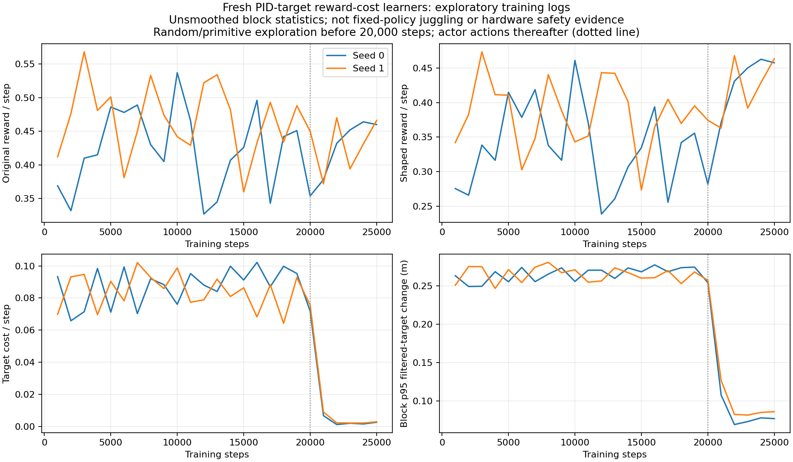

# Two fresh learners now optimize a constant reward-only cost on large filtered-target changes.

- **Date**: 2026-11-02 04:25:20 UTC documentation; actual submissions below.
- **Status**: in-flight, no fixed-policy performance evaluation yet.
- **Run dirs**: `runs/td3/noisy_history_target_cost_100_20261102_seed0`, `...seed1`.
- **Configs**: [seed0](../../../configs/td3/sustained/noisy_history_target_cost_100_seed0.yaml), [seed1](../../../configs/td3/sustained/noisy_history_target_cost_100_seed1.yaml).

## Question / rationale

Can directly penalizing rare large changes of the actual filtered PID target preserve more endurance than an actor action-delta regularizer? The [parity/CPU integration checks](2026-11-02_03-55_target-cost-parity-and-smoke.md) establish implementation behavior, not learning quality. [The first full6M outcomes](2026-11-02_04-25_six-million-strong-and-controls.md) retain a significant tradeoff. The earlier plan was to finish all6M comparisons before choosing new experiments; this is revised to start two new seeds now, while every remaining original budget/test still completes. This avoids waiting for the slower original pair; it does not infer that every existing regularizer has failed.

## Exact experiment

Reward is `original_reward - 100 * norm(cached_filtered_target_t - cached_filtered_target_previous)^4`, meters⁴ units, first command after reset excluded. The coefficient is constant so replay rewards are stationary. This is target-motion cost, not motor energy, force or a stop-risk estimator. Original actor-delta penalty is0. No new action filtering, clipping, dynamics, sensors or actor privileged inputs. Algorithm/network/optimizer/exploration recipe matches the history baseline:50-step deployable history,64x2 actor/critic, gamma .995,6M steps, seeds0/1. Actor and critic start randomly; no pretrained policy, checkpoint warm start or residual base.

- **115921**, seed0, submitted2026-11-02T04:12:09.542696+00:00, `/scratch/cluster/mrudolph/documents/air-hockey-rl/runs/td3/noisy_history_target_cost_100_20261102_seed0`; user GPUs before submission10.
- **115922**, seed1, submitted2026-11-02T04:12:09.598736+00:00, `/scratch/cluster/mrudolph/documents/air-hockey-rl/runs/td3/noisy_history_target_cost_100_20261102_seed1`; user GPUs before submission11.

[Hashed launch/batch/source manifests](../../../docs/juggling-target-cost-launch.json). Both jobs are confirmed RUNNING and have passed25k training steps. Total user GPU usage reached12 at submission, then11 after the second old .008 job completed, under16 throughout. Other jobs were not canceled or restarted.

The [new isolated runner](../../../scripts/td3/extras/run_juggle_target_cost_trial.py) starts the previously verified [reward-only trainer](../../../scripts/td3/train_juggle_target_cost.py), freezes both actor roles at1M/3M/6M, and performs the same32 reused starts700000/20k descriptive tests. Standard8-start10000/5k checkpoint evaluation continues every500k (storage cadence differs from the old .995100k recipe). Evaluation uses the ordinary task reward. New configs disable copying the replay buffer into final saved training state to limit disk use; model/critic/optimizer checkpoints, configs, raw rollouts and metrics remain saved. This changes storage only. The existing learner sources and all current source guards remain unchanged.

Coefficient400 configs are prepared ([seed0](../../../configs/td3/sustained/noisy_history_target_cost_400_seed0.yaml), [seed1](../../../configs/td3/sustained/noisy_history_target_cost_400_seed1.yaml)) but **not launched**. No schedule or increasing cost is applied to the100 runs.

### Contract review and checks

[Full contract review](../../../docs/juggling-target-cost-contract-review-20261102.json) records the exact diff from merged94acd819, effective simulator flags and source hashes. Relative to canonical sysid YAML, only the existing10k episode budget and established DR fields differ. Optional once-per-step history sampling remains false, preserving two delay-split samples; .025s delay/interpolation, noise, occlusions, hist2, PID7531.5/1928.7/0, geometry, contacts, smoothing and workspace remain intact. DR stays ±25% on paddle density/damping/gravity. The current base-env diff contains existing reward/Bellman termination-encoding changes; no simulator code was edited for this experiment.

Four unit tests pass: reward/reset/accounting tests plus a runner test with **mocked process boundaries** covering six snapshots and fixed evaluation protocol, and rejection of changed source/invalid coefficient before launch. These mocks are not full-budget integration evidence. The real64-step CPU learner check and15875-step noisy replay parity remain documented inE070. Current source hashes are pinned and checked before each frozen milestone evaluation.

## Initial reward logs, not performance evidence



Generated2026-11-02 from50 complete1000-step blocks,25k steps per seed. [All blocks](../../../docs/assets/juggling/target-cost-first25k-rewards-20261102.csv), [per-seed sums, captured source-prefix hashes and generator provenance](../../../docs/assets/juggling/target-cost-first25k-rewards-20261102.json). Seed0 original reward10594, shaped8839.436391933, cost1754.563608067; seed1 original11476, shaped9777.955106381, cost1698.044893619. The saved baseline policy calibration cost was2.6% of reward, but these initial exploratory trajectories incur about15–17%; different states/actions explain why that calibration is not a learning guarantee.

**The sharp drop in cost/target changes after20k coincides with switching from pre-learning random/primitive exploration to actor actions and early updates. It must not be presented as learned smoothness improvement.** No checkpoint juggling result exists yet; first8-start raw juggle/step/reward measurements arrive at500k, first32-start online/target comparison at1M. No raw juggles are inferred from training reward or collision counters. No new target-cost performance GIF is available yet.

## Reproduction / next

```sh
.venv/bin/python -m unittest scripts.td3.tests.test_juggle_target_cost scripts.td3.tests.test_juggle_target_cost_trial -v
.venv/bin/python -m scripts.analysis.plot_juggle_target_cost_training --max-step 25000 --out-prefix /tmp/target-cost-first25k
squeue -j 115921,115922 -o '%.18i %.9T %.10M %b %j'
```

Do not resubmit live jobs. [The plotter](../../../scripts/analysis/plot_juggle_target_cost_training.py) validates contiguous blocks and reward-minus-cost accounting, ignores only an unfinished live CSV tail, and writes raw CSV plus provenance. Continue complete budgets and collect raw juggles, steps, reward and physical/controller motion at matched protocols. These learning outcomes and hardware transfer remain unproven.
