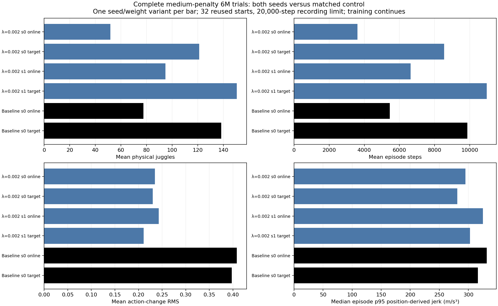
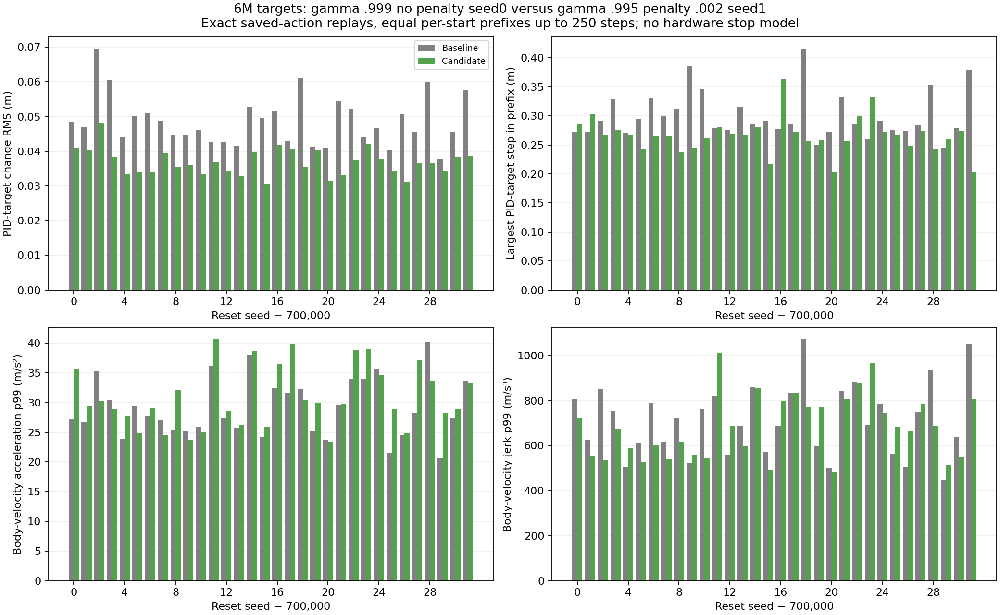
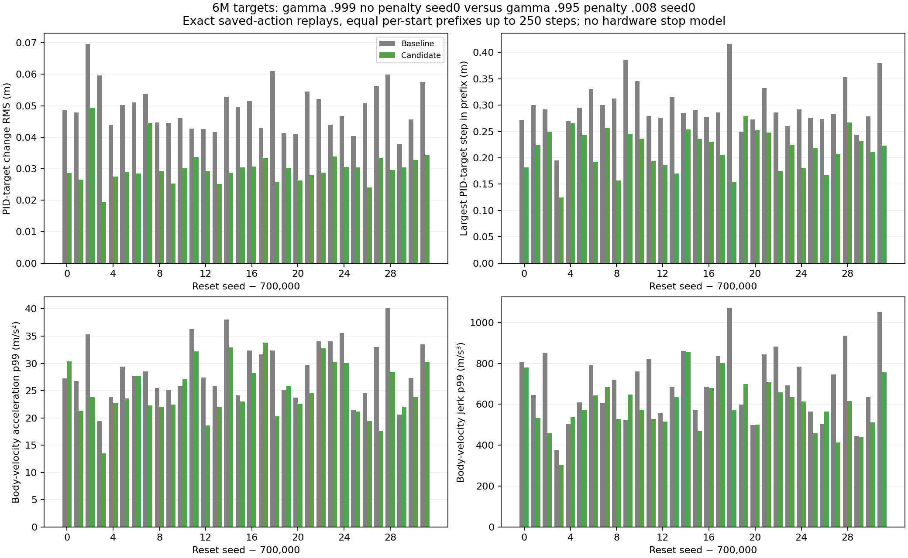

# Medium-penalty6M endurance improves in one seed, but actual command tails favor the stronger-penalty candidate.

- **Date**: 2026-11-02 04:38:31 UTC documentation; fresh saved-data replays during this turn.
- **Status**: done for both medium6M runs and the actual-command audits; other learners/long tests continue.
- **Run dirs**: `runs/td3/noisy_history_smooth_002_20261101_seed0`, `...seed1`; actual-command sources also use completed `.008 seed0` and `juggle_history_longdiscount_baseline_6m_20261102` targets.
- **Configs**: [.002 seed0](../../../configs/td3/sustained/noisy_history_smooth_002_seed0.yaml), [seed1](../../../configs/td3/sustained/noisy_history_smooth_002_seed1.yaml), canonical original sensing/DR.

## Question / completed runs

Can a medium actor-delta penalty retain endurance and reduce the actual command tails relevant to later hardware transfer? Slurm115860 and115861 completed/exit0 in5h34m01s and5h41m00s, respectively, after the full6M budgets. No early stop or restart. The following32-start/20k comparisons reuse starts700000–700031 and compare online/target roles separately.

## Raw fixed-policy outcomes

| Policy | Weights | Mean physical juggles | Mean sensed juggles | Mean episode steps | Action-change RMS | Median episode p95 position jerk (m/s³) |
|---|---|---:|---:|---:|---:|---:|
| .002 seed0 | online | 51.84375 | 45.53125 | 3614.6875 | 0.234854 | 295.158 |
| .002 seed0 | target | 121.21875 | 108.125 | 8546.375 | 0.229883 | 280.803 |
| .002 seed1 | online | 94.75 | 83.5625 | 6641.15625 | 0.242556 | 325.127 |
| .002 seed1 | target | 150.59375 | 133.625 | 10971.65625 | 0.21095 | 302.879 |
| control seed0 | online | 77.53125 | 68.03125 | 5447.0 | 0.408355 | 331.707 |
| control seed0 | target | 138.40625 | 121.71875 | 9859.8125 | 0.39745 | 316.3 |



Generated2026-11-02 from saved completed tests. Six correlated variants/192 raw episodes: [summary](../../../docs/assets/juggling/smooth-medium-6m-summary-20261102.csv), [every case](../../../docs/assets/juggling/smooth-medium-6m-episodes-20261102.csv), [source/checkpoint/output hashes](../../../docs/assets/juggling/smooth-medium-6m-provenance-20261102.json). The generic plot subtitle refers to remaining training jobs; these two medium runs are complete.

Target seed0 rises from6.75 physical juggles/501.875steps at3M to121.21875/8546.375 at6M; seed1 changes from155.09375/10690.3125 to150.59375/10971.65625. Late learning and seed differences remain substantial. Seed1 slightly exceeds the .9956M unregularized control's138.40625/9859.8125 on this cohort, but its whole-episode jerk reduction is small. Four equal-prefix, same-role comparisons to that .995 control have median paired p95 position-jerk ratios: seed0 online .908818/target .940310; seed1 online .997443/target .971407. [All ratios and detailed JSON source links](../../../docs/assets/juggling/smooth-medium-6m-paired-motion-20261102.csv). All128 initial noisy observations match exactly. These position differences include workspace/solver corrections and reflect different visited states; no robot-stop probability follows.

## Actual filtered targets and cached body-velocity tails

The baseline here is the **gamma .9996M unregularized seed0 target**, with198.625 physical juggles/14141.53125steps on the same32-start/20k protocol. Candidate M is **gamma .995/.002 seed1 target** (150.59375/10971.65625); candidate S is **gamma .995/.008 seed0 target** (100.6875/7270.6875). These are policy comparisons, not a causal estimate of a coefficient alone; seeds and discounts differ where stated.

Four executions of the existing [exact replay tool](../../../scripts/analysis/juggle_control_replay.py) replay saved actions under unchanged noisy configs/seeds. Every before/after observation, underlying reward, terminal flag and true paddle/puck position matches. Reads of cached final PID target and body velocity add no sensing calls or RNG consumption. Each comparison has32 equal-duration pairs, firstmin(250, both episode lengths) commands. M uses7602 steps per policy; S uses7204. Thus128 replay windows/29612 steps cover96 unique source trajectories: the baseline is replayed for both pairings and is not counted as independent evidence twice.

| Metric and episode aggregate | M baseline | M candidate | S baseline | S candidate |
|---|---:|---:|---:|---:|
| pid_target_change_rms_m (mean) | 0.048652 | 0.036824 | 0.049141 | 0.030240 |
| pid_target_change_p99_m (median) | 0.248640 | 0.218836 | 0.248640 | 0.160091 |
| pid_target_change_maximum_m (max) | 0.415912 | 0.364091 | 0.415912 | 0.279315 |
| velocity_acceleration_p99_m_s2 (median) | 27.566056 | 29.620513 | 27.566056 | 23.700679 |
| velocity_acceleration_maximum_m_s2 (max) | 50.437371 | 58.193666 | 50.437371 | 45.301585 |
| velocity_jerk_p99_m_s3 (median) | 706.204996 | 679.712083 | 689.312909 | 574.068990 |
| velocity_jerk_maximum_m_s3 (max) | 1294.700735 | 1181.172838 | 1294.700735 | 1076.639366 |

Units: PID-target metrics meters, cached-velocity acceleration m/s² and jerk m/s³. RMS is averaged across episodes, p99 is the median of episode p99s, and maxima are maxima over all measured prefixes. Baseline exposure differs between M and S; do not treat this as an identical three-policy window.





Generated2026-11-02 from the fresh exact saved-action audits. [M per-window values](../../../docs/assets/juggling/six-million-medium-pid-comparison-20261102.csv), [M aggregates](../../../docs/assets/juggling/six-million-medium-pid-comparison-20261102-summary.csv), [M provenance](../../../docs/assets/juggling/six-million-medium-pid-comparison-20261102.json); [S per-window values](../../../docs/assets/juggling/six-million-strong-pid-comparison-20261102.csv), [S aggregates](../../../docs/assets/juggling/six-million-strong-pid-comparison-20261102-summary.csv), [S provenance](../../../docs/assets/juggling/six-million-strong-pid-comparison-20261102.json). Each provenance links both complete32-case replay JSONs and their source hashes.

M lowers mean target-change RMS but raises median p99 body acceleration (29.6205 vs27.5661) and largest measured acceleration (58.1937 vs50.4374). S lowers target-change RMS .0302402 vs.0491409, largest target jump .279315 vs.415912m, median p99 acceleration23.7007 vs27.5661 and median p99 jerk574.069 vs689.313. This makes S a useful smoother candidate to test longer despite fewer short-horizon juggles. It does not establish that these remaining jumps are acceptable on the UR5. Cached20Hz telemetry omits reset handoff, complete substep commands, joint torque and robot controller behavior. Action-change RMS remains a distinct proxy, not motor energy.

## Reporting / reproduction / next

The moving [training report](../../../docs/juggling-smooth-sweep.md) now includes the target-cost pair's statuses and recognizes its checkpoint results when available, labeled **PID-target reward c**, separately from **Actor λ**. All fixed-policy curves use original unshaped task reward and raw juggles/steps. No absent checkpoint is plotted as zero. The fixed-comparison plotter also labels the new reward-cost method correctly. New target-cost checkpoint juggling remains pending; exploratory reward traces are separate. Refreshed moving data:522 summary/5424 episode rows.

```sh
.venv/bin/python -m scripts.analysis.juggle_smooth_sweep
.venv/bin/python -m scripts.analysis.plot_juggle_fixed_comparison --summary docs/assets/juggling/smooth-medium-6m-summary-20261102.csv --out /tmp/medium6m.png --title 'Complete medium-penalty 6M trials: both seeds versus matched control'
.venv/bin/python -m scripts.analysis.plot_juggle_control_replay --baseline docs/assets/juggling/six-million-strong-baseline-pid-replay-20261102.json --candidate docs/assets/juggling/six-million-strong-candidate-pid-replay-20261102.json --out-prefix /tmp/strong6m-replay
```

Raw outcome/motion means, paired windows, exact replay flags and all new figures/hashes are validated against saved records. No simulator/training source was changed. No new GIF was generated for this read-only audit; existing worker renderings remain in local source output directories, and the previous [6M note](2026-11-02_04-25_six-million-strong-and-controls.md) embeds an available failure clip. The smoother S target receives [paired long testing](2026-11-02_04-38_strong-six-million-long-test.md) alongside the late-discount target; medium long testing is not launched here. No finite result establishes infinite juggling or real-robot safety.
