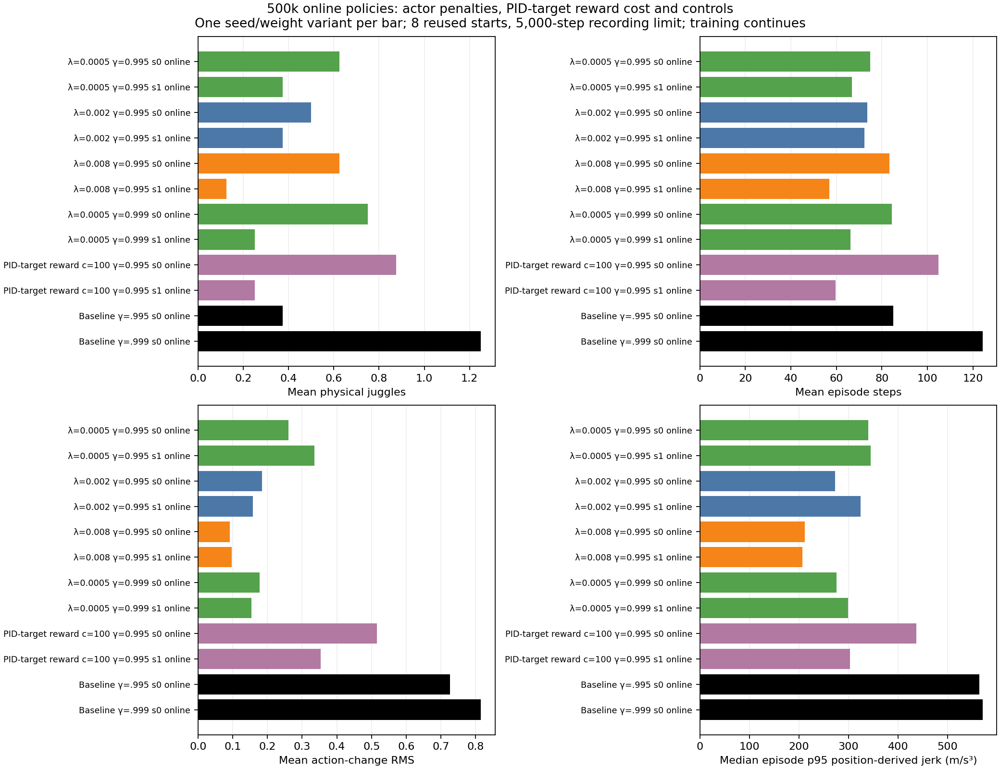
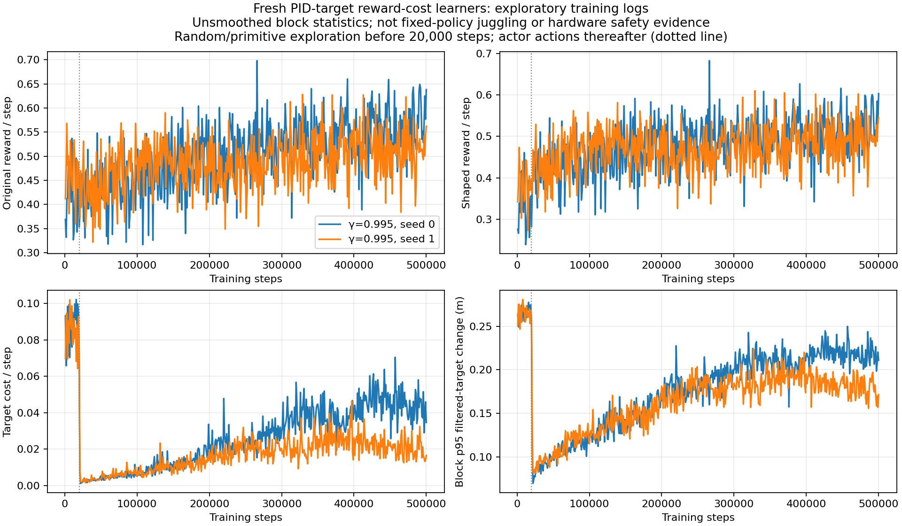

# The first reward-cost checkpoints have short episodes and provide no sustained-juggling result yet.

- **Date**: 2026-11-02 05:08:56 UTC documentation.
- **Status**: done for saved500k checkpoint analysis; two gamma .995 learners remain running toward6M.
- **Run dirs**: `runs/td3/noisy_history_target_cost_100_20261102_seed0`, `...seed1`.
- **Configs**: [seed0](../../../configs/td3/sustained/noisy_history_target_cost_100_seed0.yaml), [seed1](../../../configs/td3/sustained/noisy_history_target_cost_100_seed1.yaml), [original launch](../../../docs/juggling-target-cost-launch.json).

## Protocol / first raw measurements

Both policies train from random actor/critic initialization with constant100*norm(filtered PID target change)^4 reward cost, zero actor-delta penalty, original simulator/sensing/control/DR and gamma .995. Fixed-policy online-actor validation at exactly500k uses8 repeated starts10000–10007 and5k recording limit, **ordinary unshaped task reward**. All original actor-penalty runs and archived controls also have this exact500k protocol. Only completed500k tests available at snapshot capture are included. The subsequently added gamma .999 cost pair is not part of this frozen snapshot; absent results are never shown as zero.

| Method | Gamma | Training seed | Mean physical juggles | Mean sensed juggles | Mean episode steps | Mean raw reward |
|---|---:|---:|---:|---:|---:|---:|
| PID-target cost100 | 0.995 | 0 | 0.875 | 0.625 | 104.875 | 57.75 |
| PID-target cost100 | 0.995 | 1 | 0.25 | 0.125 | 59.625 | 33.0 |
| unregularized control | 0.995 | 0 | 0.375 | 0.625 | 85.0 | 44.5 |
| unregularized control | 0.999 | 0 | 1.25 | 0.75 | 124.25 | 71.875 |



Generated2026-11-02 from saved fixed-policy tests. [All12 summaries](../../../docs/assets/juggling/target-cost-500k-comparison-summary-20261102.csv), [96 raw episodes](../../../docs/assets/juggling/target-cost-500k-comparison-episodes-20261102.csv), [every model/config/source/output fingerprint](../../../docs/assets/juggling/target-cost-500k-comparison-provenance-20261102.json). Actor-loss coefficients and PID-target reward costs are distinct methods, explicitly labeled in the figure.

Seed0 has a higher observed mean than the .995 control here, but these are tiny counts (seven physical juggles over eight episodes versus three), one training seed each and a reused validation cohort. Seed1 remains short. Neither establishes sustained juggling, improved general reliability or smoothness. All6M budgets continue; no early gate or cancellation. The earlier .008 seed0's recovery between3M and6M is relevant caution against extrapolating these early points.

## Exploratory training reward is separate



Generated2026-11-02 from1000 complete1000-step blocks,500 per seed. [Raw blocks](../../../docs/assets/juggling/target-cost-first500k-rewards-20261102.csv), [source-prefix hashes/accounting/generator record](../../../docs/assets/juggling/target-cost-first500k-rewards-20261102.json). Seed0 original reward251412, shaped237321.557066, cost14090.442934; seed1 original243098, shaped233586.066815, cost9511.933185. These exploration-dependent block sums do not replace checkpoint juggles or episode steps. The dotted20k line marks the switch from pre-learning random/primitive actions to actor actions; the cost drop there is not evidence of learned smoothness.

The moving [report](../../../docs/juggling-smooth-sweep.md) now contains the new500k raw juggle/step/reward points alongside all existing protocols, with source phases kept separate. Source guarded simulator/trainer files remain unchanged. The reward plotter now labels gamma as well as seed; the fixed comparison correctly renders actual reward-cost checkpoint rows. These are reporting-only changes.

```sh
.venv/bin/python -m scripts.analysis.juggle_smooth_sweep
.venv/bin/python -m scripts.analysis.plot_juggle_target_cost_training --launch docs/juggling-target-cost-launch.json --max-step 500000 --out-prefix /tmp/target-cost-first500k
.venv/bin/python -m scripts.analysis.plot_juggle_fixed_comparison --summary docs/assets/juggling/target-cost-500k-comparison-summary-20261102.csv --out /tmp/target-cost500k.png --height 10 --title '500k online policies: actor penalties, PID-target reward cost and controls'
```

Continue the fixed1M/3M/6M32-start online/target tests and full budgets. [Two gamma .999 cost learners](2026-11-02_05-08_target-cost-long-discount-launch.md) test whether the better late-discount control behavior combines with this reward. No performance GIF is generated here; this saved-data analysis changes no physics or evaluated policy. The completed stronger-policy long result is documented [separately](2026-11-02_05-08_strong-six-million-long-results.md).
