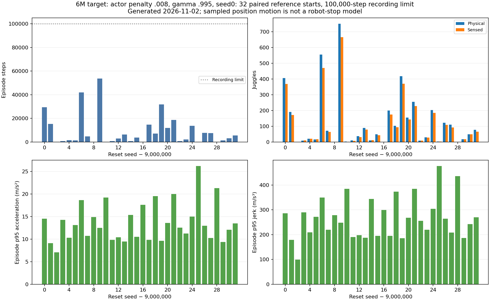
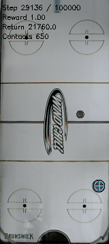

# The stronger-penalty6M target is smoother in sampled motion but loses substantial long-duration endurance.

- **Date**: 2026-11-02 05:08:56 UTC documentation; worker completed2026-11-02T04:43:53.332368+00:00.
- **Status**: done, CPU115927 COMPLETED/exit0 in9m29s.
- **Run dirs**: `/scratch/cluster/mrudolph/documents/air-hockey-rl/runs/td3/juggle_smooth_008_seed0_target6m_long_20261102`.
- **Configs**: completed6M gamma .995/.008 seed0 target, canonical original noisy sensing/control and established DR; [launch and terminal record](../../../docs/juggling-strong-6m-long-reference-launch.json).

## Question / protocol

Does the stronger-penalty candidate's lower measured command tails preserve enough endurance over longer recordings? The [selection audit](2026-11-02_04-38_medium-six-million-command-tails.md) found lower target changes and body-velocity acceleration/jerk tails than the late-discount target in short equal-prefix windows. This job is fixed-policy CPU inference, not new learning or a warm start. Actor SHA **3098fd104583404e69a577fd903f44099a57dd0a40b29de9bc8d5f2e14f32241**. All32 candidate episodes use globally reused paired-development starts9000000–9000031,100k recording limit. Same cohort/horizon as the retained reference, not independent evidence or an acceptance gate.

## Results

| Quantity | Candidate | Retained reference |
|---|---:|---:|
| Mean physical juggles |123.71875|546.25|
| Mean sensed juggles |109.78125|482.9375|
| Mean episode steps |9017.34375|37131.03125|
| Median episode steps |3351|30926.5|
| Median physical juggles |48.5|429|
| Steps min /p25 /p75 /max |13 /696.75 /12376.5 /53564|3036 /8339.5 /58873.25 /100000|
| Physical juggles min /p25 /p75 /max |0 /9.75 /164 /750|48 /118 /896 /1539|
| Mean raw reward |6710.90625|28335.3125|
| Mean action-change RMS |.16614854|.35521175|

All32 candidate episodes end in puck loss. There are29 `puck_passed_paddle` and4 `puck_hit_bottom` reason tags, overlapping in one episode; these are not33 episodes. The retained reference has29 puck-loss endings and three100k-censored recordings, whose later outcomes remain unknown. Candidate totals **288555 steps /3959 physical juggles**. Mean paired step difference is−28113.6875, median−25610.5. Different training budgets from the reference and repeated development-cohort use limit inference.



Generated2026-11-02 from completed saved trajectories. [All32 raw outcomes](../../../docs/assets/juggling/strong-6m-long-candidate-20261102.csv), [paired per-start differences](../../../docs/assets/juggling/strong-6m-long-reference-pairs-20261102.csv), [model/source/hash/quantile record](../../../docs/assets/juggling/strong-6m-long-candidate-20261102.json), [NPZ recount/shape/finiteness/terminal verification](../../../docs/assets/juggling/strong-6m-long-verified-trajectories-20261102.json). Every physical/sensed count, reward and duration agrees with the primary result. Recount uses the same existing pure counter on the saved arrays, not a separate labeling method.

Equal-prefix position motion uses firstmin(250, own steps, reference steps),7026 positions per policy; all32 initial noisy observations match exactly. Median paired p95 speed/acceleration/jerk ratios are .664046/.784470/.768415, respectively. Whole-episode candidate median p95 position-derived speed1.26414m/s, acceleration12.74195m/s², jerk259.80342m/s³. [Detailed pair audit](../../../docs/assets/juggling/strong-6m-long-reference-paired-motion-20261102.json). This lower motion accompanies much worse endurance. Position differences include solver/workspace corrections; different visited states and durations, reset omission, sampled telemetry and absent joint/robot-controller models preclude hardware-stop or causal claims. The earlier actual-command audit covers short prefixes of the20k cohort, not all of these long trajectories.

### First predeclared episode recording



Existing worker GIF copied byte-for-byte2026-11-02, not a selected good episode: reset9000000, full29335steps/406 physical/368 sensed juggles, ending puck loss. Shown steps29136–29335,200frames20fps160px wide. [Frame/model/source provenance](../../../docs/assets/juggling/strong-6m-long-gif-provenance-20261102.json). This single episode is longer than the candidate median and is shown because the reset was predeclared, not because it represents typical performance.

## Provenance correction / reproduction / next

Dated correction: the long-result plot publisher previously used the generic metadata phrase “new reset starts” even for outputs whose explicit cohort label and notes correctly said paired/reused. New output now uses neutral wording and defers to `cohort_label`; prior dated JSONs are preserved as history. Earlier regularized long results in [E066](../../../docs/experiment_logbook.md#e066) and [E069](../../../docs/experiment_logbook.md#e069) remain reused paired-development evidence. No rollout or numerical outcome changes from this wording correction.

```sh
.venv/bin/python -m scripts.analysis.plot_juggle_long_reference --results runs/td3/juggle_smooth_008_seed0_target6m_long_20261102/paired_reference_100k_eval/results.json --verified-trajectories docs/assets/juggling/strong-6m-long-verified-trajectories-20261102.json --out-prefix /tmp/strong6m-long --policy-label '6M target: actor penalty .008, gamma .995, seed0' --cohort-label 'paired reference starts'
```

No policy promotion. The late gamma .999 CPU115924 test also completed during this turn; its [verified result](2026-11-02_05-20_late-discount-six-million-long.md) was collected later in publication. Reward-cost learners continue full budgets. Finite results prove neither infinite juggling nor that a UR5 would avoid an e-stop.
