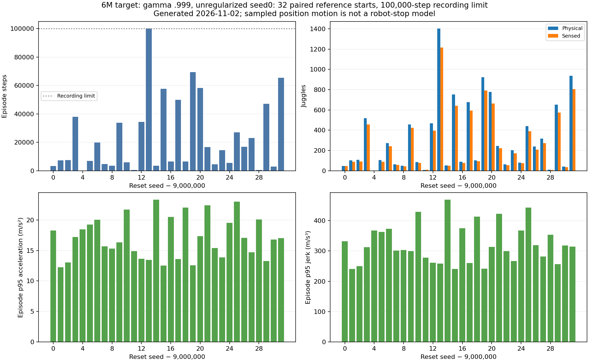
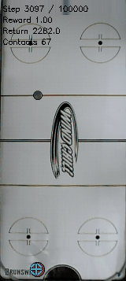

# The late longer-discount target improves over regularized candidates but remains below the retained reference.

- **Date**: 2026-11-02 05:20:31 UTC documentation; worker completion2026-11-02T04:52:03.006918+00:00, confirmed from Slurm after the initial checks in this turn.
- **Status**: done; CPU115924 COMPLETED/exit0 in33m07s.
- **Run dirs**: `/scratch/cluster/mrudolph/documents/air-hockey-rl/runs/td3/juggle_history_g0999_target6m_long_20261102`.
- **Configs**: archived unregularized6M gamma .999 seed0 target and canonical noisy sensing/control/DR; [launch/terminal record](../../../docs/juggling-longdiscount-6m-long-reference-launch.json).

## Protocol / verified outcomes

32 fixed-policy episodes on **globally reused paired-development starts9000000–9000031**,100k recording limit, original raw reward. Model SHA **204f6af6731cafd1dfa60d8466776908e85122f79722e2a92797033f3f05880e**. No new training, warm start or simulator change. Same cohort/horizon as the retained gamma .995 seed0 3.6M target; different discounts/training budgets make this a policy comparison, not a causal discount-effect estimate. These starts are not independent evidence or an acceptance gate.

| Quantity | Late gamma .9996M target | Retained reference |
|---|---:|---:|
| Mean physical juggles |321.1875|546.25|
| Mean sensed juggles |280.1875|482.9375|
| Mean episode steps |23142.34375|37131.03125|
| Median steps |10919|30926.5|
| Median physical juggles |154.5|429|
| Steps min /p25 /p75 /max |202 /4578.75 /35267 /100000|3036 /8339.5 /58873.25 /100000|
| Physical juggles min /p25 /p75 /max |2 /62.75 /481.25 /1403|48 /118 /896 /1539|
| Mean raw reward |17430.03125|28335.3125|
| Mean action-change RMS |.32704301|.35521175|

31 candidate episodes end in puck loss; one is censored at100k: reset9000013, 1403 physical/1217 sensed juggles. Its subsequent outcome is unknown. Reason tags31 paddle-pass/3 bottom overlap in three episodes; they are not34 separate losses. Reference has29 puck-loss endings and three censored recordings. Candidate totals **740555 steps /10278 physical juggles**; mean paired step difference−13988.6875, median−4754.5. This is more endurance than the tested stronger-penalty candidate's123.71875/9017.34375 but lower than the retained reference. No policy promotion.



Generated2026-11-02 from completed raw tests. [All32 cases](../../../docs/assets/juggling/longdiscount-6m-long-candidate-20261102.csv), [paired differences](../../../docs/assets/juggling/longdiscount-6m-long-reference-pairs-20261102.csv), [quantiles/source/model hashes](../../../docs/assets/juggling/longdiscount-6m-long-candidate-20261102.json), [NPZ recount/shape/finiteness/terminal checks](../../../docs/assets/juggling/longdiscount-6m-long-verified-trajectories-20261102.json). Recount uses the existing pure counter on saved arrays and agrees with all primary counts/reward/duration; it is not a separate detector.

Equal-prefix positions firstmin(250, both lengths) give7952 positions per policy and32 exact initial noisy observations. Median paired p95 speed/acceleration/jerk ratios .976575/.977505/.980370 show only small sampled-motion reductions versus the reference. Whole-episode median position p95 speed1.800827m/s, acceleration16.926023m/s², jerk313.243881m/s³. [Detailed motion audit](../../../docs/assets/juggling/longdiscount-6m-long-reference-paired-motion-20261102.json). Different visited states, finite exposure, solver/workspace position corrections and absent full substep/joint/controller dynamics preclude hardware-stop claims. Lower action-change proxy is not motor energy.

## First predeclared episode, including its failure



Existing worker GIF copied byte-for-byte2026-11-02. Reset9000000 ends at3296steps with47 physical/46 sensed juggles and puck loss. Shown steps3097–3296,200frames20fps160px wide. The episode is shorter than the median and shown because it was predeclared, not selected for quality. [Frame/model/source provenance](../../../docs/assets/juggling/longdiscount-6m-long-gif-provenance-20261102.json).

```sh
.venv/bin/python -m scripts.analysis.plot_juggle_long_reference --results runs/td3/juggle_history_g0999_target6m_long_20261102/paired_reference_100k_eval/results.json --verified-trajectories docs/assets/juggling/longdiscount-6m-long-verified-trajectories-20261102.json --out-prefix /tmp/g9996m-long --policy-label '6M target: gamma .999, unregularized seed0' --cohort-label 'paired reference starts'
```

All32 outcomes, trajectory hashes, initial observations and quantiles are checked. The earlier “pending/live” descriptions in this turn's draft notes are reconciled here after authoritative completion was collected; prior committed launch notes remain unchanged history. Four new reward-cost learners continue at gamma .995/.999. These finite results do not establish infinite juggling or real-robot safety.
