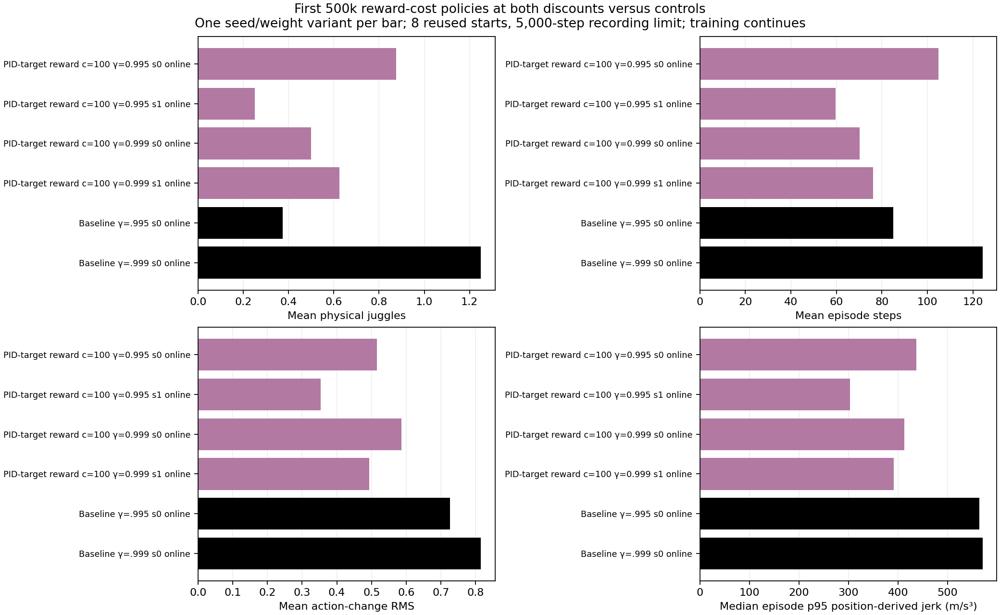

# Both reward-cost discount groups have short first500k checkpoint episodes.

- **Date**: 2026-11-02 05:53:47 UTC saved-data analysis documentation.
- **Status**: done for first500k snapshot; all four cost100 learners remain running to6M.
- **Run dirs**: `runs/td3/noisy_history_target_cost_100[_g0999]_20261102_seed{0,1}`.
- **Configs**: constant100*norm(filtered-target change)^4 reward cost, actor-delta penalty0; gamma .995/.999, two random-initialization seeds each, original simulator/DR.

## Matched500k online validation

Exactly8 reused starts10000–10007,5k recording limit, ordinary unshaped task reward. The snapshot adds the newly available gamma .999 cost policies to the two .995 policies and two unregularized controls. It does not overwrite the earlier dated12-variant500k snapshot.

| Method | Gamma | Training seed | Weights | Mean physical juggles | Mean sensed juggles | Mean steps |
|---|---:|---:|---|---:|---:|---:|
| reward cost100 | 0.995 | 0 | online | 0.875 | 0.625 | 104.875 |
| reward cost100 | 0.995 | 1 | online | 0.25 | 0.125 | 59.625 |
| reward cost100 | 0.999 | 0 | online | 0.5 | 0.25 | 70.125 |
| reward cost100 | 0.999 | 1 | online | 0.625 | 0.5 | 76.125 |
| control | 0.995 | 0 | online | 0.375 | 0.625 | 85.0 |
| control | 0.999 | 0 | online | 1.25 | 0.75 | 124.25 |



Generated2026-11-02 from saved checkpoint tests. [48 raw episodes](../../../docs/assets/juggling/target-cost-both-discounts-500k-episodes-20261102.csv), [six summaries](../../../docs/assets/juggling/target-cost-both-discounts-500k-summary-20261102.csv), [source/model/config fingerprints](../../../docs/assets/juggling/target-cost-both-discounts-500k-provenance-20261102.json). Means are per seed/weight variant, not pooled across training seeds. All episodes are very short; none establishes sustained juggling, meaningful smoothness improvement or robot readiness. The repeated8-start cohort is development evidence, not independent confirmation.

The [gamma .9951M32-start milestones](2026-11-02_05-53_target-cost-first-million-results.md) use a different cohort/horizon and are kept separate. Exploratory original/shaped reward traces are not substituted for physical juggle counts or episode lengths. All4 policies started randomly with no checkpoint/residual base, and all existing6M budgets continue. No additional reward schedule or training variant was launched here.

```sh
.venv/bin/python -m scripts.analysis.juggle_smooth_sweep
.venv/bin/python -m scripts.analysis.plot_juggle_fixed_comparison --summary docs/assets/juggling/target-cost-both-discounts-500k-summary-20261102.csv --out /tmp/cost-both-gamma500k.png
```

Moving report at this publication:561 summary rows/5928 per-episode rows, retaining separate protocol phases. No new GIF was generated by this read-only comparison. No simulator, sensing, control or training source was edited.
