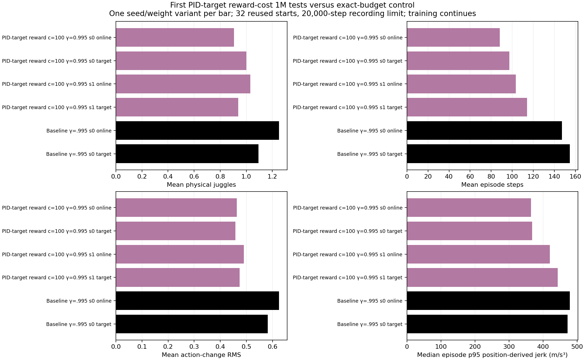
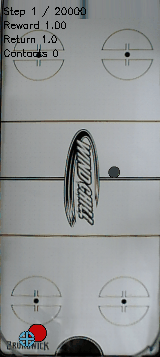

# Reward-cost1M outcomes are still short, and their exact-budget control is also immature.

- **Date**: 2026-11-02 05:53:47 UTC saved-data analysis documentation.
- **Status**: done for1M milestone analysis; gamma .995 cost100 jobs115921/115922 continue full6M budgets, now waiting for3M milestones.
- **Run dirs**: `runs/td3/noisy_history_target_cost_100_20261102_seed0`, `...seed1`.
- **Configs**: original cost100 reward, gamma .995, scratch history50 architecture, canonical unchanged sensing/control/DR.

## Exact1M32-start protocol

32 reused starts700000–700031,20k recording limit, online and target roles separately. These are distinct from the8-start/5k validation curves. Evaluation uses ordinary unshaped task reward. The source policies train from random actor/critic initialization with constant filtered-target quartic cost, not pretrained weights.

| Method | Gamma | Training seed | Weights | Mean physical juggles | Mean sensed juggles | Mean steps |
|---|---:|---:|---|---:|---:|---:|
| reward cost100 | 0.995 | 0 | online | 0.90625 | 0.65625 | 88.0625 |
| reward cost100 | 0.995 | 0 | target | 1.0 | 0.75 | 97.3125 |
| reward cost100 | 0.995 | 1 | online | 1.03125 | 0.75 | 103.28125 |
| reward cost100 | 0.995 | 1 | target | 0.9375 | 1.09375 | 113.96875 |
| control | 0.995 | 0 | online | 1.25 | 1.0 | 147.25 |
| control | 0.995 | 0 | target | 1.09375 | 1.03125 | 154.6875 |



Generated2026-11-02 from completed saved tests. [192 raw cases](../../../docs/assets/juggling/target-cost-first-1m-episodes-20261102.csv), [six summaries](../../../docs/assets/juggling/target-cost-first-1m-summary-20261102.csv), [all frozen source/model/config hashes](../../../docs/assets/juggling/target-cost-first-1m-provenance-20261102.json). The matched unregularized1M control itself averages1.25 physical juggles/147.25steps online and1.09375/154.6875 target. The new policies' roughly one juggle per episode is not sustained performance, but is not clear evidence of an acquisition failure caused by the penalty. Causal diagnosis from a mismatched later control would be invalid.

All full budgets continue. No weaker-cost/ramp variant was implemented or launched following this analysis; that possibility was held after checking the exact control. No binary early acceptance gate or cancellation. The earlier .008 seed0 recovered substantially between3M and6M, illustrating why these early means should not be extrapolated to final behavior.

## First predeclared seed0 target episode



Existing worker recording copied byte-for-byte2026-11-02: reset700000, full159steps,2 physical/1 sensed juggles, ending puck loss. All159frames shown,20fps160px wide. This is early, immature behavior, not a selected demonstration of good performance. [Frame/model/source provenance](../../../docs/assets/juggling/target-cost-first-1m-gif-provenance-20261102.json); [frozen seed0 target bundle](../../../runs/td3/noisy_history_target_cost_100_20261102_seed0/frozen_1000000_target).

```sh
.venv/bin/python -m scripts.analysis.plot_juggle_fixed_comparison --summary docs/assets/juggling/target-cost-first-1m-summary-20261102.csv --out /tmp/target-cost1m.png
```

Next: continue3M/6M comparisons and inspect raw endurance and actual motion together. Fixed-policy body position motion is not a hardware load/stop predictor. No new training recipe, simulator change, warm start or real-robot action occurred in this saved-data analysis.
