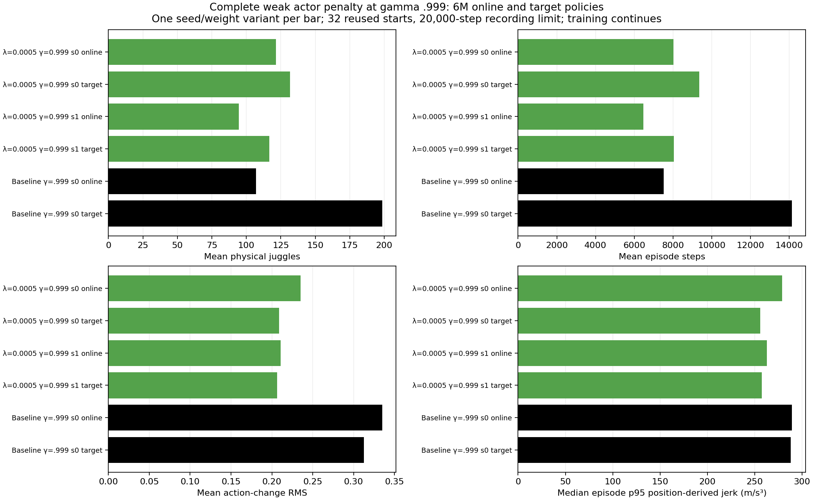
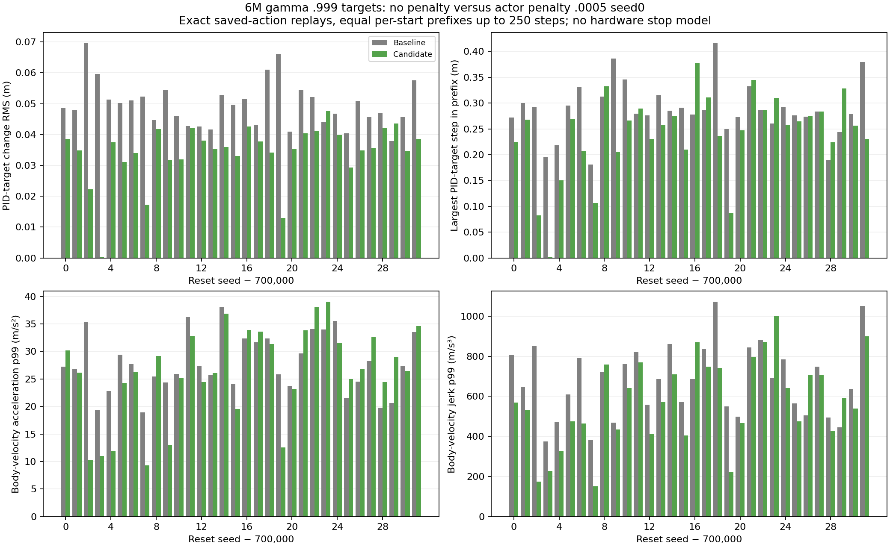

# Both weak-penalty longer-discount learners complete6M with lower endurance than their unregularized target control.

- **Date**: 2026-11-02 05:53:47 UTC saved-data analysis documentation.
- **Status**: done; Slurm115866/115867 COMPLETED/exit0 in5h46m30s/5h46m33s, worker completions04:55:32/35UTC.
- **Run dirs**: `runs/td3/noisy_history_smooth_0005_g0999_20261101_seed0`, `...seed1`.
- **Configs**: gamma .999, actor-delta penalty .0005, two scratch seeds; canonical noisy sensing/control and established DR unchanged.

## Exact6M comparison

Online and target actors each use32 reused development starts700000–700031,20k recording limit. Same-discount unregularized6M control is archived seed0; actor/target roles are correlated variants, not extra training-seed replications. No early stopping, restart or learner warm start.

| Method | Gamma | Training seed | Weights | Mean physical juggles | Mean sensed juggles | Mean steps |
|---|---:|---:|---|---:|---:|---:|
| actor .0005 | 0.999 | 0 | online | 121.4375 | 107.53125 | 8012.9375 |
| actor .0005 | 0.999 | 0 | target | 131.75 | 114.9375 | 9347.3125 |
| actor .0005 | 0.999 | 1 | online | 94.53125 | 83.46875 | 6473.9375 |
| actor .0005 | 0.999 | 1 | target | 116.6875 | 103.875 | 8045.6875 |
| control | 0.999 | 0 | online | 107.125 | 92.40625 | 7518.75 |
| control | 0.999 | 0 | target | 198.625 | 175.53125 | 14141.53125 |



Generated2026-11-02 from saved completed tests. [All192 raw episodes](../../../docs/assets/juggling/longdiscount-weak-full-6m-episodes-20261102.csv), [six summaries](../../../docs/assets/juggling/longdiscount-weak-full-6m-summary-20261102.csv), [source/model/config/output hashes](../../../docs/assets/juggling/longdiscount-weak-full-6m-provenance-20261102.json). Both regularized targets lose endurance relative to control198.625 juggles/14141.53125steps. Seed0 online slightly exceeds control107.125/7518.75, but target comparisons are separate. Whole-episode position p95 jerk medians are255.947/257.517m/s³ for the two targets versus287.992 control; different episode lengths/states confound this statistic.

Four equal-prefix same-role position comparisons (firstmin250/both durations) have target median paired jerk ratios .956049/.908041 for seeds0/1, online .941644/.910483. All128 initial noisy observations match exactly. [Pair summary and JSON sources](../../../docs/assets/juggling/longdiscount-weak-full-6m-paired-motion-20261102.csv). These are finite control-rate position derivatives, not motor energy or a stop model.

## Actual-command replay: seed0 target versus same-discount6M control

64 exact replay windows,6479 steps per policy/12958 total,19–250 commands per reset. Every before/after observation, raw reward, terminal flag and true paddle/puck position agrees with saved arrays. No extra sensor sampling/RNG calls. Different visited states remain, even with equal per-start duration.

| Metric /episode aggregate | Control | Candidate |
|---|---:|---:|
| PID-target change RMS /mean (m) |.0496633|.0342456|
| PID-target change p99 /median (m) |.242101|.202848|
| PID-target change /largest (m) |.415912|.376808|
| Cached-velocity acceleration p99 /median (m/s²) |27.279864|26.329410|
| Cached-velocity acceleration /largest (m/s²) |42.189274|56.893813|
| Cached-velocity jerk p99 /median (m/s³) |685.940498|569.785505|
| Cached-velocity jerk /largest (m/s³) |1294.700735|1531.071296|



Generated2026-11-02 from fresh exact saved-action replays. [Per-window raw values](../../../docs/assets/juggling/longdiscount-weak-6m-pid-comparison-20261102.csv), [aggregates](../../../docs/assets/juggling/longdiscount-weak-6m-pid-comparison-20261102-summary.csv), [replay/source provenance](../../../docs/assets/juggling/longdiscount-weak-6m-pid-comparison-20261102.json). Typical target changes and p99 jerk are lower, **but worst measured body acceleration and jerk are higher**. Largest target jumps fall only modestly. This is not evidence that the policy avoids real-robot stops. Cached20Hz values omit complete substep commands and reset handoff; no UR5 joint/controller model is used.

The [seed0 target long test](2026-11-02_05-53_weak-longdiscount-six-million-long.md) measures this intermediate tradeoff. The full maximum-tail table was inspected after submission and that timing/counterevidence is recorded in its manifest. No promotion or new RL variant is implied. No new GIF was generated for this read-only audit; existing milestone renderings remain in source output directories.

```sh
.venv/bin/python -m scripts.analysis.plot_juggle_fixed_comparison --summary docs/assets/juggling/longdiscount-weak-full-6m-summary-20261102.csv --out /tmp/weak-g999-6m.png
.venv/bin/python -m scripts.analysis.plot_juggle_control_replay --baseline docs/assets/juggling/longdiscount-weak-6m-baseline-pid-replay-20261102.json --candidate docs/assets/juggling/longdiscount-weak-6m-candidate-pid-replay-20261102.json --out-prefix /tmp/weak-g999-6m-control
```
