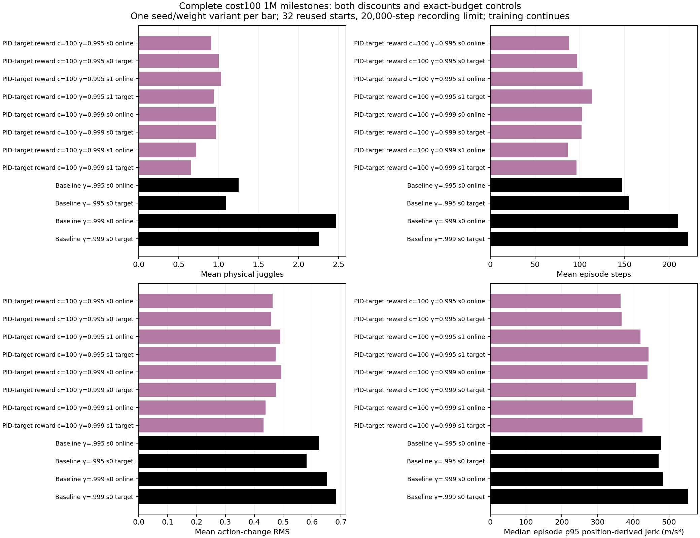

# Complete first-million reward-cost comparison

Four from-scratch cost100 learners have completed their frozen1M online/target comparisons; all remain early in their fixed6M training budget.

Documentation time: 2026-11-02 00:16:47 -0600. Figure generated2026-11-02 from saved evaluations, without new rollouts. Protocol:32 reused development starts700000–700031 per variant,20,000-step recording horizon, same frozen1M training budget. Online and target roles are correlated, not independent training replicates. Historical unregularized controls are matched by discount and budget.

| Discount | Policy / seed | Role | Physical juggles | Sensed juggles | Episode steps | Raw reward |
|---|---|---|---:|---:|---:|---:|
| 0.995 | cost100 / 0 | online | 0.90625 | 0.65625 | 88.06250 | 51.25000 |
| 0.995 | cost100 / 0 | target | 1.00000 | 0.75000 | 97.31250 | 58.87500 |
| 0.995 | cost100 / 1 | online | 1.03125 | 0.75000 | 103.28125 | 56.87500 |
| 0.995 | cost100 / 1 | target | 0.93750 | 1.09375 | 113.96875 | 71.46875 |
| 0.999 | cost100 / 0 | online | 0.96875 | 0.81250 | 102.21875 | 62.03125 |
| 0.999 | cost100 / 0 | target | 0.96875 | 0.90625 | 102.06250 | 64.53125 |
| 0.999 | cost100 / 1 | online | 0.71875 | 0.46875 | 86.53125 | 49.09375 |
| 0.999 | cost100 / 1 | target | 0.65625 | 0.65625 | 96.34375 | 57.15625 |
| 0.995 | historical control / 0 | online | 1.25000 | 1.00000 | 147.25000 | 89.46875 |
| 0.995 | historical control / 0 | target | 1.09375 | 1.03125 | 154.68750 | 98.34375 |
| 0.999 | historical control / 0 | online | 2.46875 | 2.00000 | 210.06250 | 129.53125 |
| 0.999 | historical control / 0 | target | 2.25000 | 2.00000 | 221.00000 | 143.87500 |

The cost100 gamma .999 targets average0.96875 and0.65625 physical juggles with102.0625 and96.34375 steps; their matched control averages2.25 and221. Both cost and control policies are immature at1M. These outcomes do not establish final acquisition failure or justify changing the fixed experiment midstream. All four continue toward3M/6M tests. Smaller action changes and position-derived jerk over these short, differently visited trajectories do not establish hardware safety.



The figure shows all12 variants separately. [Summary CSV](../../../docs/assets/juggling/target-cost-both-discounts-1m-summary-20261102.csv), [384 raw episode outcomes](../../../docs/assets/juggling/target-cost-both-discounts-1m-episodes-20261102.csv), and [source/config/model and output SHA256 provenance](../../../docs/assets/juggling/target-cost-both-discounts-1m-provenance-20261102.json) retain raw reward, counts and motion details. The provenance paths identify locally retained frozen checkpoints and effective configs; ignored training bundles are not published to Git. [Moving training/reward/motion report](../../../docs/juggling-smooth-sweep.md) includes juggling across training time.

At the live scheduler check during this documentation pass,115858/115859,115921/115922 and115928/115929 were RUNNING. CPU-only paired100k evaluation115950 also remained RUNNING. Including unrelated115503–115505, total GPU requests were9, below16. Scheduler observations are status snapshots, not completion claims. No jobs launched/restarted/cancelled in this pass. Existing simulator, sensing, control and randomization source guards in all four launch manifests match. No hardware used; infinite juggling and e-stop avoidance remain unproven.

Validation: checked60 source/bundle hashes and3 published output hashes,12 variants/384 unique per-variant starts, all aggregate count/reward/step means and all motion medians against raw CSV; visually inspected the new figure. No implementation changed and no training rerun for documentation.

Reproduce the saved-data figure:

```sh
.venv/bin/python -m scripts.analysis.plot_juggle_fixed_comparison --summary docs/assets/juggling/target-cost-both-discounts-1m-summary-20261102.csv --out docs/assets/juggling/target-cost-both-discounts-1m-comparison-20261102.png --height 10 --title 'Complete cost100 1M milestones: both discounts and exact-budget controls'
```

Related: [E082](../../../docs/experiment_logbook.md#e082), [E083](../../../docs/experiment_logbook.md#e083), [E085](../../../docs/experiment_logbook.md#e085), [A086](../../../docs/agent_logbook.md#a086). Training definitions: [gamma .995 launch](../../../docs/juggling-target-cost-launch.json), [gamma .999 launch](../../../docs/juggling-target-cost-longdiscount-launch.json), [canonical contract review](../../../docs/juggling-target-cost-contract-review-20261102.json).
