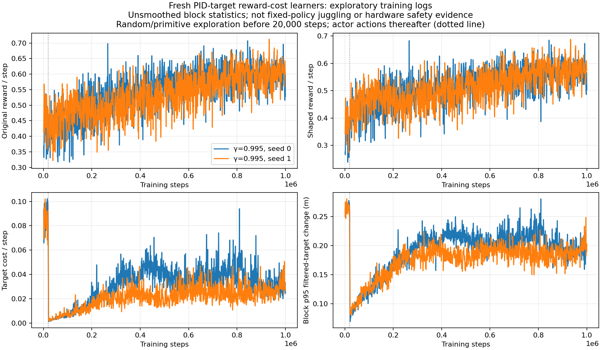
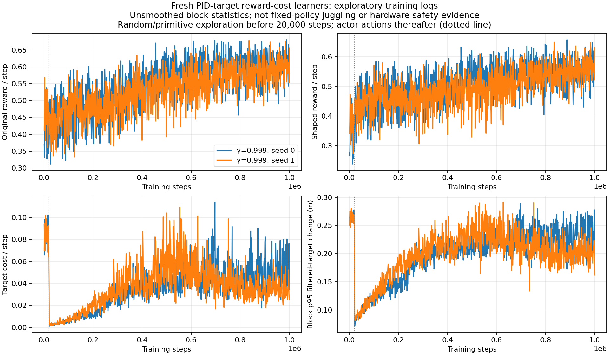

# First-million reward and target-cost traces

Four scratch cost100 learners spend4.2–6.9% of raw exploratory training reward on the actual PID-target quartic cost over their first million steps, while rising raw reward accompanies increasing command motion after exploration switches to actor actions.

Documentation time: 2026-11-02 00:20:09 -0600. Newly generated2026-11-02 from completed1000-step log blocks; no new rollouts or implementation changes. All four policies trained from random under the unchanged canonical sensing/control and established randomization. These are exploratory on-policy training logs with changing states and reset frequencies, not frozen-policy juggling comparisons or physical energy measurements.

| Gamma | Seed | Original reward sum | Shaped reward sum | Cost sum | Cost / raw reward |
|---|---:|---:|---:|---:|---:|
| .995 | 0 | 546342.000 | 514071.765 | 32270.235 | 5.907% |
| .995 | 1 | 531855.000 | 509559.108 | 22295.892 | 4.192% |
| .999 | 0 | 545410.000 | 509454.291 | 35955.709 | 6.592% |
| .999 | 1 | 530207.000 | 493510.526 | 36696.474 | 6.921% |

The dotted20,000-step transition changes the action source from random/primitive exploration to actor actions. Its immediate cost drop must not be attributed to learning. From20k–100k to900k–1M, raw reward per step rises from roughly0.436–0.449 to0.596–0.603, while cost per step rises from0.0040–0.0051 to0.0277–0.0501. This is a reward/motion tradeoff observation, not evidence of sustained juggling. No stationary penalty coefficient changed:100 remains constant throughout.



[All2000 complete blocks](../../../docs/assets/juggling/target-cost-g0995-training-1m-20261102.csv); [source-prefix hashes, config hashes, generator and output hashes, totals](../../../docs/assets/juggling/target-cost-g0995-training-1m-20261102.json). Each trace contains1000 unsmoothed blocks per seed,1M steps each. Figures show block p95 filtered-target changes, not joint limits or substep acceleration.



[All2000 complete blocks](../../../docs/assets/juggling/target-cost-g0999-training-1m-20261102.csv); [source-prefix hashes, config hashes, generator and output hashes, totals](../../../docs/assets/juggling/target-cost-g0999-training-1m-20261102.json). Each trace contains1000 unsmoothed blocks per seed,1M steps each. Figures show block p95 filtered-target changes, not joint limits or substep acceleration.

[Raw fixed1M juggling comparisons](../../../docs/assets/juggling/target-cost-both-discounts-1m-summary-20261102.csv) and [training-time raw juggling/reward/motion plots](../../../docs/juggling-smooth-sweep.md) supply the separate performance measurements. Reward cannot substitute for counts or episode steps. At inspection the four cost learners, remaining weak-actor6M evaluation allocations, and CPU115950 long test were still RUNNING, with9 total user GPU requests including unrelated jobs. No additional jobs were launched. Infinite juggling and real-robot stop avoidance remain unproven.

Validation:4000 contiguous1000-step blocks, exact captured-prefix SHA256 checks against all four growing source logs, output CSV/PNG hashes, per-block original-minus-shaped equals cost, and visual inspection of both plots. No code changed; implementation tests were not repeated. Earlier dated plots remain unchanged.

Reproduce:

```sh
.venv/bin/python -m scripts.analysis.plot_juggle_target_cost_training --launch docs/juggling-target-cost-launch.json --max-step 1000000 --out-prefix docs/assets/juggling/target-cost-g0995-training-1m-20261102
.venv/bin/python -m scripts.analysis.plot_juggle_target_cost_training --launch docs/juggling-target-cost-longdiscount-launch.json --max-step 1000000 --out-prefix docs/assets/juggling/target-cost-g0999-training-1m-20261102
```

Related: [E085](../../../docs/experiment_logbook.md#e085), [E086](../../../docs/experiment_logbook.md#e086), [A087](../../../docs/agent_logbook.md#a087).
