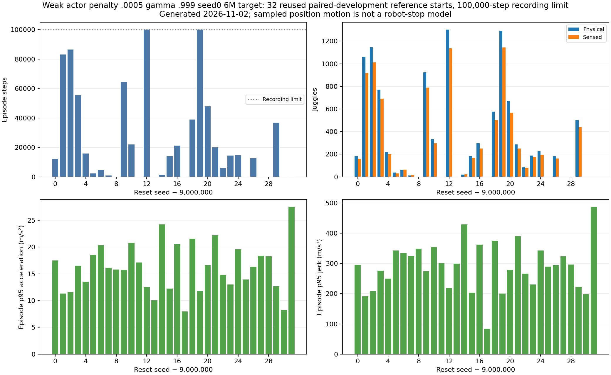
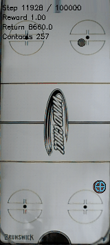

# Weak actor-penalty longer-discount6M paired long results

The .0005 actor-penalty gamma .999 seed0 6M target averages330 physical juggles and24,234.625 steps on32 reused long-development starts, with modest paired typical-motion reductions but30 puck losses and known worse command maxima.

Documentation time: 2026-11-02 00:24:58 -0600. CPU115950 completed2026-11-02 00:22:34 -0600 (06:22:34 UTC), exit0:0, elapsed37m04s. Fresh fixed-policy evaluation, followed by saved-trajectory analysis; no learner warm start. Frozen model SHA2560f4e78c40eafd4b3bbd89f92b5199752a01ac67172cb5a790347e56c2ef7e68c. Original merged dynamics, canonical noisy/delayed/occluded hist2 sensing, legacy history cadence, PID/smoothing and established ±25% DR preserved. [Completed launch and exact command/config/source hashes](../../../docs/juggling-weak-longdiscount-6m-long-reference-launch.json).

Protocol:32 predeclared starts9000000–9000031,100,000-step recording horizon, no adaptation. This globally reused paired-development cohort is not independent confirmation. The retained reference trained3.6M versus6M for both gamma .999 policies; do not call the reference an equal-budget control.

| Target policy | Mean physical juggles | Mean sensed juggles | Mean steps | Puck-loss endings | Censored at100k |
|---|---:|---:|---:|---:|---:|
| Retained gamma .9953.6M |546.25|482.9375|37131.03125|29|3|
| Unregularized gamma .9996M |321.1875|280.1875|23142.34375|31|1|
| Weak .0005 gamma .9996M |330|289.5|24234.625|30|2|

Candidate median13,388.5 steps/184 physical juggles, min16 steps/0 juggles, max100k steps/1302 juggles. Across all32:775,508 steps/10,560 physical juggles. Mean raw reward18,302.1875. The two recording-limit cases are9000012 (1302 physical/1136 sensed) and9000019 (1292/1143); subsequent outcomes are unknown. All30 other endings record puck_passed_paddle. A quarter of cases last at most133.25 steps, so the mean hides considerable early-failure risk.



Generated2026-11-02 from [32 raw episodes](../../../docs/assets/juggling/weak-longdiscount-6m-long-candidate-20261102.csv), [summary/source hashes](../../../docs/assets/juggling/weak-longdiscount-6m-long-candidate-20261102.json), and [full NPZ recount/trajectory hashes](../../../docs/assets/juggling/weak-longdiscount-6m-long-verified-trajectories-20261102.json). Counts were reconstructed with the existing pure counter, not an independent detector. Ignored local NPZ/bundles remain reproducible through recorded paths and hashes, not uploaded as large Git artifacts.

Paired motion uses the first min250/candidate-duration/control-duration positions per seed, excluding reset-position samples. All32 initial observations match exactly for both comparisons. Median per-seed p95 ratios (candidate/control): retained reference speed0.847869, acceleration0.954361, jerk0.908018; same-discount6M control speed0.866525, acceleration0.969388, jerk0.928966. These are medians of paired ratios, not ratios of medians. Whole-episode candidate median p95 position-derived jerk294.7595m/s³. [Reference paired JSON](../../../docs/assets/juggling/weak-longdiscount-6m-long-reference-paired-motion-20261102.json), [reference per-seed CSV](../../../docs/assets/juggling/weak-longdiscount-6m-long-reference-pairs-20261102.csv), [same-discount paired JSON](../../../docs/assets/juggling/weak-longdiscount-6m-long-discount-control-paired-motion-20261102.json). Equal reset/windows do not equalize visited states.

Prior exact controller replay on the separate20k development cohort found smaller typical command changes but worse global cached-velocity acceleration: candidate56.893813 versus42.189274m/s², jerk1531.071296 versus1294.700735m/s³ for the same-discount6M control. These are prior equal-prefix maxima, not fresh100k replay measurements; the sampled-position acceleration in the long evaluator is a different statistic. [Full controller-tail evidence](../../../docs/assets/juggling/longdiscount-weak-6m-pid-comparison-20261102-summary.csv). No policy promotion or hardware-stop claim follows from a modest endurance/typical-jerk tradeoff.



The first reset9000000 lasts12,127 steps/184 physical/159 sensed juggles, then loses the puck. The GIF contains only steps11,928–12,127,200 frames at50ms,160×357; it is the first scheduled episode, not a selected best clip. [GIF provenance](../../../docs/assets/juggling/weak-longdiscount-6m-long-gif-provenance-20261102.json).

Validation: authoritative Slurm COMPLETED/0:0, worker complete, all source/private bundle hashes unchanged;32 complete finite NPZs, original JSON count/reward/length parity, all32 matching initial observations in each paired comparison, visually inspected distribution figure, GIF metadata/source-copy hash, link/TOC checks. No training rerun or implementation change. Four cost100 scratch learners and the remaining actor-penalty evaluation allocations continue; no new jobs launched here. Finite simulation omits robot joint loads and substep/controller/hardware stops; infinite juggling and e-stop safety remain unproven.

Reproduction (saved data; recount uses trajectory_metrics in scripts.analysis.juggle_long_reference_continue on each training_seed9000000–9000031.npz):

```sh
.venv/bin/python -m scripts.analysis.plot_juggle_long_reference --results runs/td3/juggle_smooth_0005_g0999_seed0_target6m_long_20261102/paired_reference_100k_eval/results.json --verified-trajectories docs/assets/juggling/weak-longdiscount-6m-long-verified-trajectories-20261102.json --out-prefix docs/assets/juggling/weak-longdiscount-6m-long-candidate-20261102 --policy-label 'Weak actor penalty .0005 gamma .999 seed0 6M target' --cohort-label 'reused paired-development reference starts'
.venv/bin/python -m scripts.analysis.juggle_paired_motion --baseline runs/td3/juggle_long_reference_20261101/independent_100k_eval/results.json --candidate runs/td3/juggle_smooth_0005_g0999_seed0_target6m_long_20261102/paired_reference_100k_eval/results.json --prefix-steps 250 --out docs/assets/juggling/weak-longdiscount-6m-long-reference-paired-motion-20261102.json
```

Related: [E084 launch](../../../docs/experiment_logbook.md#e084), [E08120k/controller comparison](../../../docs/experiment_logbook.md#e081), [E080 unregularized long control](../../../docs/experiment_logbook.md#e080), [E087](../../../docs/experiment_logbook.md#e087), [A088](../../../docs/agent_logbook.md#a088).
