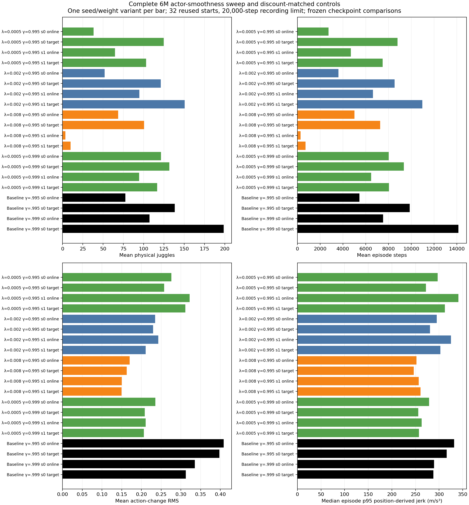

# Complete6M actor-smoothness sweep

All eight scratch actor-penalty learners completed their fixed6M budgets, showing typical-motion/endurance and seed tradeoffs without a clear consistently better policy.

Documentation time: 2026-11-02 00:40:18 -0600. Final weak .0005/gamma .995 seed0 and seed1 jobs115858/115859 completed2026-11-02 00:31:00 and00:37:07 -0600, exit0:0, elapsed7h44m10s/7h50m17s; these include final and milestone evaluations, not training-only times. Other six completions were recorded earlier. Four separate reward-cost100 learners remain RUNNING, total7 user GPUs including3 unrelated jobs at the final scheduler check. No new jobs launched or old jobs restarted.

Protocol:all20 variants (eight fresh learner seeds × online/target, two historical seed0 discount controls × online/target),640 raw episodes,32 reused development starts700000–700031,20k recording horizon, frozen6M checkpoints. Noise, occlusions, delay/interpolation, legacy hist2 sampling, PID, action smoothing and ±25% DR unchanged. No pretrained actor/critic or residual base used for new training. Correlated online/target roles are not independent training seeds.

| Gamma | Actor penalty | Seed | Role | Physical juggles | Sensed juggles | Steps | Raw reward |
|---|---:|---:|---|---:|---:|---:|---:|
| 0.995 | 0.0005 | 0 | online | 38.28125 | 34.06250 | 2744.15625 | 2011.68750 |
| 0.995 | 0.0005 | 0 | target | 124.62500 | 110.78125 | 8798.25000 | 6616.75000 |
| 0.995 | 0.0005 | 1 | online | 64.71875 | 57.09375 | 4689.31250 | 3542.90625 |
| 0.995 | 0.0005 | 1 | target | 103.18750 | 90.71875 | 7486.18750 | 5667.12500 |
| 0.995 | 0.002 | 0 | online | 51.84375 | 45.53125 | 3614.68750 | 2600.78125 |
| 0.995 | 0.002 | 0 | target | 121.21875 | 108.12500 | 8546.37500 | 6362.40625 |
| 0.995 | 0.002 | 1 | online | 94.75000 | 83.56250 | 6641.15625 | 4819.78125 |
| 0.995 | 0.002 | 1 | target | 150.59375 | 133.62500 | 10971.65625 | 8222.06250 |
| 0.995 | 0.008 | 0 | online | 68.53125 | 60.65625 | 5006.96875 | 3708.65625 |
| 0.995 | 0.008 | 0 | target | 100.68750 | 89.46875 | 7270.68750 | 5372.03125 |
| 0.995 | 0.008 | 1 | online | 3.59375 | 3.25000 | 290.78125 | 200.09375 |
| 0.995 | 0.008 | 1 | target | 9.93750 | 8.43750 | 722.87500 | 527.68750 |
| 0.999 | 0.0005 | 0 | online | 121.43750 | 107.53125 | 8012.93750 | 5622.87500 |
| 0.999 | 0.0005 | 0 | target | 131.75000 | 114.93750 | 9347.31250 | 6953.96875 |
| 0.999 | 0.0005 | 1 | online | 94.53125 | 83.46875 | 6473.93750 | 4703.12500 |
| 0.999 | 0.0005 | 1 | target | 116.68750 | 103.87500 | 8045.68750 | 5939.56250 |
| 0.995 | 0.0 | 0 | online | 77.53125 | 68.03125 | 5447.00000 | 3991.75000 |
| 0.995 | 0.0 | 0 | target | 138.40625 | 121.71875 | 9859.81250 | 7363.71875 |
| 0.999 | 0.0 | 0 | online | 107.12500 | 92.40625 | 7518.75000 | 5459.28125 |
| 0.999 | 0.0 | 0 | target | 198.62500 | 175.53125 | 14141.53125 | 10555.37500 |

The newly complete .0005/gamma .995 targets average124.625/8798.25 steps (seed0) and103.1875/7486.1875 (seed1), below the discount-matched138.40625/9859.8125 control. Seed0 has24 puck losses/8 censored20k episodes; seed1 has26/6. Both online roles lose the puck on all32 starts. All128 new role/start counts, sensed counts, steps and raw rewards match saved NPZ recounts using the existing counter.

The highest regularized target mean on this cohort is .002/gamma .995 seed1:150.59375 physical juggles/10971.65625steps, above its .995 control but below the .999 control198.625/14141.53125. Strong .008 seed1 averages9.9375/722.875. These small seed samples and repeated starts do not establish statistically reliable policy superiority. No success/cap acceptance gate selects a policy.



Generated2026-11-02 from [20-variant summary](../../../docs/assets/juggling/smooth-full-6m-summary-20261102.csv) and [all640 raw episodes](../../../docs/assets/juggling/smooth-full-6m-episodes-20261102.csv). [Provenance](../../../docs/assets/juggling/smooth-full-6m-provenance-20261102.json) pins20 results JSONs,80 frozen model/config/args/meta files, analysis and published hashes; local ignored NPZ/model bundles are identified, not uploaded. [Moving training-time count/reward/motion plots](../../../docs/juggling-smooth-sweep.md) were refreshed from saved data.

Equal-prefix motion compares each candidate to the same-discount/same-role6M control over min250/both episode durations positions, excluding reset samples. All512 initial observations across16 comparisons match exactly. Target median paired p95 jerk ratios: weak .995 seeds0/1=0.936232/0.990234; medium .995=0.940310/0.971407; strong .995=0.800834/0.788555; weak .999=0.956049/0.908041. [All paired windows, motion distributions, source/trajectory hashes](../../../docs/assets/juggling/smooth-full-6m-paired-motion-20261102.json). Smaller action deltas do not guarantee lower acceleration tails; different visited states and20Hz position sampling limit transfer implications.

The completed [weak .9996M100k test](../../../docs/experiment_logbook.md#e087) illustrates how the20k cohort can understate some long tails while early failures persist:330 mean physical juggles/24234.625steps on different globally reused reference starts,30 losses/2 censored. Retained3.6M reference remains546.25/37131.03125 on that long cohort. No frozen policy is promoted for hardware. Four cost100 scratch learners continue toward3M/6M under their unchanged fixed recipes. Further variants await those results.

Validation:all640 raw rows aggregate to the20 reported count/reward/step means and motion medians;16 full paired comparisons and512 initial-state checks;128 newly complete NPZ/JSON outcomes recounted; source guards unchanged; Slurm terminal states verified; figure visually inspected. A reporting-only caption was corrected to say frozen checkpoint comparisons instead of asserting training continues, since this actor sweep is complete. Earlier dated figures/hashes remain unchanged. No simulator/trainer/evaluator source change or expensive re-training for documentation. Finite simulation cannot prove infinite juggling or UR5 e-stop safety.

Reproduce:run `.venv/bin/python -m scripts.analysis.juggle_smooth_sweep`; select step6000000 and phases32_reused_starts/32_reused_starts_historical into the frozen CSVs; attach gamma/coefficient/seed from each frozen args.yaml; call `scripts.analysis.juggle_paired_motion.compare` on each same-discount/same-role control/candidate pair at250 positions. Render:

```sh
.venv/bin/python -m scripts.analysis.plot_juggle_fixed_comparison --summary docs/assets/juggling/smooth-full-6m-summary-20261102.csv --out docs/assets/juggling/smooth-full-6m-comparison-20261102.png --height 14 --title 'Complete 6M actor-smoothness sweep and discount-matched controls'
```

Related: [E068 complete3M](../../../docs/experiment_logbook.md#e068), [E075 medium6M/control tails](../../../docs/experiment_logbook.md#e075), [E081 weak .9996M](../../../docs/experiment_logbook.md#e081), [E088](../../../docs/experiment_logbook.md#e088), [A089](../../../docs/agent_logbook.md#a089).
