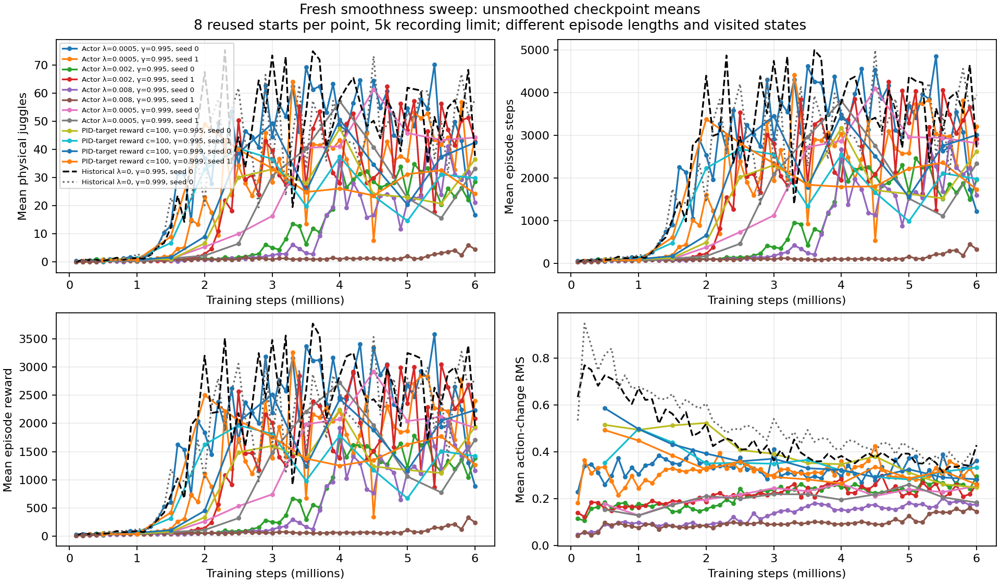
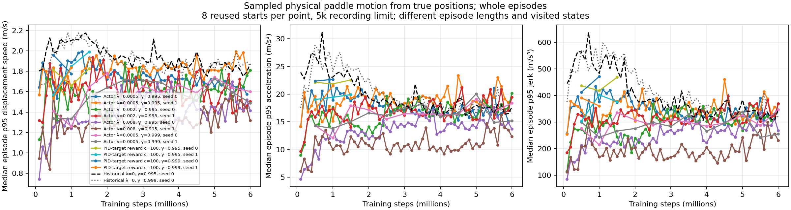

# Reward-cost acquisition checks before3M

Saved eight-start checkpoint evaluations show early juggling emerging in all four reward-cost learners, while trailing their own discount/budget-matched historical controls.

Documentation/analysis time: 2026-11-02 00:46:27 -0600. This is saved-artifact analysis, not a new experiment or fresh evaluation. Gamma .995 comparisons use2M online weights; gamma .999 comparisons use1.5M online weights. Within each comparison:8 reused validation starts10000–10007,5000-step recording horizon. Do not compare the discounts as equal budgets or pool these episodes with32-start/20k milestones.

| Run | Training steps | Physical juggles | Sensed juggles | Episode steps | Raw reward |
|---|---:|---:|---:|---:|---:|
| noisy_history_target_cost_100_20261102_seed0 | 2000000 | 6.625 | 5.875 | 496.375 | 336.0 |
| noisy_history_target_cost_100_20261102_seed1 | 2000000 | 33.0 | 29.875 | 2234.875 | 1625.0 |
| noisy_history_target_cost_100_g0999_20261102_seed0 | 1500000 | 1.625 | 1.375 | 174.375 | 107.875 |
| noisy_history_target_cost_100_g0999_20261102_seed1 | 1500000 | 9.0 | 6.375 | 612.625 | 420.875 |
| noisy_history_20261029_seed0 | 2000000 | 67.625 | 61.5 | 4401.0 | 3199.875 |
| noisy_history_long_discount_20261029_seed0 | 1500000 | 22.875 | 19.0 | 1747.5 | 1191.625 |

The .995 seed1 rise to33 physical juggles/2234.875 steps is evidence that the cost100 recipe can acquire some juggling; seed0 still averages6.625/496.375 at the same budget. Both trail the matched control67.625/4401. The .999 seeds average1.625/174.375 and9/612.625 at1.5M, versus22.875/1747.5 for that control. These small reused cohorts do not resolve final policy ranking or the smoothness/endurance tradeoff. All four remain on their fixed6M scratch budgets, with32-start3M/6M online+target tests scheduled by the existing runners. No restart, added variant or early stopping follows from this check.

[Six frozen summary rows](../../../docs/assets/juggling/target-cost-emerging-validation-summary-20261102.csv), [48 raw episode outcomes](../../../docs/assets/juggling/target-cost-emerging-validation-episodes-20261102.csv), [source/config/model and output hashes](../../../docs/assets/juggling/target-cost-emerging-validation-provenance-20261102.json). Exact raw rewards accompany counts; shaped training reward is not used as juggling evidence. Local ignored checkpoints and trajectories are identified in provenance/CSV and remain on disk.

These existing moving figures were refreshed2026-11-02 from saved records;8-start validation and32-start milestones are distinguished in [report/CSV](../../../docs/juggling-smooth-sweep.md). The linked moving figures can gain later points; the frozen48-row tables above preserve the evidence used here. Earlier dated snapshots remain unchanged.

Validation:6 complete variants/48 raw rows, unique identical8-start cohorts and exact aggregate physical/sensed counts, steps and raw rewards; source and frozen bundle hashes captured; relative links, logbook anchors and TOCs checked. Canonical simulator/control and DR unchanged. No implementation changes, new rollouts or expensive training for documentation. Scheduler verified all four jobs RUNNING and advancing;7 total user GPUs including3 unrelated jobs. Infinite juggling and robot-stop avoidance remain unproven.

Reproduce with `.venv/bin/python -m scripts.analysis.juggle_smooth_sweep`; select the explicit six run/step/online validation rows listed above and their48 episode rows from the report CSVs. [E0851M milestone](../../../docs/experiment_logbook.md#e085), [E086 reward traces](../../../docs/experiment_logbook.md#e086), [E089](../../../docs/experiment_logbook.md#e089), [A090](../../../docs/agent_logbook.md#a090).
