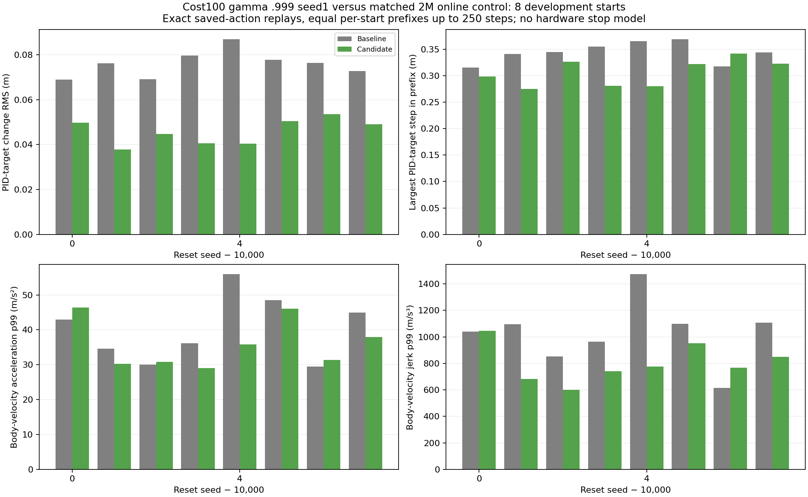

# Cost-policy acquisition and early controller replay

The gamma .999 cost100 seed1 online2M checkpoint combines higher raw juggling and lower typical actual PID-target/velocity motion than its matched2M control on eight reused validation starts, while seed0 lags and larger tests remain pending.

Documentation time: 2026-11-02 01:16:26 -0600. Checkpoint outcomes are saved evaluations; the equal-prefix command replay is fresh CPU diagnostic work in this pass. Training remains from scratch under the unchanged merged simulator, canonical noisy/delayed/occluded hist2/control recipe and established ±25% DR. No new learner/variant or warm start launched.

| Run | Training steps | Physical juggles | Sensed juggles | Episode steps | Raw reward |
|---|---:|---:|---:|---:|---:|
| noisy_history_target_cost_100_20261102_seed0 | 2000000 | 6.625 | 5.875 | 496.375 | 336.0 |
| noisy_history_target_cost_100_20261102_seed0 | 2500000 | 30.125 | 25.25 | 2025.125 | 1488.875 |
| noisy_history_target_cost_100_20261102_seed1 | 2000000 | 33.0 | 29.875 | 2234.875 | 1625.0 |
| noisy_history_target_cost_100_20261102_seed1 | 2500000 | 40.375 | 37.125 | 2683.0 | 1967.875 |
| noisy_history_target_cost_100_g0999_20261102_seed0 | 2000000 | 9.0 | 8.25 | 660.5 | 451.125 |
| noisy_history_target_cost_100_g0999_20261102_seed1 | 2000000 | 48.875 | 43.75 | 3385.875 | 2500.875 |
| noisy_history_20261029_seed0 | 2000000 | 67.625 | 61.5 | 4401.0 | 3199.875 |
| noisy_history_20261029_seed0 | 2500000 | 44.375 | 39.25 | 2971.0 | 2182.625 |
| noisy_history_long_discount_20261029_seed0 | 2000000 | 20.125 | 16.75 | 1435.5 | 1005.875 |

Each row uses8 development starts10000–10007,5000-step recording limit, online weights. Compare within discount and training budget. At2M, .999 cost seed1 averages48.875 physical/43.75 sensed juggles and3385.875steps versus20.125 physical juggles/1435.5steps for the control (sensed count in the table above). Cost seed0 averages9/660.5, so this is not replicated superiority. At2.5M the .995 seeds average30.125/2025.125steps and40.375/2683, versus44.375/2971 control. Early acquisition improvements do not establish final ranking or long-horizon reliability. Larger32-start3M and6M online/target comparisons remain scheduled while all four learners continue.

[9 frozen summary rows](../../../docs/assets/juggling/target-cost-pre3m-acquisition-summary-20261102.csv), [72 raw episode outcomes](../../../docs/assets/juggling/target-cost-pre3m-acquisition-episodes-20261102.csv), [source/config/model and output hashes](../../../docs/assets/juggling/target-cost-pre3m-acquisition-provenance-20261102.json). All16 new .9992M outcomes and8 .995seed1 2.5M outcomes were checked against complete NPZ counts, steps and raw rewards. Seed0 .9952.5M's8 cases were verified in the preceding pass. These reuses of validation starts are development evidence, not independent tests.

For .999 seed1 2M and its same-discount/same-budget control, replayed the recorded actions for the first min250/both durations steps per seed:8 windows,1776 exact transitions per policy. Every observation/reward/end flag/physical paddle and puck position matches saved data, including matched initial observations. Only cached filtered PID targets and body velocities are read; no extra sensor sampling or simulator changes.

| Actual controller/velocity metric | Control | Cost100 seed1 |
|---|---:|---:|
| mean pid_target_change_rms_m (m) | 0.076028 | 0.045826 |
| median pid_target_change_p99_m (m) | 0.307458 | 0.269303 |
| max pid_target_change_maximum_m (m) | 0.369281 | 0.342214 |
| max body_speed_maximum_m_s (m/s) | 2.000000 | 2.000000 |
| median velocity_acceleration_p95_m_s2 (m/s²) | 29.824328 | 21.466767 |
| median velocity_acceleration_p99_m_s2 (m/s²) | 39.520601 | 33.601532 |
| max velocity_acceleration_maximum_m_s2 (m/s²) | 57.491452 | 53.078172 |
| median velocity_jerk_p95_m_s3 (m/s³) | 705.816197 | 551.750250 |
| median velocity_jerk_p99_m_s3 (m/s³) | 1066.968843 | 772.003881 |
| max velocity_jerk_maximum_m_s3 (m/s³) | 1607.700543 | 1337.012821 |



Generated2026-11-02 from the exact saved-action replays. Mean component PID-target change RMS falls39.7%; median per-window velocity acceleration p99 falls15.0%, jerk p99 falls27.6%. Global observed acceleration/jerk maxima also fall in these windows, but individual seeds can worsen (see bars); this is not a universal per-start improvement. Absolute maxima remain53.078m/s² and1337.013m/s³. [Control replay](../../../docs/assets/juggling/target-cost-g0999-seed1-2m-baseline-pid-20261102.json), [candidate replay](../../../docs/assets/juggling/target-cost-g0999-seed1-2m-candidate-pid-20261102.json), [per-window CSV](../../../docs/assets/juggling/target-cost-g0999-seed1-2m-pid-comparison-20261102.csv), [full summary CSV](../../../docs/assets/juggling/target-cost-g0999-seed1-2m-pid-comparison-20261102-summary.csv), [comparison provenance](../../../docs/assets/juggling/target-cost-g0999-seed1-2m-pid-comparison-20261102.json).

[Training-time raw juggling/reward/episode-step and physical-motion plots](../../../docs/juggling-smooth-sweep.md) were refreshed from saved data. This result supports continuing the actual-target reward-cost approach to its later fixed checkpoints; no selected checkpoint is promoted to hardware. It measures20Hz planar motion over changing visited states, not full controller substeps, UR5 joints/torques or protective-stop logic. Reset handoff motion is excluded. Infinite juggling and e-stop avoidance remain unproven.

Validation:9 variants/72 unique per-variant starts and matching aggregate counts/steps/rewards;24 newly checked full NPZ outcomes;2×1776 exact saved-action replay transitions; reciprocal equal-prefix replay validation; full maxima table and figure inspected; source guards, input/output hashes and documentation links/anchors/TOCs checked. No implementation changes or expensive retraining for documentation. Scheduler confirms four learners RUNNING,7 total user GPU requests including3 unrelated jobs.

Reproduction: `.venv/bin/python -m scripts.analysis.juggle_smooth_sweep` regenerates the moving CSVs; select the nine listed run/step/online checkpoint-validation rows. For the command audit:

```sh
.venv/bin/python -m scripts.analysis.juggle_control_replay --results runs/td3/noisy_history_long_discount_20261029_seed0/train/checkpoint_2000000/survival_eval/results.json --paired-results runs/td3/noisy_history_target_cost_100_g0999_20261102_seed1/train/checkpoint_2000000/survival_eval/results.json --prefix-steps 250 --out docs/assets/juggling/target-cost-g0999-seed1-2m-baseline-pid-20261102.json
.venv/bin/python -m scripts.analysis.juggle_control_replay --paired-results runs/td3/noisy_history_long_discount_20261029_seed0/train/checkpoint_2000000/survival_eval/results.json --results runs/td3/noisy_history_target_cost_100_g0999_20261102_seed1/train/checkpoint_2000000/survival_eval/results.json --prefix-steps 250 --out docs/assets/juggling/target-cost-g0999-seed1-2m-candidate-pid-20261102.json
.venv/bin/python -m scripts.analysis.plot_juggle_control_replay --baseline docs/assets/juggling/target-cost-g0999-seed1-2m-baseline-pid-20261102.json --candidate docs/assets/juggling/target-cost-g0999-seed1-2m-candidate-pid-20261102.json --out-prefix docs/assets/juggling/target-cost-g0999-seed1-2m-pid-comparison-20261102 --title 'Cost100 gamma .999 seed1 versus matched 2M online control: 8 development starts'
```

Related: [E089 acquisition](../../../docs/experiment_logbook.md#e089), [E086 reward traces](../../../docs/experiment_logbook.md#e086), [E090](../../../docs/experiment_logbook.md#e090), [A091](../../../docs/agent_logbook.md#a091).
