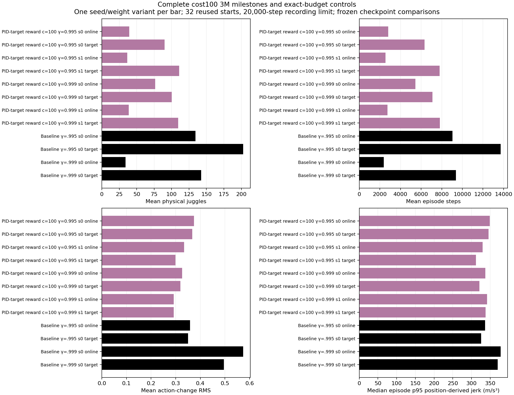
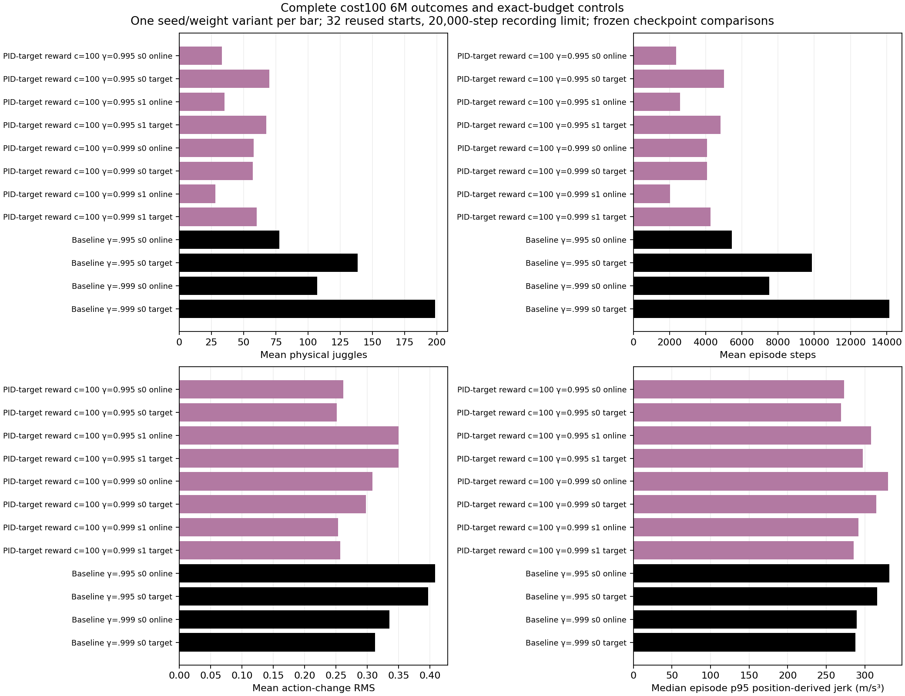
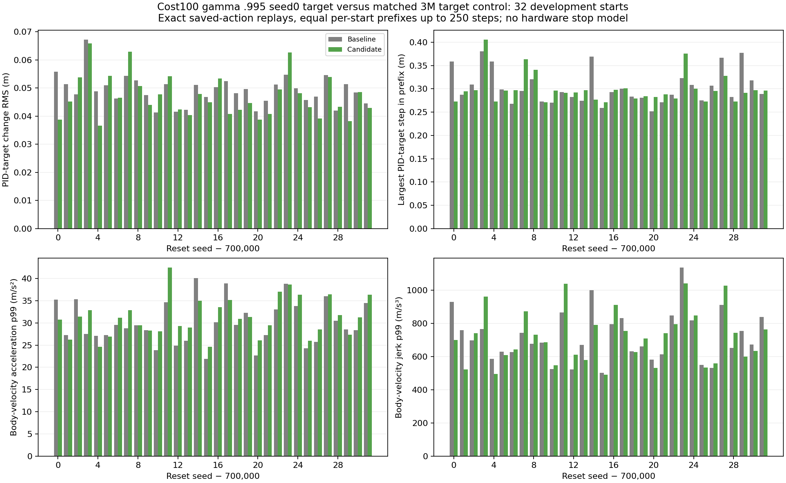
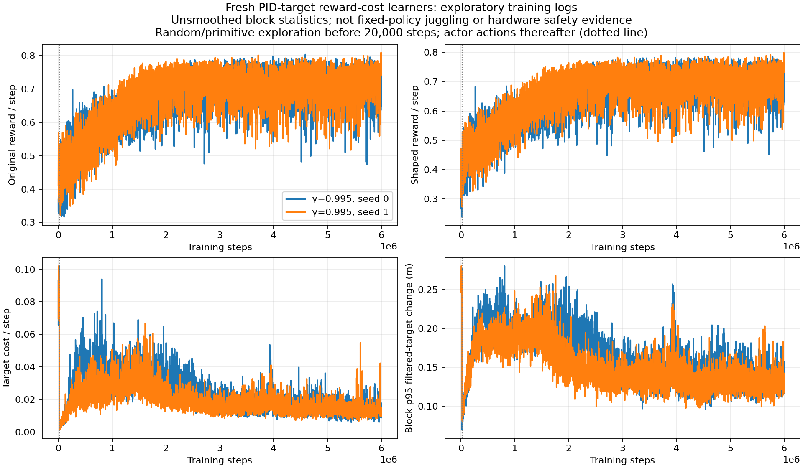
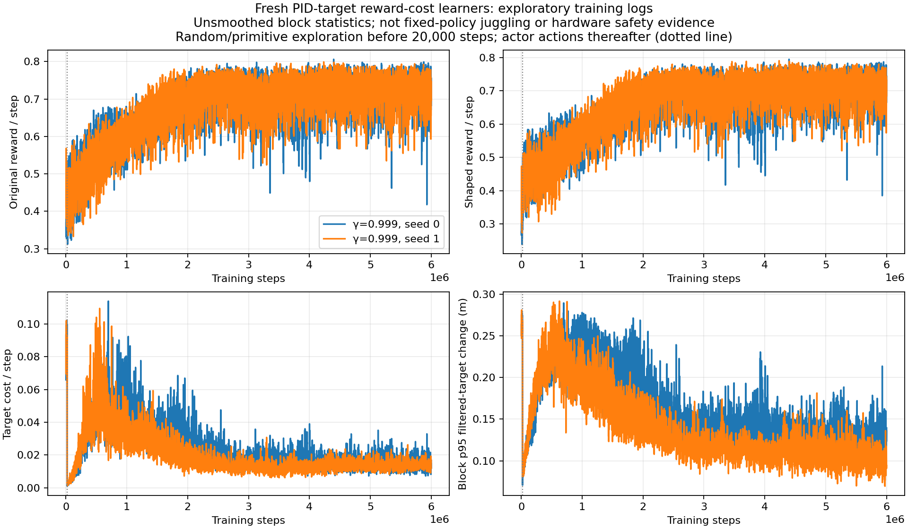
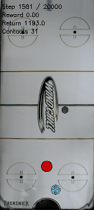

# Completed cost100 sweep and3M controller audit

All four scratch cost100 learners finished6M with worse endurance than their matched controls, and the audited .995 seed0 3M target did not show a useful command-tail improvement.

Documentation time: 2026-11-02 08:22:43 -0600. Saved-checkpoint analysis, completed training/evaluation records, and the exact saved-action controller replay performed earlier in this work session. The first partial3M snapshot was generated while seed1 target was still pending; all results below are now complete. No run time is inferred from documentation time. Slurm confirmed all four completed exit0:0:115921 ended2026-11-02 05:45:30 -0600 (elapsed7h33m21s),11592205:49:54 (7h37m45s),11592806:19:15 (7h25m26s),11592906:18:07 (7h24m15s). These include evaluations, not training-only elapsed time. Durable worker completion times agree in UTC. [Original launch](../../../docs/juggling-target-cost-launch.json), [longer-discount launch](../../../docs/juggling-target-cost-longdiscount-launch.json), [original contract review](../../../docs/juggling-target-cost-contract-review-20261102.json).

All policies trained from random actor/critic, zero actor penalty, constant actual PID-target quartic reward coefficient100, unchanged original sensing/control/history and ±25% DR. Fixed tests use32 reused development starts700000–700031/h20k, online and target roles separately. Historical controls are discount/budget/role matched; roles are correlated and training replication is only two seeds per discount.

| Budget | Target policy | Physical juggles | Sensed juggles | Mean steps | Raw reward |
|---|---|---:|---:|---:|---:|
| 3M | noisy_history_target_cost_100_20261102_seed0 | 90.09375 | 80.09375 | 6340.21875 | 4705.21875 |
| 3M | noisy_history_target_cost_100_20261102_seed1 | 110.75 | 96.90625 | 7803.625 | 5850.21875 |
| 3M | noisy_history_target_cost_100_g0999_20261102_seed0 | 100.25 | 89.5 | 7108.4375 | 5296.84375 |
| 3M | noisy_history_target_cost_100_g0999_20261102_seed1 | 109.5625 | 96.875 | 7814.75 | 5866.71875 |
| 3M | noisy_history_20261029_seed0 | 202.625 | 178.8125 | 13708.5625 | 10279.34375 |
| 3M | noisy_history_long_discount_20261029_seed0 | 142.375 | 129.5 | 9376.625 | 6915.4375 |
| 6M | noisy_history_target_cost_100_20261102_seed0 | 69.9375 | 61.8125 | 5014.84375 | 3746.65625 |
| 6M | noisy_history_target_cost_100_20261102_seed1 | 67.4375 | 57.96875 | 4819.28125 | 3590.53125 |
| 6M | noisy_history_target_cost_100_g0999_20261102_seed0 | 57.15625 | 50.3125 | 4069.625 | 3014.0 |
| 6M | noisy_history_target_cost_100_g0999_20261102_seed1 | 60.0625 | 52.53125 | 4256.4375 | 3143.9375 |
| 6M | noisy_history_20261029_seed0 | 138.40625 | 121.71875 | 9859.8125 | 7363.71875 |
| 6M | noisy_history_long_discount_20261029_seed0 | 198.625 | 175.53125 | 14141.53125 | 10555.375 |

Every cost100 target deteriorated from3M to6M on the same32-start protocol. Final cost targets span57.15625–69.9375 physical juggles/4069.625–5014.84375steps, versus .995 control138.40625/9859.8125 and .999 control198.625/14141.53125. Early .999seed1 2M eight-start gains in E090 did not establish later reliability, and are preserved as historical evidence rather than rewritten. No cost100 checkpoint replaces the retained unregularized3.6M reference.

Generated2026-11-02 from [12 variant summaries](../../../docs/assets/juggling/target-cost-complete-3m-summary-20261102.csv), [384 raw episodes](../../../docs/assets/juggling/target-cost-complete-3m-episodes-20261102.csv), [source/config/model/generator/output hashes](../../../docs/assets/juggling/target-cost-complete-3m-provenance-20261102.json). Each budget includes256 cost-policy outcomes newly recounted from NPZ and128 previously verified historical control cases.

Generated2026-11-02 from [12 variant summaries](../../../docs/assets/juggling/target-cost-complete-6m-summary-20261102.csv), [384 raw episodes](../../../docs/assets/juggling/target-cost-complete-6m-episodes-20261102.csv), [source/config/model/generator/output hashes](../../../docs/assets/juggling/target-cost-complete-6m-provenance-20261102.json). Each budget includes256 cost-policy outcomes newly recounted from NPZ and128 previously verified historical control cases.

The earlier [five-variant160-case partial3M summary](../../../docs/assets/juggling/target-cost-first-3m-summary-20261102.csv), [raw episodes](../../../docs/assets/juggling/target-cost-first-3m-episodes-20261102.csv), [figure](../../../docs/assets/juggling/target-cost-first-3m-comparison-20261102.png) and [provenance](../../../docs/assets/juggling/target-cost-first-3m-provenance-20261102.json) are retained as the initial snapshot, not additional independent cases. Its pending caption describes that snapshot time, superseded by the complete3M plot above.

The .995seed0 3M target's exact controller audit uses32 equal initial windows of min250/both durations,7889 transitions per policy. Every raw observation/reward/flag and true puck/paddle position matches the saved trajectory; only cached filtered PID targets and body velocities are read. No extra sensor/RNG calls. The lower juggle count is accompanied by only4.3% lower mean component PID-target-change RMS(.047050 versus.049179m). Median p99 target step rises.263345→.267905m and largest step.380370→.405360m; median velocity acceleration p99 rises29.0959→31.0511m/s² and jerk680.844→703.359m/s³. Maximum acceleration rises52.3794→52.8741m/s², while maximum jerk falls1409.636→1318.446m/s³. Mixed tails and lost endurance are unfavorable evidence for this checkpoint, not a general impossibility result for reward shaping.

[Baseline exact replay](../../../docs/assets/juggling/target-cost-g0995-seed0-3m-baseline-pid-20261102.json), [candidate exact replay](../../../docs/assets/juggling/target-cost-g0995-seed0-3m-candidate-pid-20261102.json), [all64 per-window metric rows](../../../docs/assets/juggling/target-cost-g0995-seed0-3m-pid-comparison-20261102.csv), [full maxima/summary table](../../../docs/assets/juggling/target-cost-g0995-seed0-3m-pid-comparison-20261102-summary.csv), [plot provenance](../../../docs/assets/juggling/target-cost-g0995-seed0-3m-pid-comparison-20261102.json). Position-derived motion in the performance plots is distinct from cached-velocity acceleration/jerk here. Windows equalize duration/reset, not visited states;20Hz omits substep and UR5 joint/controller behavior.

[12,000 raw1000-step blocks](../../../docs/assets/juggling/target-cost-g0995-training-6m-20261102.csv) and [prefix/source/generator/output provenance](../../../docs/assets/juggling/target-cost-g0995-training-6m-20261102.json). These exploratory logs are separate from frozen-policy juggling outcomes; the20k action-source switch is not learned improvement.

[12,000 raw1000-step blocks](../../../docs/assets/juggling/target-cost-g0999-training-6m-20261102.csv) and [prefix/source/generator/output provenance](../../../docs/assets/juggling/target-cost-g0999-training-6m-20261102.json). These exploratory logs are separate from frozen-policy juggling outcomes; the20k action-source switch is not learned improvement.

[Moving raw-juggle/reward/episode-step and sampled-motion training plots](../../../docs/juggling-smooth-sweep.md) now include complete cost100 outcomes and the new cost10 jobs. No checkpoint caps/success fractions select a policy.

First reset700000 lasts1780steps/25 physical/18 sensed juggles, then loses the puck. Clip shows its last200 frames,steps1581–1780,160×357,50ms/frame; not a selected best episode. [GIF provenance](../../../docs/assets/juggling/target-cost100-g0999-seed1-6m-gif-provenance-20261102.json).

Validation:all512 cost-policy3M/6M NPZ outcomes match original counts/sensed counts/steps/raw rewards; all768 table rows match aggregate means/motion medians; complete source/bundle hashes;2×7889 exact replay steps;24,000 contiguous1000-step training blocks with reward-cost accounting and prefix hashes; visual inspection of all new plots and GIF metadata; documentation links/anchors/TOCs checked. No simulator/trainer change. The only reporting change discovers the new cost10 launch manifest. No expensive retraining to produce figures.

Next action:two fresh gamma .999 cost10 trials isolate a tenfold weaker stationary penalty, after cost100 completed its full budgets. See linked launch entry. Cost400 remains unlaunched. Neither finite development results nor planar motion metrics establish infinite juggling or real-robot e-stop safety.

Reproduction: `.venv/bin/python -m scripts.analysis.juggle_smooth_sweep`; select3M/6M32_reused_starts rows for four cost100 learners and two historical controls. Frozen summary CSVs render with `scripts.analysis.plot_juggle_fixed_comparison`. Training logs render with `scripts.analysis.plot_juggle_target_cost_training --launch docs/juggling-target-cost[-longdiscount]-launch.json --max-step 6000000 --out-prefix ...`. Controller replay uses `scripts.analysis.juggle_control_replay --prefix-steps 250 --results CANDIDATE --paired-results CONTROL --out ...` in both directions, then `scripts.analysis.plot_juggle_control_replay`; exact input paths and generator hashes are in the linked JSONs.

Related: [E090 early2M result](../../../docs/experiment_logbook.md#e090), [E091](../../../docs/experiment_logbook.md#e091), [A092](../../../docs/agent_logbook.md#a092), [E092 new launch](../../../docs/experiment_logbook.md#e092).
