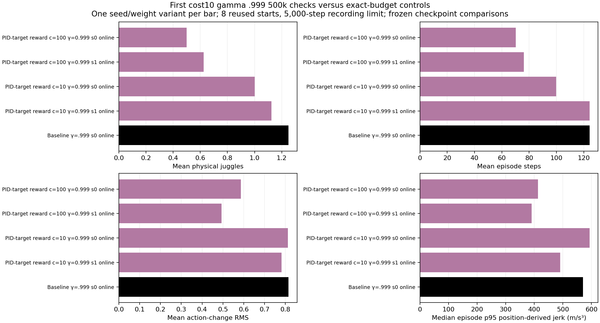
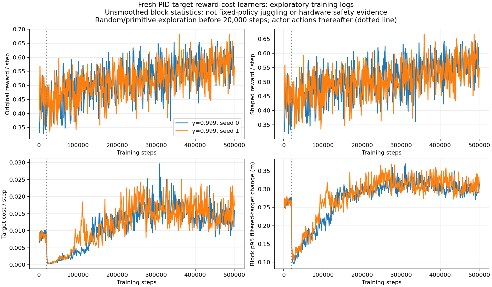

# Cost10 first500k checkpoint and reward traces

Both cost10 gamma .999 scratch policies remain immature at500k, averaging1.0/1.125 physical juggles on eight reused starts, while larger target changes appear during exploratory training.

Documentation time: 2026-11-02 08:50:21 -0600. Saved500k checkpoint analysis, no new rollouts or learner changes. Jobs116027/116028 confirmed RUNNING and advancing;5 total user GPU requests including3 unrelated jobs. All sensing, control, dynamics and established DR remain unchanged; [pinned launch](../../../docs/juggling-target-cost10-longdiscount-launch.json) and [prelaunch contract review](../../../docs/juggling-target-cost10-contract-review-20261102.json).

Within-budget protocol:500k online weights,8 reused validation starts10000–10007,5000-step recording horizon. Cost10 seeds, completed cost100 seeds and historical unregularized control share the effective configuration and cohort. These are separate from the upcoming32-start1M tests.

| Policy | Physical juggles | Sensed juggles | Episode steps | Raw reward |
|---|---:|---:|---:|---:|
| noisy_history_target_cost_100_g0999_20261102_seed0 | 0.5 | 0.25 | 70.125 | 40.5 |
| noisy_history_target_cost_100_g0999_20261102_seed1 | 0.625 | 0.5 | 76.125 | 39.875 |
| noisy_history_target_cost_10_g0999_20261102_seed0 | 1.0 | 0.625 | 99.875 | 58.25 |
| noisy_history_target_cost_10_g0999_20261102_seed1 | 1.125 | 1.25 | 124.25 | 67.0 |
| noisy_history_long_discount_20261029_seed0 | 1.25 | 0.75 | 124.25 | 71.875 |



Generated2026-11-02 from [5 frozen summaries](../../../docs/assets/juggling/target-cost10-first-500k-summary-20261102.csv), [40 raw episodes](../../../docs/assets/juggling/target-cost10-first-500k-episodes-20261102.csv), and [source/config/model/output hashes](../../../docs/assets/juggling/target-cost10-first-500k-provenance-20261102.json). New cost10 seeds average99.875/124.25steps versus124.25control; these small early outcomes do not establish superiority, failure of acquisition or hardware readiness. Larger first-million and full6M outcomes remain unknown. No success/cap acceptance gate changes the fixed budgets.



Generated2026-11-02 from [1000 raw1000-step blocks](../../../docs/assets/juggling/target-cost10-g0999-training-500k-20261102.csv) and [source-prefix/config/generator/output hashes](../../../docs/assets/juggling/target-cost10-g0999-training-500k-20261102.json). Seed0 raw reward259284, shaped253508.0405, cost5775.9595 (2.228% raw); seed1 raw258615, shaped252510.4038, cost6104.5962 (2.360%). Target changes grow after20k; the sharp initial drop marks random-to-actor action-source switching, not learned smoothness. These are changing-policy exploratory logs, not frozen-policy juggle counts or motor energy. Cost is stationary10 throughout, and different visited actions/states mean the total cost need not be exactly one tenth of another learner's cost100 logs.

[Moving raw juggling/reward/episode-length and physical-motion training plots](../../../docs/juggling-smooth-sweep.md) include the new checkpoints. First1M/3M/6M32-start tests will keep physical/sensed counts and episode steps separate from shaped reward. The report refresh reads saved records only.

Validation:16 new full NPZ outcomes agree with evaluator counts/sensed counts/steps/raw rewards; effective configs match the historical control. Five variants/40 unique per-variant raw rows aggregate correctly;1000 contiguous blocks, original-minus-shaped accounting, captured source-prefix/output hashes and unchanged launch source guards verified. Both new figures visually inspected; relative links/images and logbook anchors/TOCs checked. No implementation changes or new experiment launched. Infinite juggling and real-robot stop avoidance remain unproven.

Reproduce with `.venv/bin/python -m scripts.analysis.juggle_smooth_sweep` and select the five listed500k checkpoint-validation runs; render frozen summary with `scripts.analysis.plot_juggle_fixed_comparison`. Reward trace command:

```sh
.venv/bin/python -m scripts.analysis.plot_juggle_target_cost_training --launch docs/juggling-target-cost10-longdiscount-launch.json --max-step 500000 --out-prefix docs/assets/juggling/target-cost10-g0999-training-500k-20261102
```

Related: [E092 launch](../../../docs/experiment_logbook.md#e092), [E093](../../../docs/experiment_logbook.md#e093), [A094](../../../docs/agent_logbook.md#a094).
