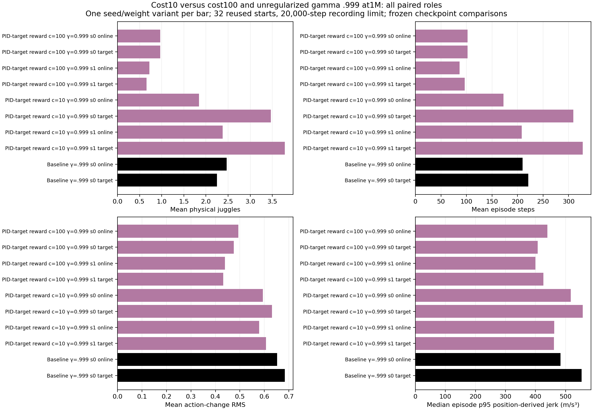
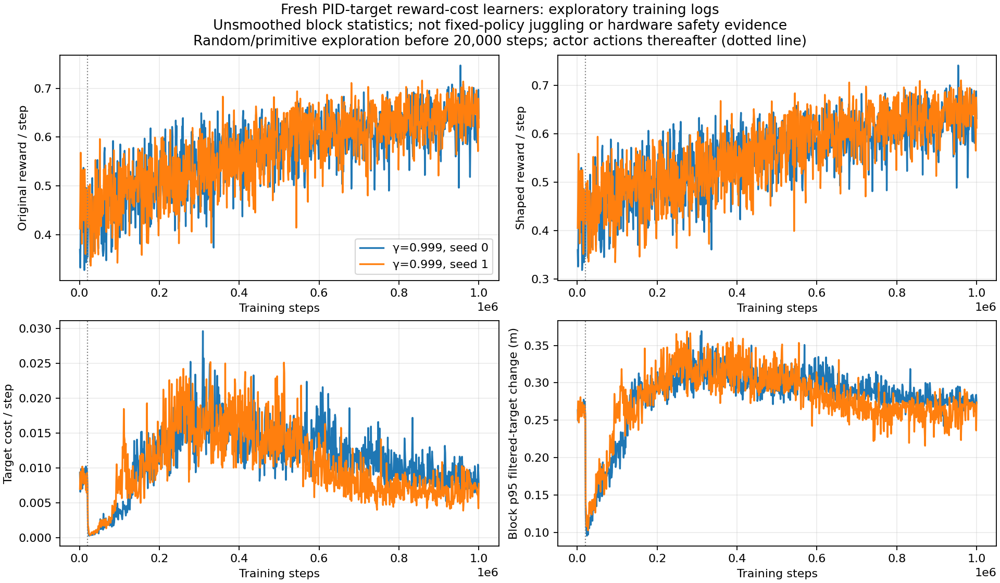
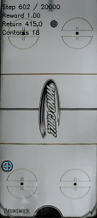

# Cost10 complete first-million milestones

Both cost10 gamma .999 target policies exceed the matched unregularized target's early raw counts on32 reused starts at1M, but all episodes remain short and smoothness benefits are inconsistent.

Documentation time: 2026-11-02 09:18:49 -0600. Saved fixed-checkpoint analysis, no new rollouts or learner changes. Jobs116027/116028 confirmed RUNNING; both first1M online/target tests completed without runner errors, and training continues toward3M/6M. Total user GPU requests5 including3 unrelated jobs. [Pinned launch](../../../docs/juggling-target-cost10-longdiscount-launch.json), [canonical simulator/sensing/control/DR preflight](../../../docs/juggling-target-cost10-contract-review-20261102.json). All new learners started with random actors/critics; stationary coefficient10 unchanged.

Protocol:1M online and target weights,32 reused starts700000–700031,20k recording horizon, same effective config. Cost10 and cost100 seeds0/1 and historical unregularized seed0 control yield10 role variants/320 raw outcomes. Online/target roles are correlated, not independent training seeds; this is reused development evidence.

| Policy | Role | Physical juggles | Sensed juggles | Episode steps | Raw reward |
|---|---|---:|---:|---:|---:|
| noisy_history_target_cost_100_g0999_20261102_seed0 | online | 0.96875 | 0.8125 | 102.21875 | 62.03125 |
| noisy_history_target_cost_100_g0999_20261102_seed0 | target | 0.96875 | 0.90625 | 102.0625 | 64.53125 |
| noisy_history_target_cost_100_g0999_20261102_seed1 | online | 0.71875 | 0.46875 | 86.53125 | 49.09375 |
| noisy_history_target_cost_100_g0999_20261102_seed1 | target | 0.65625 | 0.65625 | 96.34375 | 57.15625 |
| noisy_history_target_cost_10_g0999_20261102_seed0 | online | 1.84375 | 1.90625 | 172.25 | 111.0 |
| noisy_history_target_cost_10_g0999_20261102_seed0 | target | 3.46875 | 3.15625 | 309.4375 | 206.8125 |
| noisy_history_target_cost_10_g0999_20261102_seed1 | online | 2.375 | 1.96875 | 208.21875 | 136.25 |
| noisy_history_target_cost_10_g0999_20261102_seed1 | target | 3.78125 | 3.3125 | 327.75 | 215.46875 |
| noisy_history_long_discount_20261029_seed0 | online | 2.46875 | 2.0 | 210.0625 | 129.53125 |
| noisy_history_long_discount_20261029_seed0 | target | 2.25 | 2.0 | 221.0 | 143.875 |

Generated2026-11-02 from [10 summaries](../../../docs/assets/juggling/target-cost10-first-1m-summary-20261102.csv), [320 raw episodes](../../../docs/assets/juggling/target-cost10-first-1m-episodes-20261102.csv) and [source/config/model/generator/output hashes](../../../docs/assets/juggling/target-cost10-first-1m-provenance-20261102.json). Cost10 targets average3.46875/3.78125 physical,3.15625/3.3125 sensed juggles and309.4375/327.75steps; matched control2.25 physical/221steps; cost100 targets0.96875/102.0625 and0.65625/96.34375. This suggests less early acquisition interference than cost100, not proven final superiority or reliable long-duration juggling.

Target noisy_history_target_cost_10_g0999_20261102_seed0: mean action-change RMS0.631488, median whole-episode position-derived p95 jerk557.395m/s³.

Target noisy_history_target_cost_10_g0999_20261102_seed1: mean action-change RMS0.606245, median whole-episode position-derived p95 jerk461.777m/s³.

Target noisy_history_long_discount_20261029_seed0: mean action-change RMS0.683273, median whole-episode position-derived p95 jerk553.139m/s³.

These differently visited/short episodes do not establish a consistently improved physical-motion distribution. No fresh cached-controller replay or hardware test was done for these checkpoints. E090's early cost100 improvements did not persist at6M, so these new1M observations do not select or promote a deployment policy. Both cost10 learners retain their planned full budgets; no acceptance/cap gate or early stop.

Generated2026-11-02 from [2000 raw1000-step blocks](../../../docs/assets/juggling/target-cost10-g0999-training-1m-20261102.csv) and [prefix/config/generator/output provenance](../../../docs/assets/juggling/target-cost10-g0999-training-1m-20261102.json). Raw and shaped exploratory reward remain separate from fixed-policy juggle counts. The dotted20k random-to-actor transition is an action-source change, not learned smoothness. Later block target changes remain substantial despite cost declining. [Moving training-time counts/reward/steps and physical-motion plots](../../../docs/juggling-smooth-sweep.md) include the complete1M tests.

First reset700000 lasts801steps/12 physical/12 sensed juggles and ends with overlapping puck_hit_bottom/puck_passed_paddle tags. GIF shows last200frames,steps602–801,160×357,50ms/frame; it is the first predeclared reset, not a selected best clip. [GIF source and metadata hashes](../../../docs/assets/juggling/target-cost10-seed1-target-1m-gif-provenance-20261102.json). The clip's count is above the cohort mean; all32 cases are retained in the raw data.

Validation:128 newly complete full NPZ outcomes match evaluator physical/sensed counts, steps and raw rewards;10 variants/320 unique per-variant cases aggregate to the summaries and motion medians. Same effective config/protocol, frozen source/model/config/output hashes,2000 contiguous blocks and accounting/prefix hashes, unchanged live source guards; both plots visually inspected, GIF source-copy hash/metadata and all relative links/anchors/TOCs checked. No implementation changes, additional rollouts or expensive re-training for documentation. Infinite juggling and real-robot stop avoidance remain unproven.

Reproduce with `.venv/bin/python -m scripts.analysis.juggle_smooth_sweep`; select1M32_reused_starts rows for the five listed learner/control runs. Render the frozen summary with `scripts.analysis.plot_juggle_fixed_comparison`; reward traces with `scripts.analysis.plot_juggle_target_cost_training --launch docs/juggling-target-cost10-longdiscount-launch.json --max-step 1000000 --out-prefix docs/assets/juggling/target-cost10-g0999-training-1m-20261102`. Existing pure `trajectory_metrics` in `scripts.analysis.juggle_long_reference_continue` recounts each saved NPZ; it uses the same counter, not an independent detector. Large local ignored bundles/trajectories remain identified by paths/hashes rather than uploaded to Git.

Related: [E093500k](../../../docs/experiment_logbook.md#e093), [E094](../../../docs/experiment_logbook.md#e094), [A095](../../../docs/agent_logbook.md#a095).
