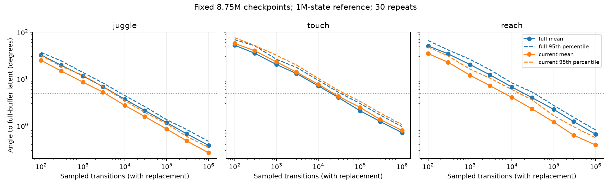

# Reward-inferred latents stabilize with 100k–300k replay samples

- **Date**: 2026-11-22 23:41 UTC
- **Status**: done
- **Run dirs**: `runs/fb/z_convergence_20261122/{full,current}` (frozen policy and replay)
- **Configs**: original run arguments preserved in each snapshot `run.json`

## Question

How many replay samples are needed for a stable reward-inferred latent at a fixed model?

## Setup

Both models frozen at 8,750,000 training steps, with their own 1M-transition replay buffers. CPU-only analysis; live trainers remained running. We tested N = 100, 300, 1k, 3k, 10k, 30k, 100k, 300k, 1M, with 30 independent repeats (seed 41000). Within each repeat, sample sizes use nested prefixes. Sampling is uniform with replacement, matching the trainer. Each task uses the same indices within a repeat.

The reference is the normalized reward-weighted backward embedding sum over every transition in that model’s frozen replay. Latents have fixed norm sqrt(50), so angular error measures direction convergence. Computation caches backward embeddings in float32, then accumulates in float64. A 1k-state check against the actual reward_inference implementation passed for all tasks/models (atol/rtol 2e-5).

Tasks exactly match online evaluation: recorded juggle reward, recorded touch indicator, and Gaussian paddle reach reward. No puck-goal grid inference or rollout performance evaluation was included.

## Results

Mean angle to the full-buffer reference ± sample standard deviation across 30 repeats (degrees):

| Model | Task | 1k | 10k | 100k | 1M |
|---|---|---:|---:|---:|---:|
| full | juggle | 11.63 ± 1.33 | 3.72 ± 0.43 | 1.18 ± 0.16 | 0.38 ± 0.05 |
| full | touch | 20.44 ± 3.38 | 7.16 ± 1.42 | 2.10 ± 0.49 | 0.71 ± 0.15 |
| full | reach | 20.40 ± 3.30 | 6.78 ± 0.91 | 2.25 ± 0.29 | 0.67 ± 0.09 |
| current | juggle | 8.59 ± 1.82 | 2.74 ± 0.49 | 0.86 ± 0.17 | 0.27 ± 0.05 |
| current | touch | 23.24 ± 5.54 | 7.74 ± 2.06 | 2.48 ± 0.59 | 0.80 ± 0.18 |
| current | reach | 12.08 ± 3.26 | 4.07 ± 1.16 | 1.21 ± 0.28 | 0.39 ± 0.11 |

Smallest tested N with 95th-percentile angle below each tolerance and no undefined estimates:

| Model | Task | ≤5° | ≤2° | ≤1° |
|---|---|---:|---:|---:|
| full | juggle | 10000 | 100000 | 300000 |
| full | touch | 100000 | 300000 | 1000000 |
| full | reach | 100000 | 300000 | 1000000 |
| current | juggle | 10000 | 30000 | 300000 |
| current | touch | 100000 | 300000 | not reached |
| current | reach | 30000 | 100000 | 300000 |

At 10k samples, touch has only 286.5 / 253.8 effective samples (full/current); reach has 671.6 / 731.2. Juggle has 4,227 / 3,710. At 10k, independently sampled touch directions differ by an average of 10.09° / 11.02°.



[Full data](2026-11-22_23-41_fb-z-convergence-assets/results.csv) · [Metadata and results](2026-11-22_23-41_fb-z-convergence-assets/results.json) · [PDF](2026-11-22_23-41_fb-z-convergence-assets/convergence.pdf)

## Conclusion

At these checkpoints, 100k is a reasonable approximate setting: every task/model has 95th-percentile error below 5°. For tighter inference use 300k: every task/model is below 2°. The existing 10k setting is noisier, particularly for touch. Error continues to decrease approximately as N^(-1/2); there is no sharp convergence boundary.

These tolerances are descriptive, chosen for interpretation rather than validated against policy returns. Results measure Monte Carlo error relative to this finite replay distribution, not error relative to the true stationary distribution or model accuracy. The 1M-sample estimate retains error because sampling is with replacement; summing the full buffer once is the reference and has zero sampling error relative to itself. Thirty repeats provide only an approximate 95th percentile. The two models have different visited-state distributions, so their difference is not a controlled architecture comparison.

## Next

Before changing online defaults, compare task rollout returns using 10k/100k/300k/full-buffer latents and repeat this check at later checkpoints. Training settings were not changed.

Reproduce with the frozen snapshots:

```bash
OMP_NUM_THREADS=2 OPENBLAS_NUM_THREADS=2 MKL_NUM_THREADS=2 .venv/bin/python -m scripts.fb.analyze_z_convergence --root runs/fb/z_convergence_20261122
```
